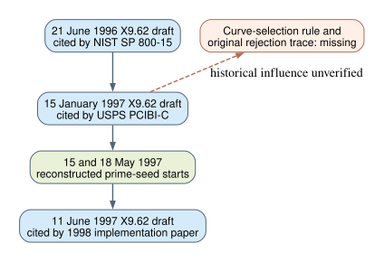

# A January 1997 ANSI X9.62 draft citation before the recovered seed streams

**Date:** 2026-10-23 UTC. **Question:** Is there a dated X9.62 working-draft version between the June 1996 draft citation and the first reconstructed NIST/ANSI prime-curve seed streams in May 1997? **Result:** A USPS source cites an X9.62 ECDSA working draft dated **15 January 1997**. The source does not include that draft's text or name any of the eleven omitted seed curves.

## Verified source

The [USPS Information-Based Indicia Program Closed System Performance Criteria PDF](https://people.eecs.berkeley.edu/~tygar/papers/IBIP/Closed_Performance_Criteria.pdf), document PCIBI-C dated **12 January 1999**, lists “ANSI X9.62, Elliptic Curve Digital Signature Algorithm Standard (ECDSA),” Working Draft, **15 January 1997**, among its references on printed page **iv**, PDF page **4**. Its PDF creation date is 26 January 1999. The retrieved 49-page file's SHA-256, size, source URL, and location are pinned in [source.json](source.json); the reference page was also visually inspected. The PDF is hosted in an academic archive but identifies itself as a USPS document. Its original 1997 cited draft was not obtained.

This citation independently identifies a specific **pre-May 1997 draft date**. It does not establish when that version first circulated, what curve-generation instructions or parameter tables it contained, or whether the later prime-field candidate-selection program followed it. A 1999 reference could cite an older copy even if the draft was revised before the May runs.



```{=typst}
#pagebreak()
```

## Why this matters to the eleven omissions

The [June 1996 NIST citation](../nist_seed_1996_preseed_draft_20261023/report.md) (`retrieved`) and this January 1997 USPS citation (`retrieved`) identify two pre-seed versions. The [June 1997 citation](../nist_seed_1997_june_draft_20261023/report.md) (`retrieved`) lies after the reconstructed May starts and before the August starts. Acquiring these three versioned drafts would allow a before/after comparison of any prime-field acceptance procedure and parameter appendix across the generation period. The absence of any one draft is not evidence that its rules differed from the published 1998 standard.

If the January version states an extra mathematical criterion, the next check is **predeclared**: compute it on all eleven omitted and eight same-field published curve classes, retaining exact counterexamples. An exact label split would nominate a possible selection rule; it would not by itself demonstrate a weakness or show that Reiter's program used it. If the January version lists a candidate's full `p,a,b,n,seed`, that would date its circulation, not explain why later candidates were skipped. If it has neither generation text nor a parameter table, it would narrow the search to later revisions or a separate submission.

The original X9.62 January draft and the generator or review log remain missing. Under the user's stipulated premise that all eleven were evaluated and rejected for a weakness, the [selection-rule problem](../../problems/nist-seed-selection-rule-unexplained.md) remains open. No candidate-level classification, ECDLP attack, or official research-state transition follows from this source. The existing canonical ECDLP graphs and selection diagrams were checked; this chronology adds no verified attack edge, so their content is unchanged.

## Reproduction and provenance

Retrieve the source URL, verify SHA-256 against [source.json](source.json), and inspect PDF page 4. The USPS citation and document date are `retrieved`; the sequence of dates is `derived` from this source and the cited internal source-bound records. The January 1997 draft's contents and the original candidate rejection trace are **unobserved**. The report, editable diagram, SVG and visually inspected PDF preserve this source-search result; no full external source PDF is redistributed here.
