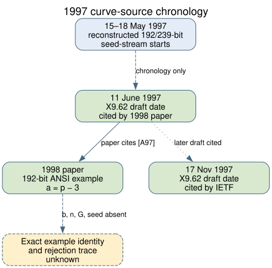

# A June 1997 X9.62 draft is cited beside a 192-bit example curve

**Date:** 2026-10-23 UTC. **Scope:** Primary-source search for the curve-selection record preceding the published NIST/ANSI prime-field parameters. **Result:** A 1998 implementation paper identifies an ANSI X9.62 draft dated **11 June 1997**, earlier than the previously traced 17 November 1997 draft. The paper says its implementation used example curves from the ANSI draft, including a 192-bit prime-field example with `a=p−3`. It prints no seed, coefficient `b`, subgroup order, generator, candidate ordinal, or rejection reason for that example. The identity of the curve it used is therefore **unverified**.

## Primary observation

The author-hosted [1998 paper by De Win, Mister, Preneel, and Wiener](https://cosicdatabase.esat.kuleuven.be/backend/publications/files/conferencepaper/69) (`retrieved`, primary; byte digest and page locations in [source.json](source.json)) has three relevant passages:

1. PDF page 4 says the implementation was based on the most recent draft documents the authors had available, identified in its references as `[A97]` and `[I97]`.
2. PDF page 12 says the authors timed example curves from the current ANSI X9.62 draft; their prime-field example uses a 192-bit modulus and `a=p−3`.
3. PDF page 14 identifies `[A97]` as an ANSI X9.62-199x ECDSA draft dated **11 June 1997**.

The paper's own wording links an available ANSI draft to a 192-bit prime-field example. It does not reproduce the draft. Calling the unnamed example **prime192v1**, any other published 192-bit curve, or one of the omitted candidates would exceed the source. Nor can this paper establish the date on which any particular `p,a,b,n,G,seed` set first entered a committee draft: the authors could have received other parameter information while preparing the 1998 paper.

The [previous source search](../nist_seed_1997_draft_archive_20261023/report.md) (`internal`) identified a **31 August 1996** draft only by a later reference and a **17 November 1997** draft by two contemporary IETF references. This newly verified June citation supplies an intermediate and temporally closer acquisition target. The recovered May 15 and May 18, 1997 seed-stream starts precede the cited June date; these starts are numerical reconstructions, not historical execution logs ([stream assessment](../nist_seed_selection_deep_20261016/report.md), `internal`).

*Solid arrows show verified references or the paper's own statements. Dashed arrows mark the missing draft contents, example identity, and acceptance trace. Editable source: [timeline.dot](timeline.dot).*

## Relevance to the eleven omissions

The paper's `a=p−3` prime-field example matches the shared coefficient form of the published and omitted 192-bit seed candidates. That is a **necessary but weak match**: all five qualifying 192-bit blocks in the reconstructed stream use this `a`, and the paper gives no `b`, `n`, `G`, or seed with which to distinguish them. The paper does not say its example was accepted because other prime-order curves were weak. It discusses implementation timings, not candidate-selection criteria.

The June draft, if recovered, could be compared by exact parameter tuple and seed against the [eleven-omission archive](../nist_seed_skipped_curves_20261016/assessed.json) and [ten published controls](../nist_seed_skipped_curves_20261016/traits.json) (`internal`). A dated table containing an omitted candidate would demonstrate that candidate reached a document stage and would change the historical interpretation. A table containing only a published candidate would bound its circulation date but would not explain the skipped blocks. A rule or change sheet that explicitly names the rejection predicate would be more decisive. The highest-value items remain the draft's parameter appendix, committee change sheets, and Bob Reiter's generator or logs.

This search yields **a new dated source lead**, not an attack property common to the eleven omissions. The [existing selection-rule problem](../../problems/nist-seed-selection-rule-unexplained.md) remains open. The canonical ECDLP graphs and the prior selection diagrams were checked; this source adds no verified attack edge or candidate-level decision, so none changes. The source PDF was retrieved and hashed for this audit; the repository preserves its URL, digest, and exact page references rather than redistributing the copyrighted full paper.

## Reproduction and limits

Retrieve the linked author-hosted PDF, verify SHA-256 against [source.json](source.json), then check PDF pages 4, 12, and 14. The author-hosted PDF is 15 pages; page references are one-based PDF pages. The report and graph are derived communication artifacts. Neither a historical generator trace nor the June draft contents were obtained. Source labels: `retrieved` for the author-hosted paper; `internal` for the existing numerical seed archive and earlier draft search; `derived` for the chronology and exact-identity limits. No official hypothesis or goal status changes follow from this source lead.
