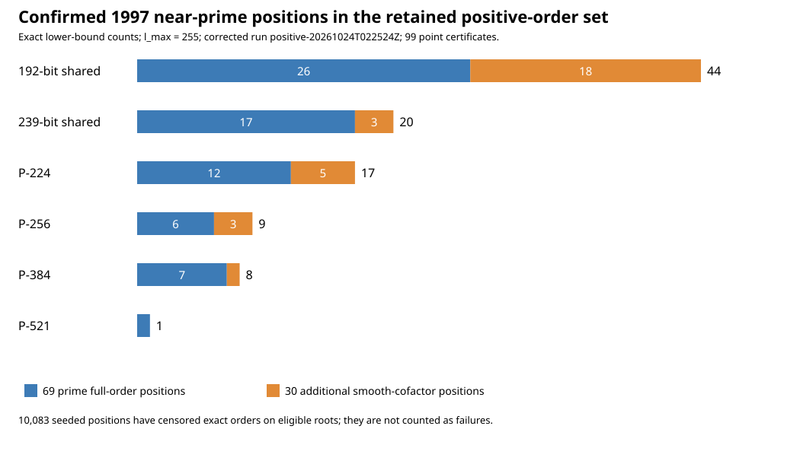
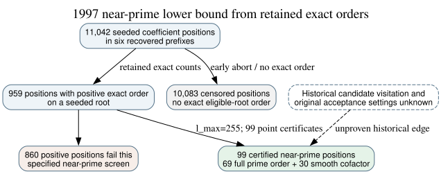

# The 1997 draft admits more than the certified full-prime-order set

**Date:** 2026-10-24 UTC. **Question:** How many seed-derived curves in the retained *positive exact-order* records satisfy the November 1997 X9.62 draft's near-primality procedure with its example bound `l_max=255`? **Verified result:** **99 distinct seed positions**: the prior 69 with prime full order and **30 additional positions** with a 255-smooth cofactor and a proven large prime subgroup. All 99 have independent subgroup-point/Hasse certificates. This is a **lower bound** on the reconstructed prefixes' draft-compatible set, because 10,083 other seeded positions have censored exact-order outputs on eligible coefficient roots. It is not a count of attempts by the original program.

## Dated rule, exact set and controls

**Retrieved:** [17 November 1997 ANSI X9.62 working draft](https://archive.org/download/x962-11-17-97/x962-11-17-97.pdf), PDF pp. 61–65, SHA-256 `0c231d5176fcf0b239b44732213d281b518a0e16cc6f13f7bd4039ec99807b6e`. Section F.2.2 divides the group order by all prime powers through an operator-supplied `l_max`, then accepts a sufficiently large probable-prime residual. Section F.3.2 gives `255` as a typical trial bound and requires `r_min > 2^160`; it then checks MOV and anomalous conditions and finds a point of prime order. The text does not mandate cofactor one or explain the historical seed schedule. This round fixes **`l_max=255` and `r_min=2^160+1`** as a reproducible reference setting, not as a recovered private setting. The same 99 also satisfy the later `n>4√p` lower bound.

**Internal exact inputs:** the six `orders_<timestamp>.txt` files and [validated census cross-check](../nist_seed_selection_20261016/raw/full_census_crosscheck_v4.json), whose digests are bound in the corrected [run receipt](runs/positive-20261024T022524Z/receipt.json). The census has 11,042 positions with a seed-derived coefficient pair in the six prefixes. The corrected interpretation gives 959 positions with at least one positive exact order on a seeded root; 10,083 have no such retained order. Among the positive records, 1,374 root branches were tested. A zero from the original `ellsea(E,1)` early-abort mode is **censored**; it is not an exact composite order or proof that the draft would reject that position.

**Measured and independently checked:** [run.py](run.py) removed all factors of primes at most 255 from each positive exact order, checked the residual with PARI/GP `isprime`, and applied the subgroup lower bound, MOV-20 and anomalous exclusion. It retained exact [per-branch rows](runs/positive-20261024T022524Z/analysis.json), GP input and raw output. [verify.py](verify.py) separately re-read every archived order, repeated the divisions, bounds and modular checks, and cross-checked every GP classification with SymPy 1.14.0. SymPy uses probable-prime methods at these sizes; GP `isprime` is the primary primality result.

The exact 99 seed positions were then checked under the frozen [point-certificate protocol](POINT_PROTOCOL.md). The successful [Sage run](runs/points-20261024T022754Z/receipt.json) chose a deterministic x from 1 through 32 for every position and produced a nonzero point `P` with `[n]P=O`. Every residual `n` passed Sage's proof-enabled primality check and `n²>16p`; Hasse's interval therefore contains only one possible multiple of `n`, the archived `u=h*n`. The [99 full parameter and point records](runs/points-20261024T022754Z/points.jsonl) identify exact field, seed, coefficient, subgroup order, cofactor and chosen point. A separate [pure-Python affine replay](verify_point_certificates.py) checked all 99 curve equations and `[n]P=O`, including all ten published and eleven named omission controls; its [verification record](runs/points-20261024T022754Z/verification.json) binds the raw file.

| Reconstructed stream | Certified full prime order | Additional 255-smooth cofactor | Confirmed near-prime total | Censored positions |
| --- | ---: | ---: | ---: | ---: |
| 192-bit shared | 26 | 18 | 44 | 2,779 |
| 239-bit shared | 17 | 3 | 20 | 1,430 |
| P-224 | 12 | 5 | 17 | 3,289 |
| P-256 | 6 | 3 | 9 | 815 |
| P-384 | 7 | 1 | 8 | 1,246 |
| P-521 | 1 | 0 | 1 | 524 |
| **Total** | **69** | **30** | **99** | **10,083** |

*Blue denotes full prime order; orange adds the 30 smooth-cofactor positions. Exact counts within the retained positive-order set have no sampling error. [Editable chart source](render.py).*

The 30 new positions are unpublished, so the reference-setting lower bound is **10 published and 89 unpublished**. Seven of the 30 qualify on the census's selected root, and 23 only on its other seed-derived root in fields with `p ≡ 3 (mod 4)`. Their minimum smooth cofactors range from 9 to 1,095,881; every prime factor of each is at most 255. These orders would fail a cofactor-one preference, which all ten published prime-field curves satisfy, but the dated X9.62 near-prime procedure does not impose that preference. All 99 exceed `4√p`, so adding that later minimum changes no count in this observed set.

*Solid edges show source-bound calculations. The dashed edge requires historical code or logs. [Editable diagram source](inference.dot).*

## Corrections and inference boundary

The first [near-prime run](runs/positive-20261024T022340Z/) yielded 130 positions but incorrectly counted P-224's `nt` column as the other seed-derived coefficient sign. It is actually the order of a different quadratic twist when `p ≡ 1 (mod 4)`; the two seed-derived signs are isomorphic and share the first-column order. The run, its verifier and exact first launcher are retained; [AMENDMENT.md](AMENDMENT.md) records why its 130-position figure is invalid. The corrected run has 99 positions. A first [point-certificate run](runs/points-20261024T022651Z/) stopped after 17 positions because its launcher paired a census order with the wrong element of a **numerically sorted** coefficient-root list. A [direct two-root Sage diagnostic](root_diagnostic.json), reproducible with [diagnose_root.py](diagnose_root.py), identified the inversion; [POINT_AMENDMENT.md](POINT_AMENDMENT.md) freezes the corrected root binding and preserves the failed attempt. These were input-mapping errors, not evidence against a curve.

**Derived:** Under the stated reference setting and retained exact orders, the known eleven omissions are a still narrower subset of 89 unpublished near-prime possibilities. This arithmetic establishes neither historical visitation nor a shared hidden weakness. A historical explanation must first show which root and cofactor policies the original program used and why it passed over the eleven prime-order candidates remaining after those policies. The original program or logs remain the decisive acquisition target; a mathematical property should be declared before testing and predict all relevant controls. The [open selection-rule problem](../../problems/nist-seed-selection-rule-unexplained.md) remains unresolved. This result adds no verified ECDLP transfer or cost edge; the existing canonical graphs were checked and remain unchanged.

**Reproduction:** Run [run.py](run.py) into a fresh directory under the frozen [protocol](PROTOCOL.md) plus [amendment](AMENDMENT.md); check its exact output with [verify.py](verify.py). Reproduce the 99 point records using `gtimeout 120 sage -python research/nist_seed_1997_nearprime_20261024/verify_points.py` under [POINT_PROTOCOL.md](POINT_PROTOCOL.md) plus [POINT_AMENDMENT.md](POINT_AMENDMENT.md), then run [verify_point_certificates.py](verify_point_certificates.py) on the resulting directory. The checked run and version details, source hashes, controls, measured local time and machine resource figures are in their receipts. Source provenance: draft `retrieved`; censored/positive point-count records `internal`; trial divisions, 99 point certificates and independent replays `checked`; historical selection `unknown`.
