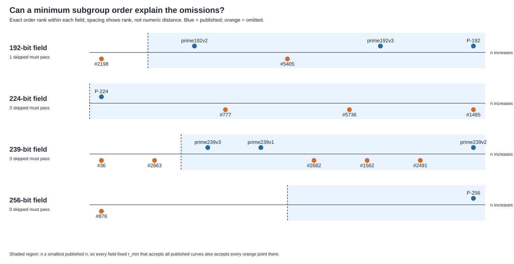
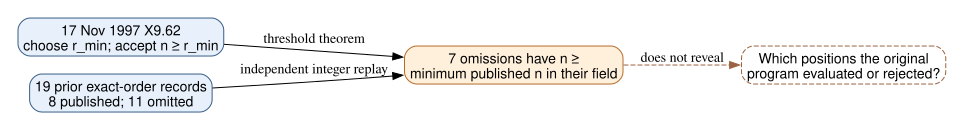

# A fixed minimum-order threshold cannot explain the eleven omissions

**Date:** 2026-10-24 UTC. **Question:** Could the operator-supplied minimum subgroup order `r_min` in the 17 November 1997 ANSI X9.62 draft account for the eleven otherwise qualifying unpublished prime-field seed positions? **Verified, conditional result:** Under a *field-fixed* threshold that admits every published control in its field, **seven of the eleven omitted prime-order curves must also pass**. No such threshold separates all four fields. This is a post-observation, source-motivated falsification of one simple rule, not a discovery of the original program's rule.

## The dated rule and the exact theorem

**Retrieved primary source:** [ANSI X9.62 working draft, cover dated 17 November 1997](https://archive.org/download/x962-11-17-97/x962-11-17-97.pdf), SHA-256 `0c231d5176fcf0b239b44732213d281b518a0e16cc6f13f7bd4039ec99807b6e`. In §F.2.2 (PDF p. 62) a nearly prime order `u=hn` requires probable-prime `n ≥ r_min`; in §F.3.2 (PDF pp. 63–64) a candidate failing that check is retried. The draft says `r_min > 2^160` and advises `r_min ≤ p+1−2√p` over a prime field. These are rules in a draft, **not** a recovered value of the historical program's `r_min`. The P-224 stream began in April 1998, after this draft; applying the same rule to it is explicitly a conditional process model.

**Derived exact fact:** If every published order in a fixed field must pass `n ≥ r_min`, then `r_min ≤ min(n_published)`. Consequently, any omitted order `n_omitted ≥ min(n_published)` also passes **every** such threshold. A complete field-fixed separator exists exactly when `max(n_omitted) < min(n_published)`.

The [analysis program](analyze.py) pinned four existing input digests, matched each of the 19 seed/stream records to a prior certified full group order, and evaluated the inequalities as arbitrary-precision integers. The [independent replay](verify.py) reconstructed `p,n` from the omitted and published source files separately and recomputed the seven counterexamples through pairwise order comparisons. The exact values and row identities are in [analysis.json](analysis.json); the [scope record](SCOPE.md) states that a first P-224 diagnostic preceded the written protocol, so this is not presented as prospective discovery.

| Field | Published controls | Earlier named omissions | Omitted ordinals that must pass every admitting `r_min` | Complete separator? |
| --- | ---: | ---: | --- | --- |
| 192-bit | 3 | 2 | 5405 | No |
| 224-bit | 1 | 3 | 777, 1485, 5736 | No |
| 239-bit | 3 | 5 | 1562, 2491, 2682 | No |
| 256-bit | 1 | 1 | none | Yes, for this field alone |
| **Comparable total** | **8** | **11** | **7 of 11** | **No overall** |

*Each field is ordered by exact `n`; horizontal spacing shows rank, not numeric distance. The shaded side starts at the smallest published `n`. Orange omitted points inside it are the seven unavoidable passes. Source: [analysis.json](analysis.json); editable drawing code: [render.py](render.py). These are exact finite comparisons without sampling error.*

P-224 is especially decisive: **all three omitted orders exceed the published order**, so any minimum accepting published P-224 accepts all three. The 192- and 239-bit sets interleave. P-256 alone has the order relationship that would permit a field-specific minimum between omitted block 876 and published block 1842, but the draft's advised ceiling places the minimum below *every* full-prime-order candidate in that field. In other words, a threshold capable of separating that pair would depart from the draft's advice; nothing found shows that one was used.

*Solid edges are the draft rule and checked integer comparison. The dashed edge marks unavailable historical program behavior. Editable source: [inference.dot](inference.dot).*

## What the comparison rules out

**Independently verified:** The 19 matched point-certificate rows report prime full group order, on-curve point, and `[n]P=O`; the verifier matched their exact `p,n` to the source rows. Because the full group order is prime, any nonidentity point would have order `n`, so the draft's correct point-selection step supplies no extra mathematical rejection criterion for these nineteen. This statement concerns a correct implementation, not an unknown 1997 program or its error handling.

**Derived:** The seven counterexamples rule out a **single fixed lower `r_min` per field as a complete explanation**, even if the value were outside the draft's advice, assuming the program reached all the named positions and applied that one rule to them. Under the draft's advised upper bound on `r_min`, all eleven full-prime-order omissions pass, as the earlier [1997 acceptance-space report](../nist_seed_1997_acceptance_20261024/report.md) already established. The present comparison strengthens that result for the possibility of an unusually high but field-fixed threshold.

**Unknown:** A changing threshold, a conjunction with another criterion, a different coefficient root, a point-count failure, editorial selection, or non-visitation could still explain individual positions. The retrieved draft has no record of seed scheduling or candidate-level decisions. In particular, the eleven are reconstructed omissions, not documented historical rejection events. This audit identifies no weakness or attack route. The [selection-rule problem](../../problems/nist-seed-selection-rule-unexplained.md) remains open; its source/log or independently predictive-property exit criteria are unmet. I checked the prior seed-selection diagrams and the canonical ECDLP graph sources; this new exclusion adds no verified attack or transfer edge to them.

**Next discriminator:** A recovered program/configuration or dated candidate log could tell whether `r_min` changed and whether these positions were visited. A proposed combined rule should specify its inputs and predict all published and omitted records, including the seven that a minimum alone must admit, before being used as a historical explanation.

## Reproduction and provenance

From the repository root, run `python3 research/nist_seed_1997_order_threshold_20261024/analyze.py`, then `python3 research/nist_seed_1997_order_threshold_20261024/verify.py`. The first prints `19 exact rows; 7 of 11 omissions...`; the second prints `independent pairwise replay: 19 rows, four fields, seven unavoidable omissions`. Rebuild the visuals with [render.py](render.py), Graphviz on [inference.dot](inference.dot), and Typst on [report.typ](report.typ). The source files' SHA-256 values are embedded and checked by `analyze.py` and recorded in `analysis.json`. Draft text is `retrieved`; prior exact curve/certificate records are `internal`; integer inequality and verifier results are `independently checked`; historical application is `unknown`.
