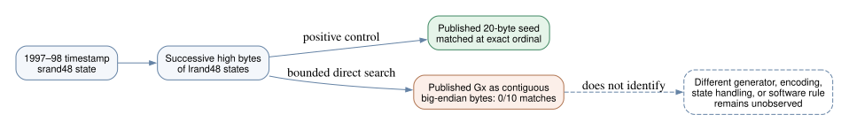

# Did the published base points consume the seed stream directly?

**2026-10-24 UTC.** The ten published prime-field base-point x coordinates do not occur as contiguous big-endian bytes of the reconstructed `lrand48` high-byte stream in a bounded search covering each seed's entire prefix and 100,000 further bytes. This is a narrow implementation check, not a reconstruction of the original point generator or a curve-selection rule.

## Question and frozen test

The [Anthropic reconstruction](https://www.anthropic.com/research/ecdsa-curve-origins) recovers the six May 1997 published base points from a separate FreeLIP generator but leaves the four later NIST base points unexplained. Could the latter have used the same `rand48` output stream that produced their curve seeds? The [protocol](PROTOCOL.md) fixed the exact archived [input](../../nist_seed_skipped_curves_20261016/traits.json), SHA-256 `a1102bd487379d223581863fab731d6eb6957bf0e264b450f1c7b298279b0b67`, all ten published controls, byte packing, and search extent before execution. The May six provide known separate-generator comparisons, while P-224, P-256, P-384 and P-521 are the live direct-stream cases.

The [script](check.py) reconstructed successive bytes with the published timestamps and searched each exact published `Gx` as a fixed-width big-endian byte string. It searched all starts through `20 × published ordinal + 100,000` bytes. For each curve it independently found the published 20-byte seed at the expected `20 × (ordinal−1)` offset, once within the bound. A synthetic coordinate copied from the stream's first bytes matched at offset zero for every curve. Full EC1 UIDs, limits and match offsets are retained in [results.json](results.json).

| Group | Curves | Direct published `Gx` matches | Seed-position and synthetic controls |
| --- | ---: | ---: | ---: |
| May 1997, separately explained by FreeLIP | 6 | 0 | 6/6 pass |
| Later NIST prime-field curves | 4 | 0 | 4/4 pass |
| **Total** | **10** | **0** | **10/10 pass** |

The widest searched start range is 240,520 bytes for P-224. P-256 was searched through 136,840 bytes, P-384 through 153,760 and P-521 through 122,720; their exact full-width `Gx` values have no direct matches. The run command was `python3 research/nist_seed_1997_selection_extension_20261023/basepoint_stream/check.py`; it returned `checked 10 published Gx values; direct hits: 0; seed and synthetic controls: pass`.

*Editable source: [interpretation.dot](interpretation.dot). Green is an exact positive seed check; orange is the bounded zero-match observation; the dashed box contains possibilities not tested by direct-byte matching.*

## What this changes

The result rejects one simple version of the “base-point generation consumed the same stream” explanation: direct contiguous high-byte assembly over the tested span. It agrees with Anthropic's separate FreeLIP derivation for the six May published points. It does not rule out a different packing of `lrand48` outputs, hashing, random field-element reduction, saved/restored RNG state, a separate generator, or extra draws beyond the bound. Because the ordinal-matched published seeds sit on consecutive 20-draw blocks, any proposed *interleaved* same-state point generator must also explain how the published block alignment survives; this test has not reconstructed that state management.

Most importantly, it says nothing about the eleven omitted curves' base points, which were never published, or whether the 1997 program reached those candidates. It identifies no weak curve or ECDLP advantage. The original code or logs, or an independently predictive selector covering all eleven omissions and same-field controls, is still required. The canonical ECDLP and seed-selection graph sources were checked; no verified attack or selection edge changes. Provenance: timestamp/base-point claim `retrieved` from Anthropic, exact input `internal`, direct-byte result `derived`, original program behavior `unknown`.
