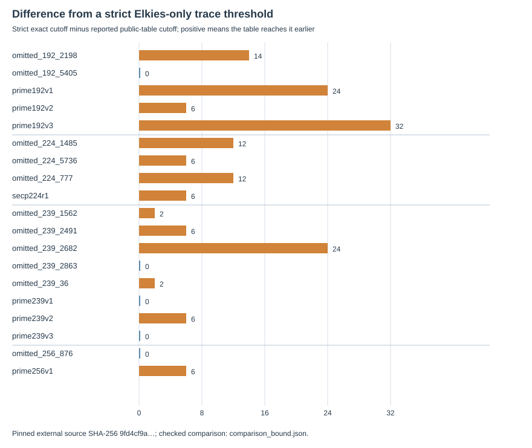
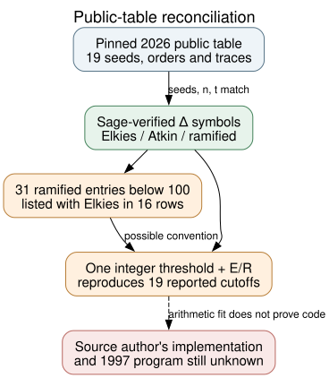

# Reconciling a public nineteen-curve table with strict Elkies arithmetic

**Date:** 2026-10-24 UTC. **Question:** Does a newly published table of the same omitted and standardized curves independently reveal an all-eleven selection property, or correct the prior exact small-prime screen? **Answer:** It does neither. Its underlying seeds, group orders and traces match the archived curves, but its “Elkies” lists include ramified primes and its displayed cutoff formula does not exactly reproduce four of its own entries. One simple integer-threshold convention does reproduce all nineteen entries. The strict, independently Sage-checked screen remains valid. The original 1997 acceptance rule is still unknown.

## Source and identity boundary

**Retrieved:** [John Preuß Mattsson's commit-pinned ASCII table](SOURCE.md) (2026-10-18) says it was generated by Claude. It is a later public computation and is **not independent historical evidence** of what Bob Reiter's software did. [Valsorda's disclosure](https://words.filippo.io/seeds-solved/) identifies the seed ordinals and explicitly says no satisfactory rule explains the extra unpublished candidates; [Anthropic's reconstruction](https://www.anthropic.com/research/ecdsa-curve-origins) establishes the clock-seeded RNG model, not the missing acceptance rule. The full 1997 draft and its actual visible gates are treated in the [earlier report](../../nist_seed_1997_original_draft_20261023/report.md).

**Internally checked:** [check.py](check.py) parsed nineteen public-table rows and bound each to an archived full `curve_uid` using its seed ordinal. For all nineteen, the external seed, prime group order `n`, and signed Frobenius trace `t` equal the archived values exactly. The displayed coefficient `b` is identical in eighteen; the public P-224 row uses `−b mod p` from the archived model, which is the opposite isomorphic sign for this field and retains the same `n,t`. Thus the mathematical comparison is of the same nineteen classes. Input SHA-256 values and row-level full identities are retained in [comparison_bound.json](comparison_bound.json). The initial [comparison.json](comparison.json) recorded the exploratory symbol/cutoff comparison before the seed, `n`, `t`, and `b` binding was added; it remains as an earlier, narrower record.

## Exact reconciliation

**Independently verified input arithmetic:** The [previous frozen screen](../sea_signature/report.md) computed `Δ=t²−4p` and independently verified all 3,173 Legendre symbols with Sage. For odd prime `ℓ`, it calls `Δ` a quadratic residue **Elkies** (`+1`), a nonresidue **Atkin** (`−1`), and zero **ramified** (`0`). Its optimistic trace-information cutoff is the first `ℓ` for which the product `M` of only strict Elkies primes through `ℓ` obeys `M²>16p`. It does not measure a real SEA implementation's running time.

**Derived from the pinned public table:** The table calls 31 ramified primes below 100 “Elkies” across sixteen curves. Its Atkin entries all have symbol `−1`; its “Elkies” entries have symbol `+1` or `0`. For example, published prime192v1 lists 5 and 11 as Elkies even though `Δ≡0` modulo both. This may be a broad convention for split or repeated-root cases; it must not be substituted silently for strict Elkies-only arithmetic.

The table describes its threshold as a product exceeding `2^(L/2+2)` for field bit length `L`. When the ramified primes are included and that expression is interpreted literally, it reproduces **15/19** reported cutoff primes. The first-prime rule `M > 2^(((L−1)//2)+2)` with `M` over `+1` **or** `0` reproduces **19/19**. This is an exact arithmetic reconstruction of the displayed numbers, **not evidence of the table generator's actual code**. The public cutoff equals our strict `M²>16p` cutoff in only **5/19**; the strict cutoff is later for the other fourteen by 2–32 prime units. The [comparison JSON](comparison_bound.json) preserves every row and both formulas. The earlier Sage verification validates the strict symbols and cutoff; this later checker validates the table comparison, and the public table itself is not an independent mathematical replication.

*Derived from `comparison_bound.json` by editable [render.py](render.py). Each bar is the strict cutoff prime minus the public-table cutoff prime; units are prime-number difference, with `n=19` curve classes. No sampling uncertainty applies to the exact arithmetic; historical runtime uncertainty is unmeasured.*

*Editable [Graphviz source](inference.dot). Solid paths are checked data relations; the dashed path marks the absent software and historical decision record.*

## Does this separate the eleven omissions?

**Derived:** No. Under the strict screen, omitted curves have a smaller cutoff in **24 of 25** within-field omitted–published pairs: 6/6 in P-192, 3/3 in P-224 and 15/15 in ANSI 239-bit. The P-256 omitted block 876 has a **larger** cutoff than published P-256, reversing the direction. The public table's more permissive convention keeps the same 24/25 direction and P-256 reversal. This is the same correlated Frobenius information viewed with a different convention, not an independent line of support. No cutoff threshold or monotone preference of either direction selects all eleven omissions in these pairs. It also supplies neither an exact subgroup ECDLP advantage nor a measured old point-counter failure.

**Inference limit:** We cannot infer whether the 1997 software reached every omitted candidate, used either cutoff, failed in a particular arithmetic routine, or applied another undisclosed criterion. The most discriminating next evidence is Reiter's original source or per-candidate logs followed by a source-identical replay on the exact 19 curves. A new mathematical hypothesis instead needs a predeclared property that handles the P-256 reversal and predicts independent historical choices or a demonstrated exact-group attack with matched controls. The [problem record](../../../problems/nist-seed-selection-rule-unexplained.md) remains open. I checked the canonical seed-selection and ECDLP graph sources; this cross-check establishes no new attack, map, cost edge or accepted historical selector, so their verified content does not change.

## Reproduction and provenance

The pinned external file digest, local command, and source role are in [SOURCE.md](SOURCE.md). `python3 check.py /private/tmp/mattsson-ecdsa-skipped-pinned.txt comparison_bound.json` generated the archived bound output; reruns must use a new path. `python3 render.py` and `dot -Tsvg inference.dot -o inference.svg` render the visuals. Source and draft `retrieved`; archived parameter checks and strict Sage results `internal`/`independently verified`; nineteen-row reconciliation `derived and programmatically checked`; author-code and 1997-process explanations `unknown`. No ECDLP speed or attack-cost claim is made.
