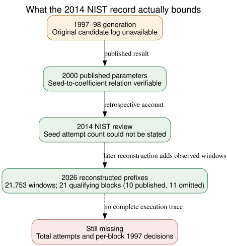

# NIST's 2014 seed-count statement and the remaining process gap

**Date:** 2026-10-24 UTC. **Question:** Did NIST later state how many candidate seeds were tried when its prime-field curves were generated, or identify an extra historical acceptance criterion? **Result:** In its 2014 Committee of Visitors review, NIST could not state the number of attempted seeds. Its own presentation described a general repeat-until-secure-against-known-attacks process, with no per-candidate log or new mathematical test. This supplies a specific provenance limit; it neither explains the eleven omitted qualifying blocks nor proves that their original program evaluated them.

## Pinned primary documents

- **Retrieved:** [NIST's 2014 Visiting Committee report](https://www.nist.gov/document/vcat-report-nist-cryptographic-standards-and-guidelines-processpdf), SHA-256 `d22e14c8a668e2c806483e3b002f6d9d7cd71657c111f445a475cc470280ec4e`, PDF page 22 (Appendix D, printed page 18). The meeting minutes attribute a FIPS 186 presentation to Dustin Moody. They distinguish NIST's verification of the published SHA-1 seed-to-parameter relation from its inability to give the number of seed attempts. The minutes also record the presenter's opinion that no sufficiently large hidden weak-curve class was then known. That opinion is a 2014 assessment, not a proof about every possible method.
- **Retrieved:** [Moody's NIST slide deck](https://csrc.nist.gov/CSRC/media/Projects/Crypto-Standards-Development-Process/documents/FIPS_186_and_Elliptic_Curves_052914.pdf), SHA-256 `da87c4202058c715904706ac1dc8abdfdaac78a31408c619916ee8a98094ab47`, PDF page 11. Its general workflow says to select a seed, generate a curve, check known attacks, and repeat when unsuitable. Its note that many seeds would likely be needed is a general expectation, not a measured attempt count or an original 1997 program trace.
- **Internally checked:** [check_sources.py](check_sources.py) verifies both source hashes and the cited page text; its retained result is [source_check.json](source_check.json). The source PDFs remain linked, not committed.

## What this adds to the nineteen-curve investigation

**Derived:** The 2026 reconstruction names eleven qualifying but omitted blocks and ten published prime-field blocks in six recovered timestamp streams ([Valsorda's ordinal list](https://words.filippo.io/seeds-solved/); [exact archived census](../../nist_seed_exact_conductor_census_20261023/report.md)). Those prefixes contain 21,753 successive 20-byte windows through the last published blocks; the prior independent census point-counted 11,042 root-admitting candidates and found the 21 named qualifying blocks. These are **reconstructed finite prefixes**, not the number of seeds attempted across all timestamps or original program runs. They also do not show which blocks the old program actually reached. The 2014 NIST review gives no independent count that would turn this observed list into a global search-size estimate.

**Source distinction:** NIST reported verifying the seed-to-curve relation, which establishes published parameters from the published seeds. It did not report reproducing Reiter's program, checking every preceding candidate, or recovering the publication decision. Its 2014 lack of an attempt count does not prove the NSA never had one, or that no code/log survived elsewhere. Conversely, the 2026 `lrand48` fit does not retroactively supply that missing execution record.

*Editable [Graphviz source](inference.dot). Green boxes are documented or reproduced relations, orange is the missing original run, and the dashed edge marks the absent total-attempt and acceptance evidence. The 21 named qualifying blocks are counts from the prior exact census, not a new search total.*

## Selection and weakness inference

This source is consistent with several live explanations: unrecorded workflow, software behavior, human review, or a further mathematical criterion. It discriminates among none of them. In particular, a statement that known attacks were checked cannot explain why eleven curves passing the known numerical gates were unpublished, even under the conditional assumption that the program reached them. The decisive check remains original source or per-candidate logs, or a predeclared criterion that predicts an independent historical decision and has an exact-group attack consequence. The [open selection problem](../../../problems/nist-seed-selection-rule-unexplained.md) retains those exit conditions. This source check establishes no ECDLP map, attack cost, or new canonical graph edge; the seed-selection and ECDLP graph sources were checked and remain factually unchanged.

**Reproduction:** `python3 check_sources.py --vcat /private/tmp/nist-vcat-2014.pdf --briefing /private/tmp/nist-fips186-2014-briefing.pdf --output /path/to/new-result.json`; `dot -Tsvg inference.dot -o inference.svg`; `pandoc report.md -f gfm --pdf-engine=typst -o report.pdf`. The checker refuses an existing output path. Provenance: NIST PDFs `retrieved`; previous 21-block census `internal`; distinctions `derived`; historical execution and any hidden weakness `unknown`.
