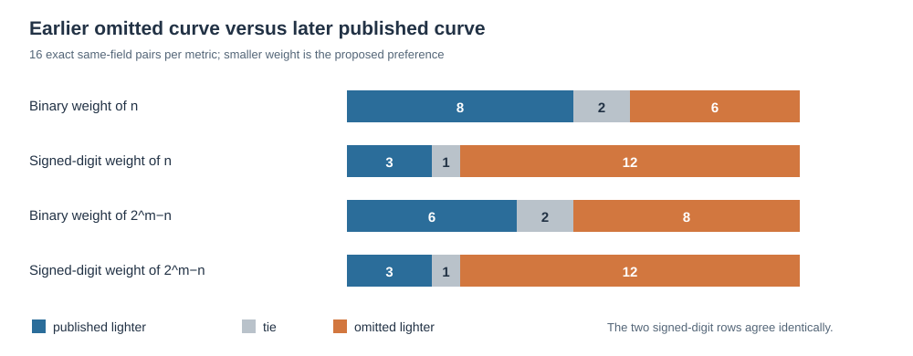

# Does a sparse group order explain the passed-over curves?

**2026-10-24 UTC. Result:** No fixed preference for any of four predeclared group-order sparsity measures explains all eleven omitted prime-field seed classes under the assumption that the original program reached them. Several earlier omissions have *sparser* orders than the later published curve in the same field. This is a bounded test of a possible implementation preference, not a test of cryptographic weakness.

## Why check order shape?

The [17 November 1997 X9.62 draft](https://archive.org/download/x962-11-17-97/x962-11-17-97.pdf) specifies ECDSA arithmetic modulo the subgroup order `n`. A designer could conceivably prefer a fixed `n` that is easier to represent or reduce. That is an **inference**, not a criterion documented for Reiter's program. The exact field primes were already chosen to have special forms; the random curve orders did not inherit those forms automatically.

The [frozen protocol](PROTOCOL.md) took the eleven omitted classes from the [assessed archive](../../nist_seed_skipped_curves_20261016/assessed.json) and ten published controls from the [traits archive](../../nist_seed_skipped_curves_20261016/traits.json), each bound by SHA-256. It fixed four smaller-is-better metrics before running: ordinary bit weight of `n`, nonadjacent-form (NAF) weight of `n`, and the same two weights of `2^m−n` for `m=bit_length(n)`. The script retained exact `p`, `n`, ordinals, and EC1 UIDs. P-384 and P-521 are descriptive singleton controls; the comparison uses eleven omissions and eight publications in four shared fields.

## Exact result

| Fixed metric, smaller preferred | Published lighter among 16 earlier-omission pairs | Ties | Omitted lighter | Two-sided allocation tail, all 25 pairs |
| --- | ---: | ---: | ---: | ---: |
| Binary weight of `n` | 8 | 2 | 6 | 3,825/4,480 |
| NAF weight of `n` | 3 | 1 | 12 | 886/4,480 |
| Binary weight of `2^m−n` | 6 | 2 | 8 | 3,825/4,480 |
| NAF weight of `2^m−n` | 3 | 1 | 12 | 886/4,480 |

*Chart data: [analysis.json](analysis.json); editable source: [render.py](render.py). Unit: one earlier omitted candidate versus one later published candidate in the same timestamp stream. The four rows are correlated: for all 21 exact inputs, `NAF_weight(n) = NAF_weight(2^m−n) + 1`, so the two NAF comparisons are the same evidence.*

The one P-256 pair is a direct counterexample to a sparse-order preference: omitted block **876** has `n` bit weight **161** and NAF weight **43**, while published P-256 at block **1842** has **167** and **49**. The omitted 239-bit block **2491** likewise has weights **148** and **38**, versus later published prime239v3's **174** and **44**. For P-224, omitted block **5736** has weights **157** and **39**, versus published P-224's **165** and **40**. Exact full-UID pair rows, including every reversal and tie, are in the JSON.

The exact allocation tails enumerate all **4,480** label allocations preserving each field's published count. They are retrospective diagnostics, since the labels were not randomly assigned, and the four metrics are correlated. No metric has the 16/16 strict orientation a universal preference needs under the candidate-visitation assumption. The much more frequent reverse NAF direction also has counterexamples, so switching to “prefer denser orders” does not supply one rule either.

## Reproduction and limit

`python3 research/nist_seed_1997_selection_extension_20261023/order_sparsity/analyze.py` produced all 21 rows, 25 same-field pairs, the 16 earlier-omission pairs and 4,480 allocation scores. `python3 research/nist_seed_1997_selection_extension_20261023/order_sparsity/verify.py` independently checked the signed-digit weights by a bit/carry dynamic program and replayed every UID-bound pair. The first command printed the exact summary in `analysis.json`; the verifier printed `verified 21 minimum signed-digit weights and 25 exact UID-bound pairs`. The [PDF](report.pdf) was rendered from this report and visually inspected.

This closes only four simple arithmetic-shape proxies. It does not measure 1997 modular-arithmetic runtime, establish that sparse `n` was desired, show which candidates the original program evaluated, or identify an ECDLP weakness. The [selection problem](../../../problems/nist-seed-selection-rule-unexplained.md) remains open. The canonical seed-selection and ECDLP graphs were checked; no verified historical selector or attack edge was added. Provenance: draft `retrieved`; exact curve archive `internal`; metrics and allocations `derived`; independent signed-digit check `verified`; historical implementation `unknown`.
