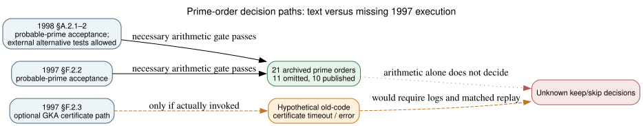

# A possible 1997 certificate bottleneck, and its limits

**Date:** 2026-10-23 local / 2026-10-24 UTC. **Question:** If the original program visited the eleven omitted prime-order seed curves, did a documented deterministic prime-order proof requirement reject them? **Outcome:** The 17 November 1997 draft includes an optional Goldwasser–Kilian–Atkin (GKA) certificate path. Its actual curve-generation path invokes probable-prime testing, without requiring a certificate. The 1998 text still permits alternative deterministic tests. Consequently the documented rule does **not** reject any of the eleven; a specific historical implementation might nonetheless have timed out or erred during a separately chosen certification workflow. We have no execution record to establish that it did.

## Primary-source comparison

- **Retrieved:** [X9.62 working draft of 17 November 1997](https://archive.org/download/x962-11-17-97/x962-11-17-97.pdf), SHA-256 `0c231d5176fcf0b239b44732213d281b518a0e16cc6f13f7bd4039ec99807b6e`, PDF p. 62 (printed p. 54), §F.2.3, describes optional deterministic GKA certificates for an integer already deemed prime by a probabilistic test. The draft §F.2.2 (PDF pp. 61–62) defines near-primality by a *probable* prime large factor; curve selection §F.3.2 (PDF p. 63) invokes that step. Its note says to use the §F.2.3 test **if deterministic testing is desired**. The certificate path is offered but not imposed as an additional acceptance test in §F.3.2.
- **Retrieved:** [X9.62 text bearing a 20 September 1998 cover](https://safecurves.cr.yp.to/grouper.ieee.org/groups/1363/private/x9-62-09-20-98.pdf), SHA-256 `6cb44495bf816008afc11cc6cf65124b484654b2d260559dab6dde55e2609da7`, PDF p. 39 (printed p. 30), §A.2.1–2, still uses probable primality for near-primality. It allows probabilistic or deterministic alternatives from a then-forthcoming ANSI X9 prime-generation standard. The specific 1997 GKA annex is absent; this is a change in *reference and options*, not evidence that a deterministic path disappeared from practice. Its PDF creation metadata is January 1999, separate from the cover date.
- **Internally checked:** [source_check.json](source_check.json) pins both PDF hashes and exact page text fragments, plus the hashes of the inherited [21-curve acceptance comparison](../nist_seed_selection_workflow_20261023/check.json) and [19-curve complete order-neighbor factorization analysis](../nist_seed_order_certificate_20261023/analysis.json). The PDFs are linked rather than redistributed.

## What a certificate hypothesis would actually predict

Under the user's **conditional** premise that all eleven were visited, a program could have demanded deterministic proofs even though the draft did not. A correct primality decision accepts all eleven because their full curve orders are independently verified primes, as are the published controls. However, a bounded 1997 implementation could fail to *find* a certificate for a particular prime before a timeout, terminate unexpectedly, or defer it. That is a testable software-workflow explanation; it is **not** a weakness of the prime-order elliptic-curve group.

The existing [exact factor study](../nist_seed_order_certificate_20261023/report.md) tested a simpler certificate proxy: the product of prime powers at most 10⁶ dividing `n−1` is below `sqrt(n)` on **all 19** same-field candidates, including every omission and published control. Thus a Pocklington proof using only those small factors separates none. The full factorizations exist, and a different certificate algorithm or cutoff could behave differently. GKA itself uses elliptic-curve certificates rather than this `n−1` proxy, so the factor result does **not** benchmark or falsify GKA. Replaying modern primality libraries does not reproduce a missing 1997 implementation.

*Solid arrows indicate documented or inherited arithmetic facts. Dashed arrows are the hypothetical historical certification workflow. Editable source: [inference.dot](inference.dot).*

## Remaining discriminator and decisive evidence

A credible version of this explanation requires the actual program's certification call sites, thresholds and logs, or a source-identical reconstruction with per-candidate traces. It predicts eleven failed or deferred cases and eight passing same-field controls, including P-256 blocks 876 and 1842, *without* changing the test after seeing their labels. If a retained routine accepts any omitted case under the original run's state and time limit, that specific all-eleven rule fails; if all separate, it explains a **workflow** choice, while historical invocation and mathematical attack relevance still need separate proof. A clean modern proof that every order is prime cannot resolve a 1997 timeout or code bug.

This round checked the existing seed-selection and canonical ECDLP graph sources: no verified vulnerability, transport map, cost edge or curve decision changes. The [selection-rule problem](../../problems/nist-seed-selection-rule-unexplained.md) stays open. Provenance labels: documents `retrieved`; inherited curve and factor records `internal`; implications `derived`; historical certificate invocation `hypothetical`. No quantitative attack-cost claim or research-status transition follows.

**Reproduction:** `python3 research/nist_seed_1997_selection_extension_20261023/check_sources.py --draft-1997 /path/to/x962-11-17-97.pdf --text-1998 /path/to/x9-62-09-20-98.pdf --out /tmp/source_check.json`; compare to the archived JSON. Generate the diagram with `dot -Tsvg research/nist_seed_1997_selection_extension_20261023/inference.dot -o /tmp/inference.svg`. The first source-check attempt incorrectly asserted 19 rows for the order-neighbor file, which actually stores 19 `n−1` plus 19 `n+1` rows; the assertion was corrected before recording the source check. No raw source or historical file was overwritten.
