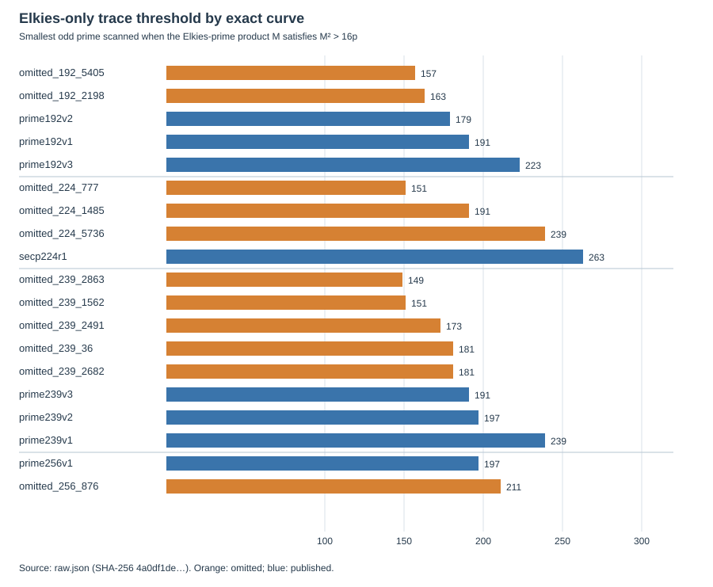
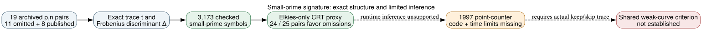

# A small-prime point-counting signature across the omitted curves

**Date:** 2026-10-24 UTC. **Question:** Under the conditional premise that the original program reached all eleven omitted prime-order curves, could an unusually *hard* Schoof–Elkies–Atkin (SEA) point count have caused them to be skipped? **Result:** The frozen optimistic Elkies-only proxy points mostly in the opposite direction. Omitted curves reach its trace-information threshold at a smaller prime in **24 of 25** same-field comparisons. P-256 block 876 is the exception, so there is no universal cutoff separating all eleven. This is a verified arithmetic pattern in the named candidate set, not a measured runtime, a historical selection rule, or an ECDLP weakness.

## Why this was worth checking

**Retrieved:** Contemporary work on Schoof point counting distinguished Atkin and Elkies cases; the small-prime behavior can affect an implementation's workload ([Morain, 1995](https://jtnb.centre-mersenne.org/item/JTNB_1995__7_1_255_0/)). A later primary mathematical analysis explains why the supply of small Elkies primes matters to SEA's expected complexity, while Atkin primes also carry information ([Shparlinski and Sutherland, 2014](https://arxiv.org/abs/1404.0399)). The [November 1997 X9.62 draft](https://archive.org/download/x962-11-17-97/x962-11-17-97.pdf), §F.3.2 note 5, says orders can be computed by Schoof's algorithm and describes improvements, but does not identify Bob Reiter's point-counting implementation or its per-candidate time limits. The **user's premise that all eleven were reached remains conditional**.

**Internal prior context:** An earlier [10,000-degree rational-isogeny screen](../../nist_seed_commonality_20261023/isogeny_screen/report.md) already computed the same Frobenius-character family and found 20 of 25 same-field pairs with *more total Elkies-or-ramified degrees* on the omitted side. That prior work also rejected a simple “few Elkies degrees caused timeout” interpretation. This round asks a narrower workload question: how far an optimistic **Elkies-only** counter must scan before enough CRT information accumulates. Its 24/25 direction is a refinement of the earlier trend, not an independent discovery or second significance test.

## Frozen exact screen

The [protocol](PROTOCOL.md), written before any curve signature was calculated, fixed the eleven omitted seed classes and eight published controls in matching fields, three metrics, controls, and a 60-second wall stop. The [pre-run amendment](AMENDMENT.md) corrects a prime-count typo: there are 167 odd primes through 997, not 166. For each archived `p,n`, we independently reconstructed `t=p+1−n` and `Δ=t²−4p`. For every odd prime `ℓ≤997`, `Δ` a quadratic residue modulo `ℓ` is called Elkies, a nonresidue Atkin, and zero ramified. We multiplied the Elkies primes in order and recorded the first `ℓ` where `M²>16p`, an optimistic CRT threshold sufficient to distinguish a trace in Hasse's interval if each contributing residue were known. It is **not** an SEA operation count: modular-polynomial cost rises with `ℓ`, actual software may use Atkin information, and neither original code nor hardware is known.

**Internally verified:** The first run's [raw record](runs/scan-20261023T1823Z/raw.json) and fully logged second run's [raw record](runs/scan-20261023T1840Z/raw.json) are byte-identical (SHA-256 `4a0df1de260e4533253ef591f7b084b73e86fac5e03558ec3609081c750f48fe`). The independent [Sage verification](runs/scan-20261023T1823Z/verification.json) recomputed all **3,173** Legendre symbols and all 19 thresholds from the archived `p,n` values, checked Hasse bounds and exact UIDs, and passed under SageMath 10.10.rc0. The synthetic residue and strict-boundary controls passed. The [run receipt](runs/scan-20261023T1840Z/receipt.json) records Python, platform, source head, dirty state and wall/CPU time; [stdout](runs/scan-20261023T1840Z/stdout.log) and [stderr](runs/scan-20261023T1840Z/stderr.log) are retained. [RUN_NOTE.md](RUN_NOTE.md) corrects two misleading directory-time suffixes and identifies the first run's absent console logs. The study's filename correction changes no arithmetic.

*Orange bars are omitted seed classes; blue bars are published controls. Smaller is a lower Elkies-only trace threshold. Source: the exact raw JSON; editable chart source: [render.py](render.py).*

| Field | Omitted cutoffs `ℓ` | Published cutoffs `ℓ` | Omitted lower in within-field pairs |
| --- | --- | --- | ---: |
| P-192 | 157, 163 | 179, 191, 223 | 6 / 6 |
| P-224 | 151, 191, 239 | 263 | 3 / 3 |
| ANSI 239-bit | 149, 151, 173, 181, 181 | 191, 197, 239 | 15 / 15 |
| P-256 | 211 | 197 | 0 / 1 |

**Derived:** Across the 25 pair comparisons, the omitted cutoff is lower in 24 and higher in one, with no ties. The two prelisted small-prime density metrics point the same general way but less cleanly: omitted curves have more Elkies primes through 101 in 21 of 25 pairs, and through 251 in 20 pairs, with two ties. Within P-192, P-224 and ANSI 239-bit, the cutoff values perfectly order the named published and omitted candidates; the P-256 pair reverses that ordering. The maximum published cutoff is 263, while the minimum omitted cutoff is 149, so no global rule of the form “reject if the Elkies-only cutoff exceeds `c`” separates the labels. More pointedly, the omission side is usually *easier* under this proxy, opposing an “old point counter ran out of time on hard omissions” story.

The [post-result reallocation](runs/scan-20261023T1823Z/post_result_labels.json) counts all **4,480** possible within-field label allocations preserving published counts. Four yield at least the observed 24/25 pair score. This is **descriptive only**: the historical labels are not randomized, candidate streams are selected and dependent, and this particular proxy was chosen after many prior features were examined. The ratio is not a probability of hidden selection or a general statistical significance claim.

*Solid arrows are exact input and arithmetic checks; dashed arrows require unavailable program traces or a mechanism. Editable source: [inference.dot](inference.dot).*

## What remains open

A true small-Elkies-based *security* concern would need to show how those small rational isogenies or their resulting structure lower unknown-scalar ECDLP cost on an exact omitted prime-order subgroup, with construction and evaluation costs and matched published controls. The verified pattern does not do that. The P-256 reversal prevents this exact scalar proxy from being a common all-eleven weakness even as an arithmetic label rule. A broader, predeclared criterion could still exist; one can fit many retrospective conditions to nineteen labeled curves.

The best process test remains the original point-counter and its per-candidate logs, followed by a source-identical bounded replay. This screen sharpens the previously reported small-Elkies trend for the May 1997 and April 1998 groups; it does not establish why a published curve was chosen. The [selection problem](../../../problems/nist-seed-selection-rule-unexplained.md) remains open. I checked the existing seed-selection and canonical ECDLP graph sources; this round creates no verified attack, isogeny map or cost edge, so none requires a factual update. Provenance: original documents `retrieved`; p,n and prior certifications `internal`; signatures and comparisons `independently checked`/`derived`; process and weakness interpretations `proposed`.

## Reproduction

The exact commands, input digests and environment are in the [logged run receipt](runs/scan-20261023T1840Z/receipt.json) and [protocol](PROTOCOL.md). Run [run.py](run.py) and the independent Sage [verify.py](verify.py) into fresh output paths. [explore_labels.py](explore_labels.py) is a *post-result* diagnostic outside the frozen primary metrics. Existing runs are not overwritten.
