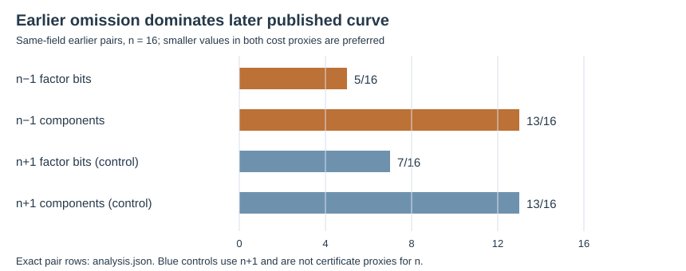
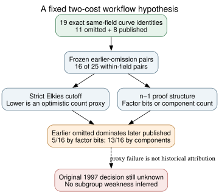

# Can a two-cost 1997 workflow explain the skipped curves?

**Date:** 2026-10-24 UTC. **Question:** If the original program evaluated all eleven omitted prime-order candidates, could it have published only candidates that were better on both an optimistic point-counting proxy and an `n−1` primality-certificate proxy? **Result:** No for the fixed pair of proxies. Among the **16** same-field comparisons where the omitted candidate precedes a published curve, an omission dominates a publication in **5** pairs using required prime-factor bit length and **13** using the number of prime-power components. One such pair would defeat the strict Pareto-choice rule. The P-256 pair points the other way on the bit-length view, so changing the direction to rescue the May/P-224 cohorts cannot make this one rule universal.

## Why this joint check

**Retrieved/earlier verified:** [The 1997 X9.62 draft](https://archive.org/download/x962-11-17-97/x962-11-17-97.pdf) discusses point counting and optional deterministic primality proofs. Our [strict Elkies-only screen](../sea_signature/report.md) found that omitted curves generally reach an optimistic trace-information threshold earlier than published controls, but P-256 reverses. Our [complete `n−1` factorization study](../../nist_seed_order_certificate_20261023/report.md) records the structure needed for a simple Pocklington size condition. Combining those two *fixed* period-plausible workflow proxies asks whether certificate convenience could compensate for point-counting difficulty. It neither reconstructs Reiter's software nor predicts its runtime.

The [protocol](PROTOCOL.md) froze the exact four input hashes, full EC1 UID joins, metrics, orientation and control before [analyze.py](analyze.py) calculated joint comparisons. It defined dominance as no worse on both metrics and strictly better on at least one. Smaller strict Elkies cutoff `ℓ` was treated as better for counting; separately, smaller largest-prime bit length or fewer prime-power factors at the `n−1` Pocklington crossing was treated as better for a certificate proxy. We compared all **25** omitted–published pairs over a shared field and applied the historical-prefix test only when the omitted ordinal was earlier: **16** pairs. The `n+1` rows are a negative arithmetic control, not a primality certificate for `n`.

## Exact observations

**Derived and programmatically checked:** [analysis.json](analysis.json) retains every full UID, ordinal, raw metric pair and dominance flag, with the source/protocol digests. The input order factorizations and strict prime-character results were independently verified in their respective studies; this joint comparison is a deterministic recombination of them. It is **not** an independent new point count or factoring run.

| Earlier omitted versus later published | Pair count | Omission dominates in `n−1` factor-bit view | Omission dominates in `n−1` component view |
| --- | ---: | ---: | ---: |
| P-192 | 3 | 0 | 3 |
| P-224 | 3 | 2 | 2 |
| ANSI 239-bit | 9 | 3 | 8 |
| P-256 | 1 | 0 | 0 |
| **Total** | **16** | **5** | **13** |

Two concrete failures for a universal cost-Pareto selector are omitted 239-bit block **2491** versus later published prime239v3 (`ℓ=173` versus `191`; crossing-factor bit lengths `76` versus `110`) and omitted P-224 block **1485** versus P-224 (`ℓ=191` versus `263`; bits `74` versus `196`). Earlier omitted P-256 block **876** instead has `ℓ=211` and crossing factor `242` bits, against published P-256's `197` and `92` bits; published P-256 dominates it on this view. These exact pair rows also show that one order of preference cannot classify all eleven through this mechanism.

The `n+1` control gives **7/16** and **13/16** earlier-omission dominations on the two metric variants. Its similar direction warns that part of the pattern is already driven by the shared Elkies cutoff; the certificate metric is not an independently established historical filter.

*Exact counts from `analysis.json`, rendered by editable [render.py](render.py). Unit is earlier omitted–later published pair; sample size 16. There is no sampling uncertainty for these exact comparisons, while historical runtime and selection uncertainty remain unmeasured.*

*Editable [Graphviz source](inference.dot). Solid arrows are the input and arithmetic comparison; dashed arrow marks the missing historical program and any weakness mechanism.*

## Inference boundary and next test

**Conclusion within the frozen scope:** A rule that retains only candidates nondominated on either of these simple counting/certification proxy pairs cannot choose all the later published curves after reaching the earlier omissions. A real 1997 point counter and GKA certificate procedure could have different costs, failure modes or time limits. The largest factor's bit length and the number of components are not measured certificate runtime; actual GKA does not use this Pocklington proxy. The `n+1` control is deliberately inapplicable to that certificate. This test neither establishes that the original program reached the omissions nor finds an ECDLP weakness.

The next discriminating step is original source or logs, or a source-identical implementation that produces per-candidate acceptance/failure traces under stated limits. The [selection problem](../../../problems/nist-seed-selection-rule-unexplained.md) remains open. I checked the seed-selection and canonical ECDLP graph sources; no attack, map, measured cost or historical selector has been established, so their verified edges are unchanged. Provenance: standard `retrieved`; exact curve/order/SEA inputs `internal` with independent checks in prior studies; joint pairs `derived`; 1997 software behavior `unknown`.
