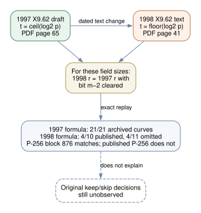

# A dated rounding change in the X9.62 seed formula

**2026-10-24 UTC.** The apparent contradiction between the later X9.62 prime-field seed formula and several published example curves has a precise version explanation. The [17 November 1997 draft](https://archive.org/download/x962-11-17-97/x962-11-17-97.pdf), §F.3.3.b, PDF page **65**, defines `t = ceil(log₂ p)`. The [text with a 20 September 1998 cover](https://safecurves.cr.yp.to/grouper.ieee.org/groups/1363/private/x9-62-09-20-98.pdf), Annex A.3.3.2, PDF page **41**, instead defines `t = floor(log₂ p)`. Both then clear the top bit of the first SHA-1 block. Each text repeats its respective rounding choice in the matching verification procedure (§F.3.4.b, PDF page 66; Annex A.3.4.2, PDF page 42). The source pages were visually inspected, and both PDFs are pinned by SHA-256 in the [protocol](PROTOCOL.md). The cover dates distinguish surviving texts; they do not date the actual editorial decision.

## Exact 21-curve replay

The [frozen test](PROTOCOL.md) independently implemented both printed formulas for the eleven omitted seed classes and ten published controls, retained every full EC1 UID, and checked `r·b² ≡ (−3)³ (mod p)` for the exact archived coefficient. It also called the prior census implementation after hashing its source. A separate [bit-string verifier](verify.py) reconstructed both formulas from SHA-1 digest bits rather than integer masks. All 21 altered-seed controls changed `r`.

| Comparison | Published | Omitted | Total |
| --- | ---: | ---: | ---: |
| 1997 ceiling formula matches archived coefficient | **10/10** | **11/11** | **21/21** |
| 1998 floor formula matches archived coefficient | **4/10** | **4/11** | **8/21** |

The seven published curves actually printed in the **1997** draft all match its ceiling formula. Only **four of seven** match the later floor formula: prime192v1, prime192v2, prime192v3, and prime239v2. Prime239v1, prime239v3 and P-256 do not. Across all 21 named seeds, the later formula changes the coefficient for **13**; a list generated under that formula refers to different curves at those positions. P-256 is especially decisive against treating the later formula as the historical selection filter: omitted block **876** happens to match the 1998 floor formula, while published P-256 at block **1842** does not. The four omitted matches are 239-bit blocks **1562** and **2491**, P-256 block **876**, and P-224 block **1485**. Exact `r` values and identity-bound checks are in [analysis.json](analysis.json).

*Editable [Graphviz source](formula_versions.dot). Solid arrows show text and arithmetic checks; the dashed arrow is the missing historical keep/skip trace.*

## Why one bit changes

Let `m = bit_length(p)`. Because each prime field size tested here has `m mod 160 ≠ 1`, both printed formulas use the same number `s` of complete 160-bit SHA-1 blocks. The 1997 formula sets `t=m`, takes `h=m−160s` bits of the first digest, then clears their top bit. The 1998 formula sets `t=m−1`, takes `h−1` bits, then clears their top bit. Thus, **on all six field sizes in this study**, the 1998 integer is the 1997 integer with bit `m−2` cleared. The independent verifier checked this identity for all 21 seeds.

The earlier [full-census implementation](../../nist_seed_selection_20261016/generate_candidates.py) uses `t=floor(log₂ p)` in both named variants: it leaves the first block unmasked for its `nist_fips_186_2` variant and clears its top bit for its `ansi_x9_62_1998` variant. The former equals the 1997 ceiling-plus-clear value on these fields; the latter equals the later 1998 floor-plus-clear value. Both implementations were reproduced exactly. The [census report's](../../nist_seed_selection_20261016/report.md) observation that the later strict text matches four of ten published coefficients is therefore correct, but the recovered **1997** text supplies a compatible printed formula for all seven of its own published prime-field samples. The older mismatch must not be projected back onto that draft.

## Selection inference

This version difference explains a standards-text inconsistency; it does **not** explain why the eleven qualifying curves were passed over. All eleven match the 1997 formula used to reconstruct them. The 1998 formula separates neither the published nor the omitted label and fails on published P-256. The fact that later P-224, P-384 and P-521 also match the 1997 formula is an exact arithmetic observation, not evidence that their original 1997–98 program followed that document. The original generator's code, run log and editorial decisions remain missing.

The [open selection problem](../../../problems/nist-seed-selection-rule-unexplained.md) stays open. The canonical seed-selection and ECDLP graphs were checked; this adds a versioned source relationship, not a historical acceptance or attack edge. Sources: 1997 and 1998 PDFs `retrieved` and hash-bound; exact curve inputs `internal`; formula equality and counts `derived` and independently replayed; generator behavior `unknown`.

## Reproduce

With the two source PDFs at the exact paths and SHA-256 values fixed in the protocol, run `python3 research/nist_seed_1997_selection_extension_20261023/x962_rounding/analyze.py` and `python3 research/nist_seed_1997_selection_extension_20261023/x962_rounding/verify.py`. The first printed 21 archived matches for the 1997 formula and 8 for the 1998 formula; the second printed `verified 21 pairs of dated SHA-1 bit strings and the one-bit identity`. The [PDF](report.pdf) was rendered from this report and visually inspected.
