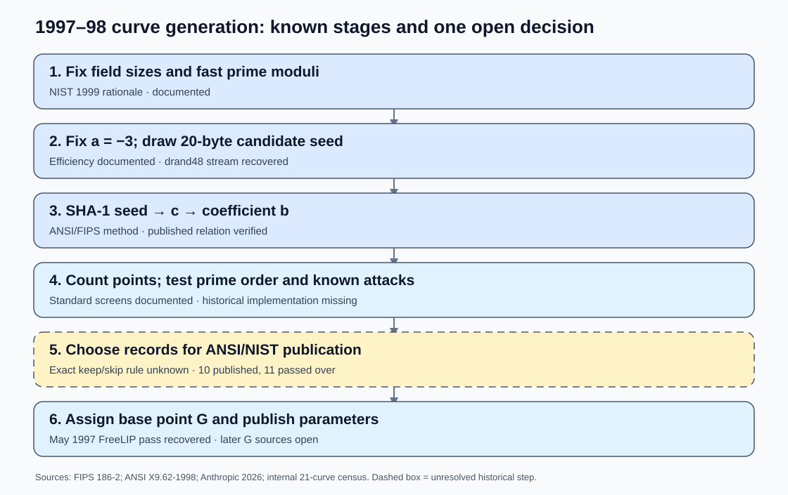
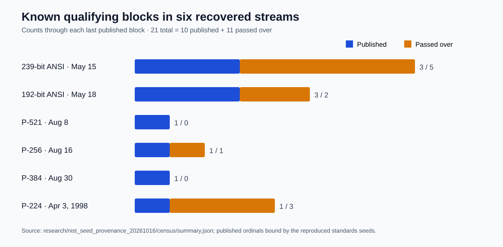

# A 1997 workflow reconstruction for the NIST/ANSI prime curves

**Date:** 2026-10-16

**Question:** Which contemporary decisions plausibly produced the published curves, and which could explain eleven mathematically qualifying seed blocks passed over in the recovered streams?
**Status:** Historical reconstruction and bounded comparison. The original acceptance code and logs have not been recovered.

## In plain terms

The **family of curves** makes sense as a 1997 engineering project: choose field sizes for several security levels; use prime moduli that make arithmetic fast; fix `a = -3` for efficient doubling; derive `b` from a published SHA-1 seed; and keep curves with a large prime-order group. The recovered clock-seeded `drand48` stream fits ordinary C software of that period. [FIPS 186-2][fips], [ANSI X9.62-1998][ansi], and [Anthropic's reconstruction][anthropic] support these steps (`retrieved`).

The **exact keep/skip decisions** remain unexplained. The recorded six-stream census contains **21,753 seed blocks**, of which **11,042 have point-count rows**; **21** pass the known prime-order, order-bit-length, and MOV screens: **ten published, eleven passed over**. The classification has been independently replayed *given the stored point counts*; this does not replay the 1997 program. A qualifying block in today's reconstruction might never have been evaluated by that program. [Census][census] (`internal`); [Valsorda][valsorda] (`retrieved`).

## What a designer then was selecting for

| Choice | Source and implication |
| --- | --- |
| **Several security levels.** | NIST's July 1999 appendix pairs prime-field sizes 192, 224, 256, 384, and 521 with 80, 112, 128, 192, and 256-bit symmetric-key categories, naming SKIPJACK, Triple-DES, and prospective AES sizes. This documents the final suite's purpose, not an original 1997 design memo. [FIPS 186-2, pp. 24–27][fips] (`retrieved`). |
| **Fast moduli.** | All five NIST prime moduli are generalized Mersenne numbers. NIST's Appendix 6.1 gives special reduction formulas for them. This choice was upstream of seed search and is separate selection freedom. [FIPS 186-2, pp. 49–56][fips] (`retrieved`). |
| **Fast curve formula.** | NIST explicitly names efficiency as the reason for `a = -3`. [FIPS 186-2, p. 28][fips] (`retrieved`). |
| **Simple subgroup.** | NIST's prime curves have prime order and cofactor one. ANSI's generation method permits a nearly-prime order, tests MOV and anomalous cases, and then obtains a base point. This explains rejecting many generated curves, but all final 21 pass the tested ordinary screens. [FIPS 186-2, pp. 24, 28][fips]; [ANSI Annex A.3.2][ansi] (`retrieved`); [process audit][process] (`internal`). |
| **Checkable coefficient.** | ANSI starts with an *arbitrary* seed of at least 160 bits, hashes it with SHA-1, and says the coefficient pair need not itself be sampled randomly. FIPS Appendix 6.4 likewise begins with an arbitrary 160-bit string. Publication lets a reader check seed-to-`b`; it does not reveal how many candidates were tried. [ANSI Annex A.3.3.2][ansi]; [FIPS Appendix 6.4][fips] (`retrieved`). |
| **Implementation examples.** | ANSI Annex J.5 calls its three 192-bit and three 239-bit curves **sample curves** useful for checking implementations; it gives one 256-bit sample, P-256. This explains the request for several curves over a field, not the choice among qualifying candidates. [ANSI Annex J.5][ansi] (`retrieved`). |

NIST's [2014 retrospective][nist-slides] (`retrieved, retrospective`) says it solicited comments on new signature schemes in 1997, worked with ASC X9, and received NSA-generated curves. It describes a generic seed → curve → screen for known attacks cycle. It supplies no acceptance trace or extra test. The 1998 ANSI and 1999 NIST texts postdate the May 1997 runs; they document the standards that emerged, not necessarily the exact code that ran.

## Chronology and a second generator

The six reconstructed `srand48` inputs are dated **15 May 1997** (239-bit ANSI examples), **18 May** (192-bit examples/P-192), **8 August** (P-521), **16 August** (P-256), **30 August** (P-384), and **3 April 1998** (P-224). P-224 came after the larger curves. A separate 112-bit standards need or project pass fits that delay, but no recovered document says that was the cause. The dates are reconstructed PRNG seeds, not independently witnessed wall-clock records. [Census][census] (`internal`); [Anthropic][anthropic] (`retrieved`).

There is a striking contemporary date match: on **13 May 1997**, NIST publicly announced a planned federal standard for public-key agreement and explicitly invited comment on elliptic-curve techniques. A later Federal Register notice says NIST also solicited comments that day on adding elliptic curves to the digital-signature standard. The recovered May 15 and May 18 inputs are **two and five days later**. This documents an active standards setting; it does not prove the public notices triggered either generator run, because the input timestamps need not be independently witnessed run times. [NIST's May 1997 notice][nist-1997-agreement] and [December 1998 Federal Register account][fr-1998-signatures] (`retrieved`).

Anthropic identified a **different, FreeLIP generator** for the six May 1997 base points. Its small seeds were 20000 for P-192; 20420, 20507, 20509 for prime239v1–v3; and 20512, 20517 for prime192v2/v3. This assignment order differs from the two curves' timestamp order and their publication order. It is **consistent with** a separate base-point or standards-assembly pass. It also makes May base-point search consuming the same `drand48` seed stream a less direct explanation for omitted windows. The four later prime base points are still unexplained. [Anthropic][anthropic] (`retrieved`).

The chart is right-censored: each stream ends at its last published block. Its published/skipped ratio is not an estimate of all historical generator attempts. Seven omitted blocks occur in the two ANSI example streams; four precede P-256 or P-224. P-384 and P-521 are the first qualifying blocks in their recovered streams. [Summary][summary] (`internal`).

Two actual software choices help explain why the raw stream contains more mathematically interesting curves than the final 21. The recorded census finds **17 prime-order candidates whose order has more bits than the field prime**, all excluded by the extra bit-length rule. In the four fields with `p ≡ 3 (mod 4)`, the published coefficients follow the simple exponentiation square-root convention; **31 other blocks have prime-order groups only on the opposite coefficient sign**. These are distinct from the eleven still unexplained omissions. P-224 has `p ≡ 1 (mod 4)`, so its square-root computation takes a different code path; its two coefficient signs define isomorphic curves and cannot explain the three P-224 omissions. This is a specific reason to investigate a later P-224 implementation branch, not evidence that one existed. [Census][census]; [sign audit][process] (`internal`).

## Candidate explanations that remain

| Possible 1997 process | Evidence for or against | Decisive next check |
| --- | --- | --- |
| **Resource-limited or imperfect point counting** | ANSI describes recent major improvements to Schoof's method. A later near-era [MIRACL SEA implementation][miracl] documents large timing variation with curve and Elkies-prime availability; its exact release date and any NSA use are unverified (`retrieved, contextual`). A valid curve could be lost to timeout, an incomplete proof, a crash, or bookkeeping. Yet a predeclared modern Elkies-coverage proxy did not split all 21 labels. [Feature screen][pre] (`internal, externally run`). | Original point-count software, logs, error codes, and limits; or a versioned replica frozen before checking the 21 labels. |
| **Human or committee selection from a batch** | Multiple ANSI samples, separated dates, and a separate FreeLIP base-point pass fit staged work (`derived`). They do not establish a specific editorial preference. | Committee drafts, marked parameter tables, correspondence, or original output records. |
| **Extra `drand48` consumption** | Possible if validation drew from the same RNG. All published seed windows still align to 20-draw boundaries. Five tested consumption models, including same-stream Tonelli–Shanks draws, missed at least three published positions; the six May base points used another RNG. [Census report][census] (`internal; model tests not independently replayed`). | Exact call trace reproducing every published ordinal and boundary phase. |
| **Undocumented mathematical screen** | NIST's later description calls for a known-attack check. All 21 pass the checked ordinary order, MOV, anomalous, and bounded CM screens. `n<p`, positive trace, prime twist, no small twist factor, and maximizing twist prime factor each fail on published or omitted controls. A predeclared screen of roughly 60 deterministic features found no perfect classifier. [Selection study][selection], [P-224 follow-up][p224], [feature screen][pre] (`internal`). | Dated rule or code, precise threshold, and successful prediction on an independent historical decision. |
| **Deliberate rare-class selection** | There is no identified weak class or retained witness. Under fixed field and exact 20-consecutive-draw seed extraction, the 48-bit LCG can yield at most `2^46` distinct candidate-start states across *all* timestamps and ordinals; arbitrary extra draws between intact windows allow at most `2^48`. These are ceilings, not observed work. [Process proof][process] (`internal`). | A concrete invariant or algorithm, its density under this generator, a witness or reproducible route, and full construction/evaluation/per-target costs. |

A [2015 preliminary note on elliptic twins][twins] (`retrieved`) pointed to P-384's uncommon prime-order twist as a clue to extra screening. The later census shows P-384 was **the first qualifying block in its recovered run**. Its twist therefore gives no evidence of a preference among earlier qualifying blocks *within that run*. Timestamp-level selection remains possible but unmeasured. P-224 lacks a prime-order twist, and a passed-over P-224 candidate has a larger largest twist prime factor than published P-224. A twist requirement is absent from the cited 1998 ANSI generation checks, so using this modern trait as a 1997 rule needs separate historical evidence.

## My working reconstruction and its limit

**Proposed:** The designers fixed fast primes and `a=-3`, used a clock-seeded C RNG to produce 160-bit candidate strings, derived `b` via the ANSI/IEEE hash recipe, and processed group orders with period software. Curves or output records were gathered for more than one standards context. The May base points came from a separate FreeLIP pass. One or more unrecorded operational choices, software failures, tests, or editorial decisions intervened before publication.

This accounts for the *kind* of parameters and for a staged schedule. It still cannot classify the eleven specific omissions. Bob Reiter's parameter-generator code or a contemporary run log is the highest-value missing object. Solinas's 2015 memory about a phrase hash was tentative and conflicts with the recovered prime seeds. [Anthropic][anthropic]; [Weis's correspondence record][weis] (`retrieved`). The next discriminating test is to freeze one historically plausible toolchain and stopping rule before comparing all 21 candidate blocks; a mismatch rejects only that toolchain.

The published hash relation confirms a seed-to-coefficient computation, **not** the number of seeds, timestamps, or field primes inspected. The recovered generator narrows a specific rare-instance grinding story under its assumptions. It does not constrain earlier field-prime choice or a hidden algorithm working on honestly generated curves. No criterion or structural trait identified here supplies an ECDLP shortcut. A claimed hidden route would need its mechanism, access model, and complete costs, including any costly intermediate advantage.

## Artifacts and source scope

This search changes no curve identity, frozen point count, hypothesis status, or canonical ECDLP graph. The [open problem][problem] records the missing historical evidence. The earlier [seed-stream graph][old-graph] and frontier graphs under `knowledge/frontiers/ecdlp/` were checked; this search adds no mathematical edge, so they remain unchanged. [render_visuals.py](render_visuals.py) is the editable source for both SVGs. [report.typ](report.typ) is the source for the inspected [PDF](report.pdf).

[fips]: https://csrc.nist.gov/files/pubs/fips/186-2/final/docs/fips186-2.pdf
[ansi]: https://pdfcoffee.com/x9-62-1998-ecdsa-pdf-free.html
[anthropic]: https://www.anthropic.com/research/ecdsa-curve-origins
[valsorda]: https://words.filippo.io/seeds-solved/
[nist-slides]: https://csrc.nist.gov/csrc/media/projects/crypto-standards-development-process/documents/fips_186_and_elliptic_curves_052914.pdf
[nist-1997-agreement]: https://csrc.nist.gov/News/1997/Plans-to-Develop-FIPS-for-Public-Key-Based-Crypto
[fr-1998-signatures]: https://csrc.nist.rip/encryption/dss/fr981215.htm
[miracl]: https://github.com/miracl/MIRACL/blob/master/source/curve/sea.cpp
[twins]: https://arxiv.org/abs/1506.07269
[weis]: https://saweis.net/posts/nist-curve-seed-origins.html
[census]: ../nist_seed_provenance_20261016/README.md
[summary]: ../nist_seed_provenance_20261016/census/summary.json
[pre]: ../nist_seed_provenance_20261016/PREREGISTRATION.md
[selection]: ../nist_seed_selection_deep_20261016/report.md
[p224]: ../nist_seed_selection_followup_20261016/report.md
[process]: ../nist_seed_generation_process_20261016/report.md
[problem]: ../../problems/nist-seed-selection-rule-unexplained.md
[old-graph]: ../nist_seed_selection_deep_20261016/seed_slots.svg
