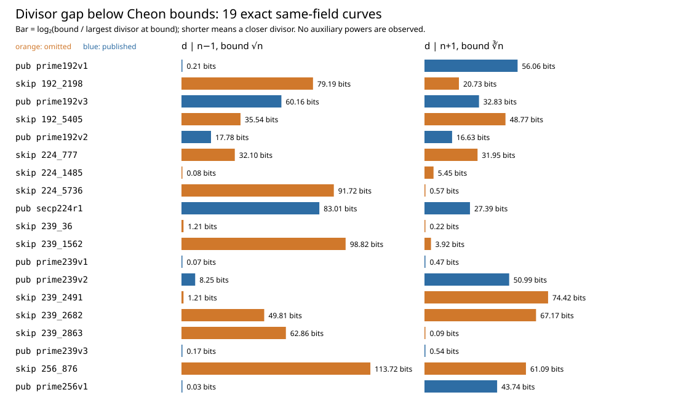
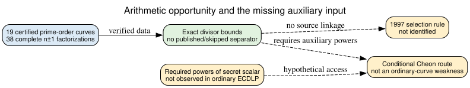

# Order-neighbor divisors do not mark the eleven skipped curves

**Date:** 2026-10-23 UTC. **Scope:** The eleven omitted prime-field seed classes and eight published same-field controls, each identified by its exact EC1 UID in [analysis.json](analysis.json). **Verdict within this screen:** No shared auxiliary-input divisor opportunity separates the labels. This result does not test ordinary ECDLP hardness or reconstruct a 1997 selection rule.

## Why test these divisors?

[Cheon's auxiliary-input algorithm](https://www.math.snu.ac.kr/~jhcheon/publications/2010/StrongDH_JoC_Final2.pdf) (`retrieved`, primary; downloaded PDF SHA-256 `fd7746b9d2c37c228b63e9b993e7eb58a90045740f5d1fd6aac3e5a5af70b4de`) is sensitive to divisors of the prime subgroup order `n−1` or `n+1`. The `n−1` route requires a point encoding the *unknown secret raised to a chosen power*, in addition to the usual public point. The `n+1` route requires a sequence of such auxiliary powers. The standard public inputs to an ECDLP, ECDSA signature, or ECDH exchange do not include these objects. The algorithm appeared in 2006, after the curve-selection period; there is no evidence that its criteria were screened in 1997.

The full `n−1` and `n+1` factorizations had already been completed and verified for these nineteen curves in the [order-certificate study](../nist_seed_order_certificate_20261023/report.md) (`internal`). This study asks a narrower arithmetic question: do the omitted curves consistently have divisors nearer the theoretical bounds than published same-field controls? The [protocol](PROTOCOL.md) froze the bounds, inputs, cap, controls, and interpretation before this calculation.

## Exact result

[analyze.py](analyze.py) read all 38 previously verified factorization outputs, checked each product against the archived `n±1`, enumerated every divisor (maximum observed count **10,240**, below the two-million cap), and selected the largest divisor at the exact integer bound. It checked the integer-root implementation with `n=101` against brute-force divisor lists and rejected injected wrong factors and a wrong group order. The exact source digests, group orders, divisors, rational gap ratios, EC1 UIDs, and source-output digests are in [analysis.json](analysis.json) (`internal`, derived). The script did not rerun factorization or point counting; primality and curve-order evidence are inherited from the cited prior studies.

| Frozen opportunity metric | Omitted curve more favorable | Published control more favorable | Ties |
| --- | ---: | ---: | ---: |
| Largest `d | n−1` at `d ≤ ⌊√n⌋`, smaller bound/divisor gap | 5/25 | **20/25** | 0 |
| Largest `d | n+1` at `d ≤ ⌊∛n⌋`, smaller gap | 12/25 | 13/25 | 0 |
| Largest `d | n+1` at `d ≤ 1024`, larger `d` | 11/25 | 14/25 | 0 |

The 25 pairs compare candidates only within the four fields that have both labels. No metric has a universal direction. In P-256, the published curve's `n−1` divisor lies very close to `√n` (display gap **0.031 bits**), whereas omitted block 876 has a **113.722-bit** display gap. The omitted P-224 block 1485 reverses the broad trend with a **0.081-bit** gap, while the published P-224 gap is **83.009 bits**. These are approximate chart coordinates derived from exact rational ratios, not attack-cost measurements. The pair scores are exploratory: the labels and earlier factorization results were known before this study, and the stream endpoints are selected rather than random samples.

*Figure 1. Display `log₂(bound/largest divisor)` by curve and direction; source integers and EC1 UIDs are in [analysis.json](analysis.json). The 1024-limited metric is tabulated in the same JSON. Editable chart source: [render_visuals.py](render_visuals.py). The bars are deterministic arithmetic, so no statistical uncertainty interval applies.*

*Figure 2. The solid edge is exact arithmetic from verified factorizations. Dashed edges are missing auxiliary inputs and absent historical linkage. Editable source: [inference.dot](inference.dot).*

## Interpretation and next discriminator

**Derived:** A rule that classifies all eleven omissions as weak solely because their orders offer more favorable divisors for this auxiliary-input route fails on published same-field controls. This closes the three declared divisor-opportunity metrics on these nineteen curves. It does not exclude other subgroup-order properties, attacks with different auxiliary data, or a hidden criterion unrelated to `n±1`. The apparent published-side `n−1` tendency is not a protective 1997 screen; it also has five reversed pairs and no contemporaneous source.

**Missing premise for an attack:** No protocol transcript or implementation here supplies `[x^d]G` or the longer power sequence for an unknown `x`. Even a perfect divisor match would therefore be insufficient to call an ordinary ECDLP instance weak. A proposed auxiliary-input attack must name the exact protocol that exposes the powers, the attainable `d`, the data and memory requirement, and the full cost against a same-field published control. A new quantitative speedup claim would require the repository's progress-fidelity record and independent verification.

**Historical next step:** A dated 1997–98 curve-selection artifact or original generator trace remains necessary to attribute any rule. The [selection problem](../../problems/nist-seed-selection-rule-unexplained.md) stays open. The seed-selection and canonical ECDLP graphs were checked; this screen adds no verified ordinary-DLP attack edge, so they remain unchanged. The [PDF](report.pdf) includes both figures.

## Reproduce the derived screen

From the repository root run `python3 research/nist_seed_aux_input_divisors_20261023/analyze.py`, then `python3 research/nist_seed_aux_input_divisors_20261023/render_visuals.py`. Build the PDF from this directory with `pandoc report.md --metadata-file=pdf_metadata.yaml --pdf-engine=typst -o report.pdf`. The original [38 factorization verification receipt](../nist_seed_order_certificate_20261023/runs/certificate-20261023T1747Z/verification.json) and exact curve archive (`internal`) are prerequisites. No official research state changes follow from this retrospective structural screen.
