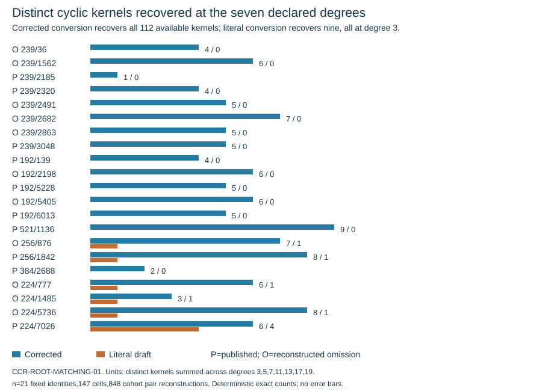
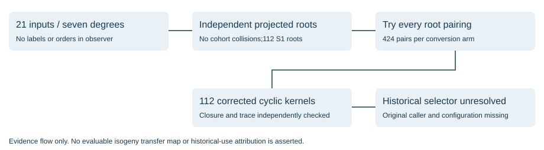

# CCR root matching on all 21 NIST/ANSI curve candidates

2026-10-27. T-5518. Observation report; no formal hypothesis decision. The missing historical selector remains unidentified. The corrected CCR root-pairing reconstruction recovers every one of 112 rational cyclic kernels across all 147 fixed-cohort cells. All eleven reconstructed omissions and all ten publications enter a favorable case at degree seven or higher. None exhibits the projected-coordinate collisions tested here.

## Source-based question and exact scope

The 24-page Charlap-Coley-Robbins draft describes independently finding roots for the half-kernel sum S1 and quotient coefficients Anew,Bnew, trying possible pairings, and validating the reconstructed kernel. Page 6 explicitly advances to the next auxiliary prime if no base-field S1 root exists and uses a non-repeated S1 root. Page 18 tries pairings rather than prescribing rejection after one failed guess. These are auxiliary-prime and root-selection rules; they are not a documented curve-rejection criterion. Morain 1995 printed page 275 corrects the coefficient conversion; his example over F_101 supplies a control. No original 1997 executable is authenticated.

CCR-ROOT-MATCHING-01 freezes degrees 3,5,7,11,13,17,19 and the same21 curve identities, ten publications and eleven reconstructed omissions across six streams. [comparison.csv](comparison.csv) preserves full UIDs, fields, model coefficients, orders, seeds and ordinals; [cells.csv](cells.csv) records every curve/degree result. Cohort SHA-256: `93ac4774b993a994a17d9327df92e0f2b287e66755cd933fdc683015fec1d545`. The native observer receives only index,p,A,B,ell. Known orders and labels enter the independent post-audit only.

Fresh projected polynomials are computed in the full ell-division algebra, not by executing the historical one-time q-series coefficient builder. Independent annihilation identities plus Krylov-rank proofs establish exact minimality. Full degree ell+1 on every cohort projection proves distinct algebraic coordinate values; the rational root sets agree with the corresponding mathematical projection polynomials. Special controls can have fewer distinct values and retain their collisions. The actual historical coefficient tables, root enumeration and stopping policy remain unknown.

## Measured and independently verified outcomes

- Successful native attempt 03 completes147 cohort cells and five controls. There are67 favorable cohort cells and 112 rational S1 values. All 112 have non-repeated source fibers and recover a cyclic kernel with the corrected conversion. Projection-collision cells: zero.
- Each conversion arm tries all 424 cohort root tuples. Corrected conversion yields172 successful division-factor pairings and 112 distinct cyclic kernels; all 112 have coherent quotient coefficients. At degree 3, several Anew/Bnew pairings reconstruct the same degree-one kernel, so pairings are not counted as distinct kernels.
- Literal-draft conversion yields69 factor pairings but only nine distinct cyclic kernels, all at degree 3 where kernel recovery depends on S1 alone. It recovers zero kernels at degrees 5,7,11,13,17,19. Every cohort curve has a favorable case at degree 7 or higher, including all publications. Thus this literal error still does not explain the historical split.
- Including controls: 456 exact projection-minimality proofs,735 independent scalar-coordinate checks,932 pair reconstructions and 249 cyclic-pair Frobenius/trace checks. FLINT independently proves all rational-root sets complete. Integer arithmetic reconstructs division polynomials, both moment conversions, Newton kernels, all remainders and cyclic closure. For a cyclic kernel, Frobenius x-coordinates yield a sign-ambiguous trace set containing the independently known trace; no sign-resolution or full point count is claimed.
- The published-example A/A captures match exactly after normalizing only their observer index. Arithmetic controls include20 packed-versus-naive products, two rejected false certificates, and a deficient-rank annihilator control.

## Controls and the actual non-repeated-root rule

Morain's published example is y^2=x^3+x+1 over F_101 at degree 7, with S1=31,Anew=19,Bnew=26 and kernel x^3+70x^2+47x+10. Corrected recovery reproduces it and rejects incorrect pairings; the literal arm recovers no degree 7 kernel. A favorable degree 19 control on the same curve exercises the entire higher recurrence before cohort calls.

The j0 control y^2=x^3+1 over F_101 has projection degrees[7,7,4] instead of[8,8,8]. Its three rational S1 values have division-fiber degrees[6,3,3]. The first value combines two subgroup fibers and lacks a recovered cyclic degree 7 kernel. The source's non-repeated-root rule excludes that value; the other two recover valid kernels. This is a detectable coordinate complication, not a claim that the documented algorithm rejects this control curve. The j1728 control y^2=x^3+x has degrees[8,4,8] and no rational roots at degree 7. Neither special control belongs to the cohort.

All three control orders were directly enumerated:105,102,100, traces-3,0,2. Local LMFDB av_fq classes 1.101.d,1.101.a,1.101.ac respectively have matching trace polynomials1+3T+101T^2,1+101T^2,1-2T+101T^2. These are isogeny-class consistency checks, not individual-model identifications. Source postgresql://devmirror.lmfdb.xyz:5432/lmfdb/public.av_fq_isog; extraction ended 2026-10-19T16:45:49.243703+00:00. All four selected-index manifests were complete before querying. CONTROL-COUNTS.json retains exact models, labels and provenance. No challenge-curve catalog crosswalk is claimed.

## Retained failures and diagnostic resource data

Attempt 01 passes the published-example gate but its fixed32-case generic collision search finds no required collision. It stops before any cohort call. Attempt 02 changes that control to explicit special-j curves, then starts all 147 cohort cells: 101 finish and 46 remain partial because GP factorial() returns a real value. The process exits 0 and prints its final marker despite those internal errors; both stderr and per-cell completion framing are therefore required. Attempt 03 uses exact integer factorials, adds the favorable maximum-degree control, and completes all 147 cells without those errors. Every previous capture remains retained. A static pre-run amendment corrected GP's second-derivative syntax before any observer call. The earlier API calibration evaluated only a small noncohort example; its full stream was not retained locally and it is not counted as a frozen cohort trial.

There are three recorded external GP observer invocations. Across retained attempts,294 cohort cells start,248 complete and 46 remain partial; these are case counts, not process counts. Attempt 03 wall time4.730161s,user CPU 4.643442s,system CPU 0.022960s are measured diagnostics on modern macOS ARM64 under uncontrolled load, not performance comparisons or historical timing. Initial independent audit wall time80.286795s is also diagnostic; verifier CPU time was not captured. Operational errors do not count as curve rejections.

## Evidence, replay and remaining limits

The raw export seals65 files; archive bytes18,671,614, SHA-256`4f4c4478b4967089685dd626625451afce409d508c749e435cbdb970be32ea03`. After extraction, run `python3 -B evidence/verify.py` with python-flint 0.9.0. Replay checks manifests, all three attempt receipts/framing, the complete final arithmetic audit, and the full fixed-cohort bindings. It invokes no external scientific producer or network; FLINT arithmetic runs in process. The full replay passed after archive extraction into a different directory. Publisher PDFs/images and interpreter/FLINT binaries remain outside the export; exact source URLs and digests are retained.

This reconstruction excludes no cohort candidate under the documented non-repeated-root and pairing predicates at the seven tested degrees. It supplies no transfer, endomorphism exclusion or historical selector. It does not execute the original q-series builder, historical root ordering, all larger degrees, full eigenvalue sign recovery, CRT/resource policies or candidate visitation. Existing canonical/Atkin, FreeLIP, SEA and ECPP graphs retain their separate sealed scopes; this report adds separate figures and changes no official hypothesis status.

Primary sources: [CCR draft](https://www.lix.polytechnique.fr/Labo/Francois.Morain/Introuvables/Drafts/ccr.pdf), pages 6,8-9,18; [Morain 1995](https://jtnb.centre-mersenne.org/item/10.5802/jtnb.143.pdf), printed 274-275. CCR is cited as1991/1992, while recovered scan metadata is2018; exact draft version is unestablished. The printed correction is dated1995. Source behavior is distinct from proven original-program use.

Canonical object-store delivery stopped at HeadObject403. Exact archive bytes were pushed in Git under the existing large-file-ok PR exception; no remote store success is claimed. Inherited immutable A/A record collisions still prevent a clean merge-readiness claim. The scientific goal remains open.
