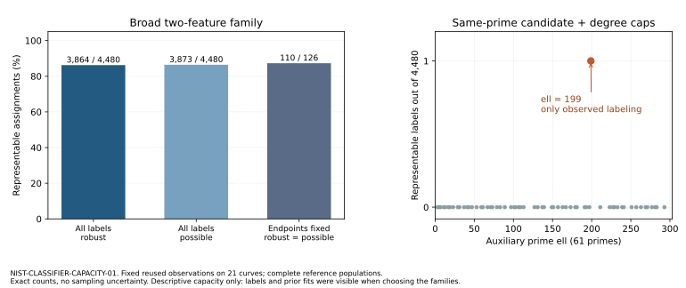

# Exact selector capacity and period source recovery

2026-10-27. Observation report for NIST-CLASSIFIER-CAPACITY-01, Conductor T-5518. This presents recorded data and a documentary comparison; no formal goal or hypothesis status is promoted. The actual historical selector remains unresolved.

The ell-199 rule from the parent study retains all 10 publications and excludes all 11 reconstructed omissions across all six streams. Its narrow family is more selective than the broad two-feature search on the fixed reference populations below. These fractions are **descriptive capacity, not p-values or probabilities of historical choices**.

| Frozen model family | Field publication counts fixed | Final stream endpoints also fixed |
|---|---:|---:|
| All signature pairs, robust to unknowns | 3,864 / 4,480 | 110 / 126 |
| All signature pairs, possible unknown completions | 3,873 / 4,480 | 110 / 126 |
| Same-prime candidate-count cap AND minimum-factor-degree cap | 1 / 4,480 | 1 / 126 |

The narrow family's one represented labeling is the actual publication assignment, and only ell=199 represents it. Every other tested prime has zero represented labels preserving the field publication counts. The 1,777 cap models and all 61 prime summaries are retained, not just the matching model. In the observed-value cap grid, the matching representative is C=20, D=1980. Any real/integer cap in the already identified intervals C from 20 through 59 and D from 1980 through 2199 has the same classification on this cohort. Caps 32/2048 remain posthoc representatives, not uniquely identified constants.

## Fixed inputs and interpretation

Reuse the identical 21 curve observations, 2,551 complemented signature patterns and 61 known-degree candidate/minimum-factor point sets from the signed-Frobenius parent archive. No new curves, torsion measurements, division-polynomial factorizations or point counts were run. INPUTS.json binds all original p, a, b, n, stream/ordinal, UID and source hashes. Imported row-byte SHA is e8d6a874e3dc77970c88957f4bca075a0cc7a431dd8bcb25e5c5d7bcba6eeb0f. Singleton P-384/P-521 observations with unknown features stay unknown. Curve names, seeds, timestamps and UIDs are not classifier features.

The reference population keeps the number of publications in each exact field: choose(8,3) * choose(5,3) * choose(2,1) * choose(4,1) = 4,480. The singleton publications are fixed. Conditioning additionally on every final stream endpoint gives choose(7,2) * choose(4,2) = 126. This second reference fixes all P-224/P-256 labels and varies only the early 192/239-bit positions. It respects the truncated cohort, but cannot calibrate the fixed P-224/P-256 choices separately.

The full family includes all 3,252,525 unordered signature pairs and all 16 Boolean truth functions, including old-old and degenerate functions: 52,040,400 cases. Robust means every allowed unknown completion fits; possible allows per-row completions, which need not be jointly realizable arithmetic facts. The narrow family enumerates each of 61 primes, with both caps drawn from that prime's observed values. This grid represents all distinct predictions of the two lower-threshold conjunctions on this cohort.

All original labels, source observations and prior fits were already visible before this design. The model families were chosen in that context. The calibration protocol and code were frozen before this coverage calculation; that does not retroactively preregister the parent search. These are alternative labels on the same curves, not new historical decisions, held-out test data, independent samples or an exchangeability model. Unique representability in a selected family does not identify its use in 1997.

## Methods, controls and complete outcomes

The enumerator constructs all truth-table output masks and explicit cap-grid predictions. A second algorithm enumerates all 2^21 bit masks to verify population completeness; checks every positive witness rowwise; scans all pairs using forced-bin compatibility for missing fits; and independently tests each cap fit with the smallest rectangle containing required positives. Both modes share one native binary, parser and embedded fixtures. This is algorithmic cross-checking, not an independent reviewer or a new cohort.

All 4,480 coverage rows and all 61 per-prime cap bits match. The verifier makes 2,003,555,400 pair-compatibility checks for 616 robust-noncovered labelings; 607 also have no possible fit. The remaining nine have possible but no robust fits. Actual-label counts reproduce 16 robust/possible pairs and 19 robust/possible truth functions. Four-bin exhaustive coverage, XOR, identical-row/opposite-label collision, unknown handling and A/A repeat controls pass before cohort input in both modes. There is no sampled subset or result-direction stopping.

| Flow | Count |
|---|---:|
| Planned | 2 |
| Attempted | 2 |
| Completed | 2 |
| Failed / timed out | 0 / 0 |
| Excluded / interrupted / resumed | 0 / 0 / 0 |

Each arm is N=1 complete reference-population evaluation; 4,480 labels and 61 primes are internal exhaustive units. Apple clang 17, C++17, -O3, one thread, shared macOS arm64. Enumeration used 0.339 diagnostic wall seconds (0.058631 user, 0.002739 system); verification used 4.739 diagnostic wall seconds (4.544776 user, 0.022447 system). Counted endpoints are exact, without sampling uncertainty; clocks have wall_valid=false and support no performance comparison. Embedded A/A repeats exact predictions; no timing interval is inferred. Watchdogs 600/1800 seconds were not reached; there were no measurement retries. Draft schema validation findings were corrected before freezing and before coverage execution.

## Period sources and a concrete counterexample

The new [source review](SOURCE-REVIEW.md) records primary URLs, exact hashes, page numbers, retrieval failures and what was actually read. Dewaghe's Lille thesis defended December 12, 1996 contains the resultant sign formulas on printed pages 31, 32 and 38. This closes the previous gap between a period bibliography pointer and actual pre-1997 mathematical text. It does not establish implementation by the original selector or identify the exact revisions in the 1998 journal article.

Proposition 28 requires odd projective order e for its Atkin resultant shortcut. Existing ell-199 values supply counterexamples to an acceptance rule requiring that shortcut: published P-224 has e=20, while omitted P-224 positions 1485 and 5736 have e=25. The period conjugate kernel factor has degree e*(ell-1)/2 and need not be irreducible. Published 239-bit curves with e=40 therefore construct degree 3960, although their minimum irreducible degree is 440. A 2048 cap on that intermediate is different from the exact observed rule.

Müller's original 1995 dissertation was located in Saarland's university repository, DOI 10.22028/D291-25721. The catalog is accessible; direct PDF retrieval failed and the cached extraction is corrupted by font encoding. Its algorithmic text has not been read, and no claim here relies on it. No copy request or other outgoing human message was sent. The inspected sources establish neither mandatory ell=199 nor caps 32/2048. The parent later-counter replay also stopped all eleven omission curves before 199; it remains a later reconstruction, not an original rejection log.

## Reproduction and custody

Frozen protocol: 548f533365b7e2a9528d8d41ea4fa19c6a6a6dcfeb29374a697e8a72549ad04a. Freeze commit: 6b0655a18f54b823cf9c7157ef777db765034d1e, pushed before the first coverage execution; freeze metadata also names the immediately preceding HEAD. Raw record commit: ec6fd4be59d19b3d5949814d96ae635b19f5607b. Parent signed-action archive SHA: e8c128fc7f78497775b83f2e8e49cbe6b92da9a12b7c6993ef293425619bd388. New archive: 91,413 bytes, 31 sealed files, SHA fd066dd45628fb85847be9078ae132fcfca1613df2569b953c4cac893f8d1392. The manifest and archive bytes pass full hash/extra-file checks. Extract/rebuild relocation replay repeated both modes, matching all six result files byte-for-byte and reproducing the exact original binary SHA on this host; it is same-data validation. [PORTABLE-REPLAY.json](PORTABLE-REPLAY.json) retains receipts. The unified export passes check-export --verify-files.

Canonical object-store upload returned HeadObject 403. Exact archive bytes are retained in Git under the current PR's verified large-file-ok exception. Third-party PDFs/text/page images and compiler binaries are excluded. Raw calibration records were committed and pushed before this report. All final PDF pages were visually inspected before publication. Existing canonical attack/frontier graphs were checked: no formal result or measured frontier changes; this study adds classifier-capacity plots and source provenance. The parent report remains an immutable record of its own scope.

Rebuild/replay from the sealed bundle using `python3 verify_archive.py /absolute/new/output-directory` with Apple clang and /opt/homebrew/bin/zstd. This retains original records and writes into a fresh directory. Graph source `make_report.py` reads recorded outputs only: mode `figures` uses matplotlib; mode `pdf` uses ReportLab and embeds the quantitative graph. Public inputs, source and build flags are retained even when a different platform produces different native binary bytes.

## Next discriminating work

Retain the ell-199 two-cap pattern as a specific lead. Recover a dated caller or implementation supplying a reason for the prime, known/unknown splitting-degree mode, the precise two resource quantities and their bounds; compare its actual visitation and stopping sequence across all 21 fixed curve identities. Do not substitute list length for comparison rank or smallest irreducible degree for every intermediate degree. A source mechanism must explain all six streams without posthoc exceptions. The P-224 cube/splitting/twist-torsion lead remains recorded, and the actual historical selector and problem record remain open.
