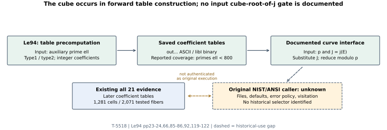
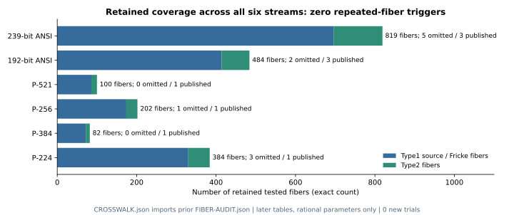

# Recovered 1994 modular-polynomial source and May 1997 LiDIA bundle

27 October 2026 PDT / 28 October UTC. T-5518, GOAL-NISTSEED-ab8949.

**The historical selector remains unresolved.** This source-recovery round obtains Lehmann's actual thesis and an advertised LiDIA 1.3 bundle captured in May 1997. It checks the documented interface against the fixed eleven reconstructed omissions and ten publications across six streams using already completed evidence. There are **zero new scientific trials** and no original NIST/ANSI caller execution.

## Observed primary sources

**Retrieved and read:** Frank J. Lehmann, *Implementierung von Algorithmen zur Berechnung modularer Polynome und deren Anwendung im Algorithmus von Atkin*, title dated **29 July 1994**. The 125-page PostScript is preserved in a **31 July 1997** capture of his university homepage. Its creation header is dated 18 October 1994. The uncompressed author link succeeds where the previously searched FTP gzip location did not. [Exact source](https://web.archive.org/web/19970731071932id_/http://www.cs.uni-sb.de:80/users/mdenny/Bewohner/lehmann/lehmann.diplom.ps), [reading scope and hashes](SOURCE-REVIEW.json), [retrieval receipt](lehmann-thesis-ACCESS.json).

The original is 850,162 bytes, SHA256: 244fc341ec6785f1b779614d155d71205a967359a46e151f1995ed44bc6339c1. Original bytes, converted PDF, extracted text and source-page images remain private under .work/. Six load-bearing pages were visually inspected. The archive capture establishes preservation at that date; it does not establish use by NIST.

**Retrieved and statically inspected:** the advertised 1.3 LiDIA package captured 17 May 1997, 2,343,749 bytes, SHA256: 0189dcbb3daab55cb39f213bf612d025b71aac6bd4ca7a5c09b687f47c98d387. Every one of its 1,461 members is cataloged; all 1,285 regular bodies were scanned and hashed without executing package code. The README says 1.3 while version.h says 1.2.0. [Original capture](https://web.archive.org/web/19970517195215id_/http://www.informatik.th-darmstadt.de:80/TI/LiDIA/linktop/LiDIA.tgz), [static inventory](PACKAGE-INSPECTION.json), [version qualification](PACKAGE-VERSION-NOTE.json).

The 5 February 1997 announcement still lists prime-field point counting as work in progress. The 2 February 2000 announcement explicitly places its SEA package outside the free distribution, although it uses LiDIA. This explains why a general release tarball can lack the counter. [1997 announcement](https://math.albany.edu/g/Math/Comp/cas/LiDIA-feb97), [2000 announcement](https://math.albany.edu/g/Math/Comp/cas/LiDIA-feb2000).

## The j-cube question

**Source observation:** Le94 pp 23-24,57-62 describe evaluating integer-coefficient modular polynomials at J=j(E), reducing modulo p, and using splitting types. The type 1 construction uses a Weber identity, with w=f2^24:

    j = (w+16)^3 / w.

That is a forward identity for constructing formal q-series and integer coefficient tables. It does not require extracting a cube root of the input j(E). Type 2 Hecke-index restrictions on p 92 involve auxiliary ell and a separate chosen index; they do not depend on the target curve's field, j or conductor.

**Derived implication:** these documented paths do not supply the proposed cube-root-of-j acceptance gate. This leaves the observed P-224 cube/splitting pattern intact as a separate lead, without assigning it to this implementation. Different undocumented code paths remain possible.

## Comparison against every fixed curve

The [full-identity CSV](cohort-crosswalk.csv) retains p, A=-3, b, n, j, seed, ordinal and complete curve UID for all 21 entries. [source_crosswalk.py](source_crosswalk.py) checks the existing source bindings and each exact identity before summarizing the earlier CM and modular-fiber observations.

**Derived from retained observations:** all 21 satisfy p>3, ordinary/generic-j conditions; none belongs to a tested ordinary base-field isogeny class containing j=0 or 1728. The earlier fiber record covers 61 levels 3..293,1,281 curve/level cells,1,185 rational parameters and 2,071 fibers:1,772 type 1 source/Fricke and 299 type 2. No tested fiber has a nonconstant derivative gcd. An existing level 53 positive control over F1009, parameter 98, does trigger a repeated type 2 fiber.

| Stream | Published | Omitted | Retained type 2 fibers | Repeated-fiber triggers |
| --- | ---: | ---: | ---: | ---: |
| 239-bit ANSI | 3 | 5 | 123 | 0 |
| 192-bit ANSI | 3 | 2 | 70 | 0 |
| P-521 | 1 | 0 | 14 | 0 |
| P-256 | 1 | 1 | 28 | 0 |
| P-384 | 1 | 0 | 10 | 0 |
| P-224 | 1 | 3 | 54 | 0 |
| Total | 10 | 11 | 299 | 0 |

These are exact counts of retained observations, without a statistical uncertainty model. They use later LiDIA tables and rational parameter roots. They are **not** a certificate for all extension-field fibers, every theorem in Le94, or every original coefficient table. No new full-poly squarefreeness assertion is inferred from the thesis prose. [Crosswalk and input digests](CROSSWALK.json), [prior Ma94 crosswalk](../implementation-sources-01/report.md).

## What the table-generation workflow adds

**Source observations:** pp 85-86 and 119 describe CRT coefficient reconstruction with a heuristic stop after two unchanged iterations; pp 120-121 give ASCII out... files, libI binary conversion via atobin and reverse conversion via bintoa. The thesis reports a precomputed equivalent polynomial for every prime ell<800. Named routines now include examine_l, lmod_equ, lcompute_ark and lcompute_ars.

**Derived implications:** a blanket claim that 199 was the authors' inherent precomputation ceiling is inconsistent with the reported broader coverage. Which files reached a specific later generator remains unknown. A heuristic table stop and a binary conversion are concrete provenance dependencies to investigate, but neither demonstrates an erroneous table, a rejection, or a classifier of the eleven omissions.

The package scan finds no Ma94 buildLlist, choose_relations, compute_klist, verify_order or simple_verify; neither eco, eco_prime, eco_gfp, Elkies nor Atkin appears as a whole token. Positive scanner controls find Fp_polynomial in 70 regular files and power_mod in 21. Generic polynomial code contains compute_degree/prob_compute_degree/find_root; ECM factorization code also exists. This is a scoped absence of named point-counter routines in these exact package bytes, not an assertion that the package contains no elliptic arithmetic.

## Reproducibility, limits and next discriminating work

- **Passed:** static inspection against the hash-pinned private package; all 21 retained-evidence crosswalk; public archive verification; fresh-directory extracted metadata replay; Python syntax and JSON parsing. The first recovery helper emits a harmless Python invalid-escape warning; its original bytes and the unsuccessful GET outcomes are retained.
- **Public custody:** raw commit 6501d989d0 precedes this report. BUNDLE.json seals 36 metadata files in a 47,370-byte archive, SHA256: d389d0276d82213cc452232e96119ec092f18822381c0c2596788e8297c03f8b. A separate 63,194-byte compressed regular-file hash catalog is bound as an external component. No third-party source bodies are in Git or the public archive. No canonical object-store upload is claimed for this round.
- **Remaining evidence:** original MEQ output tables and conversion code; original eco bodies and numerical defaults; the NIST/Reiter/ANSI caller and invocation; error/timeout policy and candidate-decision logs. Any recovered mechanism must be frozen before an untuned comparison of all 11 omissions and 10 publications. A perfect retrospective fit alone remains insufficient for historical attribution.
- **Next source work:** follow the newly documented examine_l/lmod_equ/lcompute_ark/lcompute_ars and out.../atobin/bintoa artifacts, then compare authenticated original tables with the later tables. Separately preserve the j/endomorphism/transfer workstream; these sources establish no new general exclusion or transfer advantage.
- **Publication limits:** the current main comparison still reports 11 merge conflicts and five inherited immutable A/A identifier collisions. MERGE-HYGIENE.json retains exact refs and diagnostics. Those records were not overwritten. Scientific completeness and merge readiness remain separate.

To verify the public archive and compressed catalogs, run python3 -B verify_bundle.py. With prior studies available at their bound paths, run python3 -B source_crosswalk.py --check. Replaying the original package scan additionally requires the exact private tarball and package-members.csv. Original historical programs were not run.

The earlier source-chain and fiber diagrams retain their sealed historical scope. The parent index is updated to this new source boundary and chart; no canonical isogeny/endomorphism edge or formal scientific status changes. The overall goal stays active, and the historical selection problem stays open.
