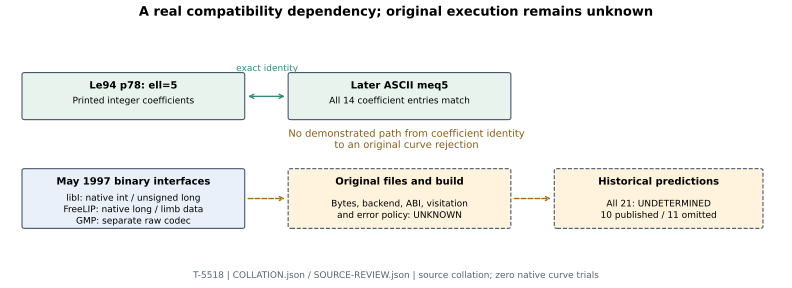

# Original table witness and historical binary I/O

28 October 2026 UTC. T-5518 / GOAL-NISTSEED-ab8949.

**Historical selector unresolved.** This source-only continuation verifies one printed 1994 coefficient table, recovers the binary interfaces in the May 1997 package, and checks a previously located history snapshot. It does not execute the original point counter or define a new curve-selection criterion. All eleven reconstructed omissions and ten publications remain in scope; there are zero new scientific trials.

## A dated coefficient witness

**Retrieved and visually checked:** Le94 printed p78 (PDF p79) gives the complete integer polynomial for ell=5:

    G5(X,J) = (X^2+10X+5)^3 - J*X
            = X^6+30X^5+315X^4+1300X^3+1575X^2+(750-J)X+125.

All seven coefficient rows, including the negative J coefficient, agree exactly with the later meq5 file. The printed modulo 101 table also agrees with reduction of the integer coefficients. A separate convolution reconstructs the cubic polynomial identity. This authenticates one mathematical coefficient identity, not original file bytes or NIST use. [Le94 original](https://web.archive.org/web/19970731071932id_/http://www.cs.uni-sb.de:80/users/mdenny/Bewohner/lehmann/lehmann.diplom.ps), [collation record](COLLATION.json).

The intermediate boxed a_0,0=43 on that page conflicts with its final a_0,0=24 modulo 101. The surrounding calculation computes a_1,0=43, and both final tables are consistent. This is a printed index inconsistency; no original program defect is inferred.

## A source-based compatibility requirement

**Retrieved and read:** the hash-pinned May 1997 LiDIA bundle contains these interfaces:

| Backend | Binary writer/reader found in the exact package | Consequence established by source |
| --- | --- | --- |
| libI | Three native int fields, then length native unsigned-long digits | Widths, endianness and representation affect the file format |
| FreeLIP | zbfwrite/zbfread store native long words, including signed digit count | Machine word and limb representation matter |
| GMP | mpz_out_raw/mpz_inp_raw | Separate codec; not the libI structure dump |

The libI wrapper checks feof before reading but does not check fread return counts. FreeLIP's lower-level reader checks read failures, while its void LiDIA wrapper discards that return value. The GMP source header records a swap of binary/text API bodies on 9 January 1997; that is a dated comment, not recovered pre-change executable code. [Exact source member hashes](OLD-IO-SOURCES.json), [reading notes and line references](SOURCE-REVIEW.json), [1997 package](https://web.archive.org/web/19970517195215id_/http://www.informatik.th-darmstadt.de:80/TI/LiDIA/linktop/LiDIA.tgz).

**Derived:** a shared C++ method name does not define a universal binary interchange format. The original tables, chosen backend, ABI and reader error policy are concrete dependencies to establish. These routines receive coefficient values and file handles; an omission-specific effect still requires actual level visitation and caller behavior.

The later meq_prime reader prefers ASCII before binary or compressed variants and dispatches binary rows through its bigint backend. Its modulus-taking row reader handles the compressed formats used by polynomial construction. This is later 2.3.0 lineage, not authenticated 1997 source. The private canonical copy matches Git blob 01bec36819fde2ea247872e6add0ed578fe3bdbb exactly; the initial extra-newline copy remains retained. [Later reader](https://github.com/passagemath/upstream-LiDIA/blob/23dac491f4cd96eb7de648a5cf90eb9ec77653c8/src/ec_order/eco_gfp/eco_gfp/meq_prime.cc), [exact binding](LATER-READER-SOURCE.json).

## Complete cohort accounting

The [21-curve gap crosswalk](cohort-gap-crosswalk.csv) preserves every p,b,n,j,seed,ordinal and full UID, checks each against the frozen prior rows, and verifies the imported CSV against its original archive seal. For each of the ten publications and eleven omissions, the historical table bytes, backend/ABI, visitation and error policy remain UNKNOWN, so the historical I/O prediction is UNDETERMINED. These entries are not rejected, accepted or failed native trials.

No new mathematical property screen, conductor value, endomorphism, transfer map or historical predicate is inferred. The existing P-224 cube/splitting observation and ell199 retrospective separator retain their earlier claim boundaries.

## Source-availability observations

The 1999 February/October and August 2000 project-page captures explicitly describe the counting package as outside the free distribution. They offer no direct original table download in the inspected links. One filtered Saarland archive query is empty; three prefix queries time out. Those outcomes are retained and do not establish that no copy survives. [Page receipts](period-sites-ACCESS.json), [archive-query receipts](named-table-indexes-ACCESS.json).

The previously located Software Heritage LiDIA-history snapshot 1a8893e6a86f444e8be8e7bda6cb34fb1735a00e returns branches={} and next_branch=null. Its earlier full-visit metadata does not imply preserved source branches. The GitHub repository metadata also advertises size 0. This closes that specific source lead, not all historical CVS/SVN archives. [Snapshot response](https://archive.softwareheritage.org/api/1/snapshot/1a8893e6a86f444e8be8e7bda6cb34fb1735a00e/?branches_count=100), [review](HISTORY-REVIEW.json).

## Verification and continuation

The coefficient collation, all 21 identity bindings, original CSV seal and public archive verification pass. Fresh-directory metadata replay checks all 16 sealed members and the coefficient identities without a native program or network. This is source collation, not a scientific execution export. Raw commit dda4dd955f precedes this report.

The archive is 16,808 bytes, SHA256: c4669307afed8544ffcdb6c715a7b3800fda72f9afea48e714eaca5cb11e3c1f. Original source, HTML, package, PDF and page-image bodies remain private and excluded. An initial archival expected-file-count assertion stopped before committing; the inspected 22-file set was then committed. No scientific run or evidence row changed.

Replay the public seal with python3 -B verify_bundle.py. The local collation check is python3 -B inspect_artifacts.py --check and additionally needs the bound prior studies and later meq5 mirror. Original atobin/bintoa bodies, table files, backend/ABI, caller, defaults and logs remain required for a predictive I/O mechanism. A new native test requires a frozen source-bound protocol; arbitrary corruptions must not be selected to fit the labels.

The next historical acquisition target is an actual standalone ECO source/table distribution or original NIST/Reiter caller, rather than the empty history snapshot. General j/endomorphism/transfer criteria remain open. The overall goal stays active. Prior canonical diagrams preserve their sealed scope; this new diagram records the added coefficient identity and unresolved binary-file boundary without a new isogeny edge or scientific status change.
