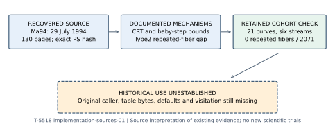
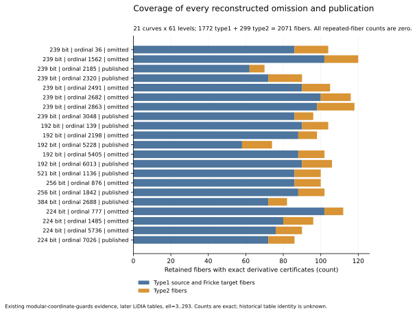

# The 1994 implementation thesis: actual limits and unresolved caller

2026-10-27. T-5518, implementation-sources-01. Source review and a crosswalk to existing evidence; zero new scientific trials. The historical selector remains unresolved. This report changes no formal goal or hypothesis status.

**Retrieved:** Markus Maurer's implementation thesis, with a title-page date of **29 July 1994**, has been recovered from an archived university FTP mirror. This resolves the missing-Ma94 document identified in the preceding Muller1995 review. The thesis describes the actual `eco` program, source-file/function names, relation files, resource controls and optional command-line modes. It does not authenticate the original NIST/ANSI caller or demonstrate a rule rejecting the eleven reconstructed omissions.

## Recovery and custody

The archived [Darmstadt ECC project page](https://web.archive.org/web/20010711230819/http://www.informatik.tu-darmstadt.de/TI/Forschung/ECC.html) lists both Ma94 and Le94 and their exact filenames. A second archived directory index exposes their HTTP FTP-mirror paths. The previously guessed Ma94 filename is now a documentary observation: `maurer.diplom.ps.gz`.

The [actual Ma94 file](https://web.archive.org/web/20060216012606id_/http://www.informatik.tu-darmstadt.de:80/ftp/pub/TI/reports/maurer.diplom.ps.gz) is a 281,859-byte gzip, SHA256 `a 0bfcc09e9d58bfefac531bf9a9037f42b317c36f7e5681f273b283cf6b1b3e3`. Its decompressed PostScript is 908,172 bytes, SHA256 `32a1d6a3b30f94f400ab724728b6291a7b0381f19e9271c34aee6ee3d1b34047`. The PostScript creation header is 17 October 1994; the title page is dated 29 July 1994. The 2006 archive capture is a preservation date, not a proof of the file's custody in 1994. Ghostscript10.08.0 converted the unchanged PostScript with `-dSAFER`; the resulting130-page PDF and text remain private. Printed page = PDF page minus one. Title/date and load-bearing pages were visually inspected. [SOURCE-REVIEW.json](SOURCE-REVIEW.json) retains exact hashes, read scope and conversion details.

Two other actual texts were retrieved and read: [Lehmann, Maurer, Muller and Shoup's author-hosted counting paper](https://shoup.net/papers/counting.pdf), whose first-page footnote attributes ANTS 1994 pp 60-70, and [Buchmann, Muller and Shoup's distributed report](https://publikationen.sulb.uni-saarland.de/handle/20.500.11880/25886), whose cover says 27 April 1995, Report03/95. The author-hosted first PDF has a 2001 conversion date; byte identity to the proceedings edition is unestablished. The second was obtained through the public university download link after a retained CLI403. No certificate warning was bypassed and no copy request was sent.

All public GET outcomes, including failures, are retained in the `*-RECEIPTS.json` files and `LEHMANN-ALLSTATUS.json`. Catalog phrase searches returned two unrelated/full-text hits for Markus Maurer and no result for modularer Polynome; neither proves absence. Exact Le94 CDX requests returned an empty array, including without a status filter. Its contents remain unobtained. Two broad internal-wildcard CDX queries returned general domain records, not a filename-specific result, and are not used as thesis evidence. The100-row report-directory query is bounded and is not a complete directory census. Primary PDFs, PostScript, OCR, HTML bodies and page images stay ignored under `.work/` and are excluded from Git and the public evidence archive.

## What Ma94 actually says

| Printed pages | Retrieved observation | Implication and limit |
|---|---|---|
|39-46,110|Supersingular and base-field-isogenous j=0/1728 cases have shortcut counters using norm representations and random-point elimination.|These return orders; they are not stated curve exclusions. The preceding all 21 independent CM-route study already covers them.|
|59-61|The baby-step table keeps four bytes of an x-coordinate, restores a possible matching point, and compares complete coordinates.|A hash-key collision alone is not a described curve rejection. Duplicate-bucket handling and actual machine-word layout need the C body. No new fingerprint replay is claimed.|
|65-66|Relations are sorted by candidate count and integer reciprocal density. A configurable baby-step bound K_B,max moves moduli to giant steps, with rebalancing.|This is work partitioning. It supplies neither the fitted single-prime candidate cap32 nor a minimum division-factor cap2048. Numerical defaults and complete tie handling remain unknown.|
|83-93|Given a,b supply E4=-a/3 and E6=-b/2; type1/type2 neighbor formulas use modular parameters and derivatives.|No cube root of j is requested in these interfaces. This is source-formula inspection, not execution of original `eco`.|
|89-90|For type1, DJ=0 has a square-root fallback and a division-polynomial divisibility check.|An exceptional derivative need not reject a curve.|
|93|For type2, repeated roots in G_l(A(tau),Y), hence a vanishing DJ_i, leave the neighbor reconstruction unspecified. The text reports no such case observed.|A genuine documented unsupported condition, now crosswalked to the complete retained fiber audit below.|
|94-100|The implementation uses signed, positive-half eigenvalue candidates and a y-only matching heuristic, switching division-polynomial/rational-function methods with memory and list size.|The previous complete-kernel matching study checks this particular ambiguity; it is not a 32-entry cutoff.|
|110-113|A global MAXKOMB is chosen for the CRT combinations; generic processing advances through auxiliary primes. Large Atkin-prime splitting work was omitted in one375-digit example.|No numerical MAXKOMB or mandatory199 test is supplied; an auxiliary-prime skip is not a curve omission.|
|117-118|`-moduls` selects a supplied prime list; `-noadeg` suppresses Atkin splitting-degree work only with that list; `-rsplit` skips a prime lacking its saved split file; `-proof` requests order proof.|These are actual historical interface modes. Original invocation, files, defaults and generator error policy are still required.|
|119-126|Names include buildLlist, compute_klist, eigenvalue, verify_order, simple_verify, choose_relations and binsearch. Relation records store a dynamic cpos pointer and cpos[0] length; helper tools can reorder or remove relations.|Function names and data descriptions are recovered. Function bodies and a dated call chain to the NIST/ANSI generator are not.|

### A literal pseudocode inconsistency

Printed p 111 initializes `KOMB=1` and `PROD=2`, then prints a loop guarded by `PROD <= 4*sqrt(p) AND KOMB > MAXKOMB`. For any positive integer `MAXKOMB>=1`, the second conjunct is false at initialization. **Derived:** a literal transcription visits no odd auxiliary prime for every curve, regardless of its j-invariant or endomorphism ring. This cannot discriminate the cohort. The image was inspected to exclude an OCR error. This is a documentary inconsistency, not evidence that the shipped C program or original generator had this defect. Replacing AND by OR would be a reconstruction choice and must not be silently described as original code.

## Crosswalk against every omission and publication

[CROSSWALK.json](CROSSWALK.json) pins all imported records and hashes; [cohort-crosswalk.csv](cohort-crosswalk.csv) retains all 21 full curve UIDs, fields, equations, orders, seeds, ordinals and per-curve coverage. `build_crosswalk.py --check` reconstructs this table from the existing records and checks identity using p,j and the full p,b,n,UID tuple. Models are y^2=x^3-3x+b. The fixed cohort is 10 publications and 11 reconstructed omissions across six RNG streams; omission does not establish original visitation or a rejection event.

The [earlier complete fiber audit](../../../../nist_seed_modular_coordinate_guards_20261027/report.md) covers 21 curves x61 odd primes3..293,1185 rational modular parameters and 2071 source/target fibers. There are1772 type1 source/Fricke fibers and 299 type2 fibers. All have gcd(G,G_Y)=1 and gcd(G,G_X)=1. Thus Ma94 p 93's repeated-fiber condition is absent on every retained type2 parameter and both its source/target j roots. The old positive control at p 1009, level 53, parameter98 does have nonconstant gcds, so the detector's positive behavior was exercised. Exact Bezout certificates and independent PARI/FLINT root completeness belong to the prior study; they were not regenerated or relabeled as new trials here.

The [prior CM-route comparison](../report.md) independently finds none of the 21 curves in the supersingular or ordinary j=0/1728 base-field isogeny classes. The [prior complete y-match comparison](../../../y-coordinate-matching-20261027/README.md) finds no wrong first y-match in411 valid cyclic kernels, including228 on omissions and 183 on publications; its generic and CM controls distinguish successful and erroneous matching. The411 kernels represent22 levels, not a new execution of all possible kernels. The conditional canonical extension retains its original assumptions.

**Scope boundary:** the fiber coefficients come from the retained later LiDIA table set. The computation rules out this exact unsupported condition on that set through293; it does not authenticate the 1994 coefficient bytes, original root ordering, partial/faulty arithmetic, different prime lists or the 1997 caller. This crosswalk adds a dated source interpretation to completed all 21 evidence; it is not a rerun of `eco`.

## What changes and what remains open

The missing implementation document is now read, rather than merely cited. It provides concrete source names and distinguishes total CRT combinations, baby-step memory, eigenvalue candidate lists and division-factor degrees. These are different quantities. It documents list-based and saved-file modes that make original visitation dependent on caller inputs. It does **not** establish that any such mode was used to omit any of the eleven curves.

The P-224 cube/splitting observation and the exact retrospective ell 199 two-cap separator remain leads with their existing limitations. Ma94 gives neither a cube-root-of-j prerequisite nor the two fitted constants. Its actual type2 repeated-root gap does not occur on the tested later-table cohort. No CM-field, conductor, endomorphism, transfer or cryptographic weakness conclusion follows from these implementation passages.

Next discriminating sources are the C bodies listed on pp 119-121, actual coefficient files and defaults/invocations, the unrecovered Le94 text, and especially the original Reiter/NIST/ANSI generator caller or run log. Any newly recovered condition must be frozen and compared with all 11 omissions and 10 publications without tuning. Original selection remains the goal; the present source round is progress, not completion.

Canonical diagrams checked: parent kernel-recovery/workflow, complete y-matching orbit, signed separator/policies, calibration, and period first-phase diagrams. Their mathematical statements are unchanged. This round adds an archival source chain and retained-coverage view; no isogeny edge or formal scientific status is added.

## Reproduce this source crosswalk

From the repository root, run `python3 <this-directory>/build_crosswalk.py --check`. This reads the hash-pinned existing records and creates no scientific producer. Retrieval scripts refuse to overwrite an existing receipt; repeat recovery in a new attempt directory. `make_visuals.py` draws existing counts only. `make_report.py` creates the accompanying PDF digest. The source manifest distinguishes actual bytes, preservation timestamps, title-page dates and access failures.
