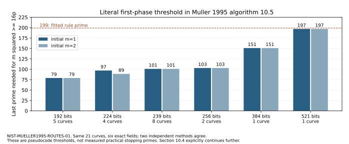

# Muller1995 source routes on the complete NIST/ANSI cohort

2026-10-27. Observation report and primary-source review, NIST-MUELLER1995-ROUTES-01, T-5518. The historical selector remains unresolved. No formal goal/hypothesis status is promoted.

**New source progress:** the original 1995 dissertation is now retrieved and read in the relevant sections. The previous round located its catalog but could not read the actual PDF. The public university link downloads through the in-app browser; the failed CLI/FTP retrievals are preserved separately. This updates availability, not the original selector's implementation provenance.

**New exact result:** neither source special-CM route distinguishes any of the eleven omissions. Both independent calculations find zero special-route cases among all 10 publications and all 11 omissions, including P-384. The generic-j positive controls exercise both isogeny targets successfully. The literal first-phase product threshold never requires 199, but the source explicitly says the practical implementation continues further. It is not a practical stopping-prime reconstruction.

| Source-defined property | Publications, out of 10 | Omissions, out of 11 |
|---|---:|---:|
| Supersingular prime-field curve | 0 | 0 |
| Ordinary base-field isogeny class containing j=0 | 0 | 0 |
| Ordinary base-field isogeny class containing j=1728 | 0 | 0 |

These are fast counting routes in the thesis, not source-documented curve rejections. The scope is these two specific special CM target classes. Other CM fields, general endomorphism conditions, transfers over extensions, and a different implementation remain outside this check.

## What was actually read

Volker Muller, *Ein Algorithmus zur Bestimmung der Punktanzahl elliptischer Kurven uber endlichen Korpern der Charakteristik grosser drei*, Saarland 1995, oral examination May 18, 1995. [University record](https://publikationen.sulb.uni-saarland.de/handle/20.500.11880/25777), DOI [10.22028/D291-25721](https://doi.org/10.22028/D291-25721). Actual institutional PDF: 1,850,913 bytes, 170 pages, SHA-256 d74d935009796e32237ffce2b4be1211c112f0e151fd407b074fffecdbeab8cc. Provenance retrieved, verified by Codex T-5518 on 2026-10-27.

Read introduction, section 4.6, sections 7.1-7.4, chapters 9-11; OCR is only a navigation aid because font encoding breaks text extraction. The examination date, algorithms 9.5/10.5, method-switch discussion on printed p122 and practical continuation on p149-150 were visually inspected. [SOURCE-REVIEW.md](SOURCE-REVIEW.md) maps exact printed/PDF pages to claims, including formula inspection of 7.3/7.6 and the difference between algorithm 11.2 and a curve exclusion. Third-party PDF/OCR/page images stay private and are excluded from public Git/archive bytes. No security warning was bypassed; no outgoing copy request was sent.

## Exact CM and isogeny conditions

The unchanged cohort has certified p,n and models y^2=x^3-3x+b. Put t=p+1-n and K=4p-t^2. For ordinary prime-field classes, isogeny to a curve with j=0 is equivalent to K=3v^2; isogeny to one with j=1728 is equivalent to K=4v^2. Supersingular cases have t=0 here. This square-class calculation requires no complete factorization or exact endomorphism conductor, including for P-384. It tests a CM field, not divisibility by 3 or a conductor equal to 3.

The independent norm calculation follows the source's unit-multiple description. For p=a^2+3b^2 it tests traces +/-2a, +/-(a+3b), +/-(a-3b). For p=a^2+b^2 it tests +/-2a, +/-2b. PARI qfbsolve produces norm representations independently of the Python discriminant test. Both compare the entire 21-row vectors, including exact p,n,trace,K,flags and both product thresholds. No label, seed, timestamp or UID enters arithmetic; all are retained for binding only. [cohort.csv](cohort.csv) contains all 21 full identities and results.

Because each certified cohort group order n is prime, every nonzero point has order n. Special-CM candidate orders lie in the Hasse interval, whose width is smaller than n for these inputs. A different candidate cannot annihilate a nonzero point. Thus, conditional on the existing certified p,n and valid affine point generation, the negative class results also preclude a wrong special order being accepted by the source's random-point test. This is a group-theoretic deduction, not a new point-generator or full-counter execution.

## Controls and local catalog provenance

Both arms independently count these explicit models before reading cohort rows:

| Control equation | p | n | j | Observed route in both methods | Local class |
|---|---:|---:|---:|---|---|
| y^2=x^3+3x+1 | 7 | 12 | 2 | ordinary, isogenous to j=0 | 1.7.e |
| y^2=x^3+4x+1 | 5 | 8 | 1 | ordinary, isogenous to j=1728 | 1.5.c |
| y^2=x^3+x | 7 | 8 | 1728 mod7 | supersingular | 1.7.a |
| y^2=x^3+x+1 | 5 | 9 | 2 | ordinary, neither special class | 1.5.d |

The first two are generic-j models deliberately chosen to test isogeny rather than just checking their own j-invariant. Python enumerates x,y; GP counts using quadratic characters. Singular/wrong-order guards and A/A repeated flags pass. All four local index manifests were complete before lookup. LMFDB source public.av_fq_isog, extraction ended 2026-10-19T16:45:49.243703+00:00; q, Weil polynomial, p-rank and supersingularity bind each control class. Classes are not individual models. The selected-column indexes lack the cryptographic fields; no catalog identity crosswalk is made. Exact lookup response is LMFDB-CONTROLS.json.

## Literal source threshold and its limit

Algorithm 10.5 multiplies ascending odd auxiliary primes until m>=4sqrt(p). Both methods use the exact integer comparison m^2>=16p. The two initializations retain the ambiguity of pseudocode initialization and the separately mentioned parity information:

| Exact field bits | Curves | Last prime, initial m=1 | Last prime, initial m=2 |
|---|---:|---:|---:|
| 192 | 5 | 79 | 79 |
| 224 | 4 | 97 | 89 |
| 239 | 8 | 101 | 101 |
| 256 | 2 | 103 | 103 |
| 384 | 1 | 151 | 151 |
| 521 | 1 | 197 | 197 |

These are first-phase threshold calculations on imported fields, not new curve point counts, actual original visitation or an upper bound on practical visitation. Section 10.4 explicitly says to compute further auxiliary-prime information to make the remaining possibilities manageable, and does not specify a fixed numerical continuation threshold. It also describes omitting exact splitting-degree work at large auxiliary primes, giving ell>=500 as an example, and moving to another auxiliary prime when Atkin information is unhelpful. These are source auxiliary-work policies, not curve exclusions.

Section 7.4 switches from division polynomials to rational functions when the list is small or memory is tight. It supplies no 32-candidate acceptance bound. The minimum-factor variants appear among trial ideas not used in the reported implementation. Algorithms 7.3/7.6 do not request a cube root of j; they use supplied coefficients and modular parameters/derivatives. These documentary facts constrain this particular reported implementation without dating every later implementation or authenticating the original caller.

## Complete execution, export and custody

Protocol frozen at cd2379a448786ee1ae4bda011eac0ab967a6b610, pushed before cohort evaluation; protocol SHA-256 e3f1c92cd312df6e21fe9eefde92438f184382ea93d44d75887748077ae13b52. Raw commit 84497e44870eb82f0c4d5563b3cf5321b75bbe06. One complete 21-row evaluation per arm, N=1. Planned 2, attempted 2, completed 2, failed 0, timed-out 0, excluded 0, interrupted 0, resumed 0. Python integer/isqrt+sieve versus independent GP norm forms+nextprime. No new point count on the21 cohort curves, native historical executable or held-out cohort is claimed.

Shared macOS arm64, one thread. Diagnostic wall seconds: discriminant 0.038837 (user 0.021214, system 0.009138), norm 0.038662 (user 0.011645, system 0.007197). Exact counted rows have no sampling uncertainty. Clocks have wall_valid=false; no performance comparison follows. Watchdogs 180 seconds/arm were not reached and no scientific attempt was retried. A pre-freeze input-preparation path error was corrected before any cohort evaluation.

The unified export passes file verification. Both arms replay after decompression into a different directory; RESULT.json,all 21CSV and both raw output vectors are byte-identical. [POR| 192 | 5 | 79 | 79 |
| 224 | 4 | 97 | 89 |
| 239 | 8 | 101 | 101 |
| 256 | 2 | 103 | 103 |
| 384 | 1 | 151 | 151 |
| 521 | 1 | 197 | 197 |-REPLAY.json](POR| 192 | 5 | 79 | 79 |
| 224 | 4 | 97 | 89 |
| 239 | 8 | 101 | 101 |
| 256 | 2 | 103 | 103 |
| 384 | 1 | 151 | 151 |
| 521 | 1 | 197 | 197 |-REPLAY.json) retains validation. Archive 21,642 bytes, 23 sealed files, SHA-256 66afd594f61224ee61937a663d044f7c7fb9684a8dd6b086c539e8515cd91ca9. Full manifest and extra-file checks pass. Canonical HeadObject403 refusal is retained; exact bytes are in Git under verified large-file-ok. Raw records were committed/pushed before this report. Source PDF/text/images and runtime binaries remain excluded.

The editable quantitative graph is generated from recorded thresholds by make_report.py; the PDF embeds it. Every final PDF page was visually inspected before publication. Canonical attack/frontier graphs were checked: no formal status, transfer cost or measured frontier changes. This report adds a period source map and route/threshold observations.

## Next implementation-specific evidence

The actual thesis now points more precisely to Markus Maurer's 1994 Diplomarbeit and Frank Lehmann's 1994 Diplomarbeit for practical implementation, list handling, modular-polynomial construction and stopping details. Their contents have not yet been obtained or used. These and the original NIST/Reiter caller are the next source targets. The ell-199 cap pair remains a retained retrospective lead; this source audit supplies no historical acceptance rule. The selector problem and overall goal remain open.
