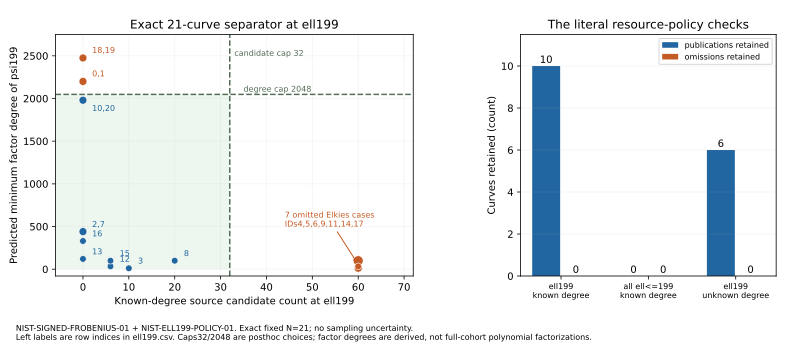
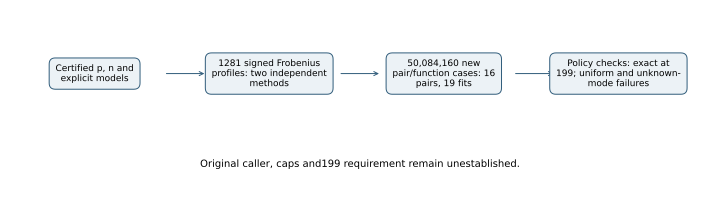

# Signed Frobenius: an exact two-rule separator and its source limits

2026-10-27. Observation report; historical selector remains unresolved. This round adds exact evidence and changes no formal goal/hypothesis status.

**Observed:** a two-predicate separator at auxiliary prime 199 retains all 10 publications and excludes all 11 reconstructed omissions across all six streams. It uses a source-derived eigenvalue candidate-list size and the minimum irreducible-factor degree predicted for the 199-division polynomial. The caps32/2048 are posthoc representatives of a range, not recovered historical constants.

Let C199 be the maximum positive-half candidate-list length across the two stable eigenlines, assuming the projective splitting degree is known. C199=0 on the nonsplit branch because that source eigenvalue list is skipped. Let D199 be the smallest predicted irreducible factor degree of psi199. The observed classifier accepts exactly when **C199<=32 and D199<=2048**.

| Cohort subset at 199 | Count | Candidate-list size | Minimum psi199 factor degree |
|---|---:|---|---|
| Published Elkies cases |4|at most 20|below 2048|
| Published Atkin cases |6|0, list skipped|at most 1980|
| Omitted Elkies cases |7|60|below 2048|
| Omitted Atkin cases |4|0, list skipped|2200 or 2475|

Any candidate cap from 20 through 59 and degree cap from 1980 through 2199 gives the same fixed-cohort classification. The power-of-two pair32/2048 is therefore not uniquely identified. All exact models/seeds/UIDs are in prior-rows.json; [ell199.csv](ell199.csv) contains every199 observation and acceptance bit. Omissions are reconstructed positions, not documented original rejection events.



## Complete search and controls

Both independent arithmetic implementations agree on all 1281 cells: 21 curves x61 odd primes 3 through 293. The native method uses2x2 matrix orders and fixed-point divisor inversion. The independent GP method uses eigenvalue orders and separate split/nonsplit/scalar/Jordan cycle formulas. Exactly three cells need direct scalarity tests beyond trace/determinant: two239-bit cells at 5 and publishedP-224 at 3. The native affine quotient and independent formal division-polynomial derivative maps agree. Differentiate before reduction.

The conjugacy counts are 673 nonsplit, 574 split, 33 Jordan and 1 scalar. The scalar cell is publishedP-224 at 3: Frobenius=-I, with full order 2, order modulo global sign 1, projective order 1. Its quadratic twist consequently has full rational 3-torsion. The three omittedP-224 curves have non-scalar Jordan action at 3. This gives a concrete torsion meaning of the earlier cube/splitting pattern on this cohort; no universal j-cube equivalence or historical requirement follows.

Controls distinguish +I,-I, Jordan and nonsplit actions. Native independently counts the small models and factors their division polynomials; GP independently counts the controls and computes the corresponding orders. Expected(full, x, projective) orders are(1,1,1),(2,1,1),(3,3,3),(48,24,8). A/A, singular and wrong-order controls pass. Local LMFDB classes1.7.b, 1.7.ab, 1.7.e, 1.5.d are provenance for classes only, not exact models. Sourcepublic.av_fq_isog extraction ended2026-10-19T16: 45: 49.243703+00: 00; explicit control equations, fields and counts are in arithmetic.py and LMFDB-controls.json. The indexes do not cover the cryptographic fields.

The new 1313 columns generate 6680 Boolean atoms. With the prior 1913 atoms there are 2551 distinct complemented observation signatures, 2056 new to this round. The search evaluates only pairs involving a new-only signature: 3,130,260 pairs and 50,084,160 truth tables. Old-old pairs reuse the previous complete zero-fit census. Bitset and rowwise enumeration agree on all 16 fitting signature pairs, 19 complete truth tables and every collision witness. New single-signature fits: zero. All fits and every alias are retained unranked in [ALL-FITS.json](ALL-FITS.json); no other fit is silently discarded. There are 3,130,244 nonfit pair witnesses and 16 fit markers. Duplicate truth-table possibilities sometimes differ only on bins absent from this cohort.

All source observations and labels were already visible. The generation rules/code were frozen before new arithmetic and pair fitting; this is exploratory exact computation, not a p-value or held-out historical prediction. The source comparison counts are positive-half candidate-list metrics, not field-operation costs or wall time. Factor-degree multisets are derived from the independently checked linear action, not 1281 newly factored division polynomials.

## Test of the resource-policy explanation

The separate follow-up was frozen after seeing the new exact-fit results. It fixes caps32/2048 and tests the domain/mode alternatives without retuning:

| Policy | Publications retained | Omissions retained |
|---|---:|---:|
| At 199; splitting degree known |10|0|
| Every recorded prime through 199; degree known |0|0|
| At 199; splitting degree unknown |6|0|

The unknown-degree variant loses prime239v2, prime192v1, prime192v2 andprime256v1. The uniform variant loses every publication, starting at primes 67 through 83. All exact failing cells are in policy-check-01/RESULT.json. These failures test a particular resource-policy interpretation; they do not negate the 199 observation.

The later full-counter replay reached 199 or higher for onlyP-384 and P-521. All 11 omission replays stopped below 199; even publishedP-224 stopped at 197. Consequently an at 199 callback cannot cause those omissions in that particular measured replay. The original 1997 caller may have differed, but no artifact currently establishes a mandatory199 test.

Candidate count is not comparison rank. Omitted 239/2863 and 256/876 each have 60 candidates but correct positive-half ranks 3 or 8 at 199. A 32-candidate-position timeout would admit either, rather than explaining its omission. The recovered source allocates 100 slots at 199, not 32. A hypothetical older fixed32-entry buffer remains unestablished.

Minimum irreducible-factor degree is also not every intermediate polynomial degree. In the period account, a conjugate factor can have degree r*(ell-1)/2. Published 239v1,239v3 and P-521 have r199=40, producing degree 3960 by that construction despite minimum irreducible degrees 440,440,120. A hard 2048 bound on all intermediate polynomials therefore fails those controls. Read [SOURCE-QUALIFICATION.md](SOURCE-QUALIFICATION.md) for the exact distinctions.



## Source and chronology

Primary retrieved sources:[Schoof 1995](https://www.numdam.org/article/JTNB_1995__7_1_219_0.pdf), sections6-8, and[Morain 1995](https://www.numdam.org/article/JTNB_1995__7_1_255_0.pdf), sections3.4-3.6 and bibliography. Morain cites Mueller October1994 and Dewaghe December1994 works in preparation. That establishes contemporary work, not identity with a later routine or use by the original NIST/Reiter caller. A 1998 publication date alone cannot date when the underlying idea became available. Full Dewaghe 1998 text remained inaccessible via AMS403; no algorithmic detail is inferred from its abstract. The Lercier/Morain author mirror timed out. Source code inspected is the explicitly later LiDIA 23dac491 lineage; exact function-file hashes are in SOURCE.json. No retrieved source prescribes32,2048 or a mandatory199 gate.

## Execution, custody and replay

Main frozen code commit14879cb3754b2518ebfd50ff0d655cd6efe89310; protocol SHA7739aeed6fe205c3273d68e02156e98907897b63c8188689c1bf9e4f7eda1b8c. Policy freeze commit51e096610846 (full commit bound in its export); protocol SHAd7f20c7aada947521a45554110ac7814397023adc6c67a3187891361bfd339ab. Main execution: pinned python-flint0.9.0 interpreter invokes run.py; GP2.17.3 is /opt/homebrew/bin/gp. Shared macOS arm64, exact single-thread arithmetic; no timing claim. Two arithmetic producers, one classifier analysis and one shared policy process completed; exports represent two arithmetic whole-matrix instances plus three logical policy instances. The policy arms share a process and have no per-arm clock. Both exports pass file verification. No scientific producer/control failure occurred in this round; preliminary catalog SQL/read-path errors did not produce mathematical observations.

Archive: evidence.tar.zst, SHA e8c128fc7f78497775b83f2e8e49cbe6b92da9a12b7c6993ef293425619bd388, 1033672 bytes, 54 sealed files. BUNDLE.json seals it and the payload manifest. It retains all native/GP outputs, predictions, candidate lists/ranks, source imports, every fit/witness, both protocols and both exports. Original third-party source packages, PDFs and runtime binaries are excluded. Canonical artifact upload returned HeadObject403; exact bytes remain in Git under PR2602's verified large-file-ok exception. No object-store or CI success is implied.

For fresh full replay, extract and run with the pinned flint Python:

```sh
zstd -dc evidence.tar.zst | tar -xf -
python3 -B evidence/run.py
python3 -B evidence/policy-check-01/policy.py
```

The public verify_archive.py offers a shorter relocation validation: it hashes every sealed file, reruns both 1281-cell arithmetic methods, recomputes all bitset pairs and policy results, and compares them with the original complete rowwise results/witnesses. It does not repeat the expensive rowwise pair enumeration. PORTABLE-REPLAY.json records its exact scope. These are same-input validation replays, not independent cohorts.

No canonical frontier graph or formal hypothesis status changes. Earlier sealed graphs retain their scope. This round adds the separator/policy figure and inference diagram and links the open selector problem. The next discriminating evidence is a dated original requirement/caller, or a source-backed mechanism explaining why199 is mandatory, which degree mode was used and what the two resource limits actually constrained. An exact retrospective classifier alone does not establish the criteria they used.
