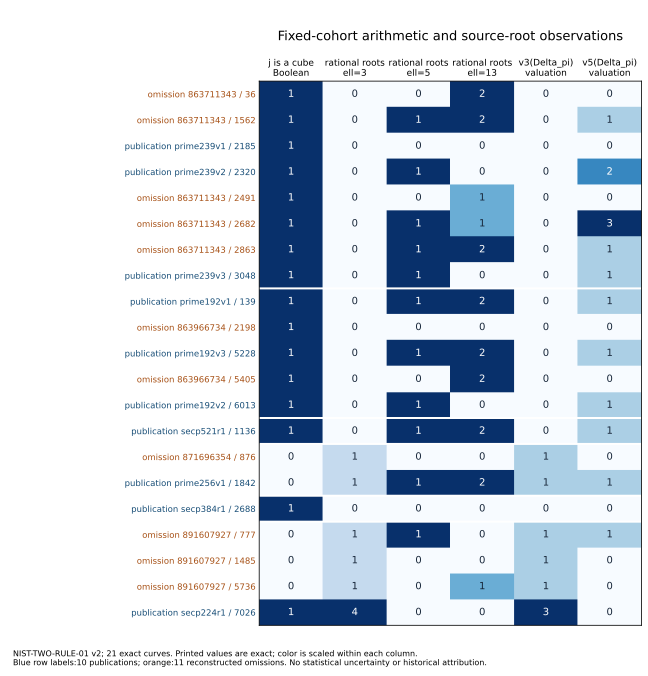
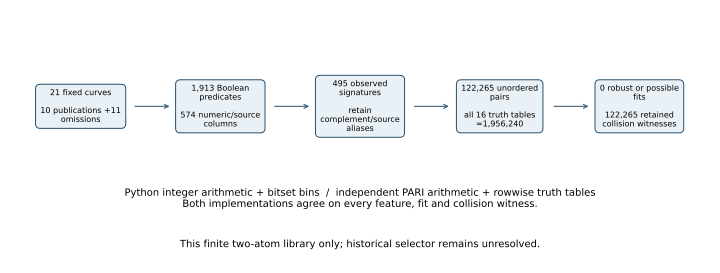

# Two-predicate audit of the fixed NIST/ANSI cohort — 2026-10-27

These are exact observations and scoped comparisons. The historical selector remains unresolved; this report changes no formal hypothesis or goal status.

**Measured/derived result:** 1,913 frozen Boolean predicates from 574 numeric/source columns give495 distinct complemented observation signatures on21 exact curve identities. Both implementations evaluated122,265 unordered signature pairs and all 16 truth tables per pair (1,956,240 distinct pair/function cases). There are **zero robust fits and zero possible fits**, including the explicit single-signature audit. Every pair has a publication/omission collision witness. No arbitrary pair of complex rules is excluded.

The ten publications and eleven reconstructed omissions cover all six timestamp streams. Omissions are not documented historical rejection events. Exact models and seeds are bound in [inputs.json](inputs.json), [rows.json](rows.json), [IDENTITY-BINDING.json](IDENTITY-BINDING.json) and [cohort-features.csv](cohort-features.csv). All 1,281 imported fibers also match the exact field and independently reconstructed j, not just a field-size alias. The actual rows-byte SHA is e8d6a874e3dc77970c88957f4bca075a0cc7a431dd8bcb25e5c5d7bcba6eeb0f.

## Fixed search scope

Read [LIBRARY.md](LIBRARY.md) and the frozen [v1 protocol](experiment.protocol.json), with the wrapper-only [v2 amendment](attempt-02/experiment.protocol.json). Features cover power residues of b,c,j,j−1728,E6 and discriminants; field residues and order shape; local CM-field characters and Frobenius-discriminant valuations through 293; all 61 rational-root table levels; source ECPP status and integer costs; twist observations; strict seed expansions; and four source-based sign-loss faults. No exact IDs, seed bytes, publication/base-point metadata or timing features enter the classifier. Global CM conductor values are not silently substituted for local valuations or actual endomorphism conductors.

All16 Boolean functions cover AND, OR, XOR, complements, constants and degenerate one-input rules. Aliases that coincide on these21 curves are not claimed universally equivalent. Unknowns stay unknown. A robust fit must work for every completion; a possible fit needs only a rowwise favorable completion, potentially without a jointly realizable mathematical completion. Both fit sets are empty.

The source imports and labels were already visible; this is exploratory fixed-cohort analysis. The library and code were frozen and pushed before fitting, not preregistered before discovery of the underlying observations. There is no p-value, held-out prediction, novelty or historical-use claim.

## Specific curve observations

The P-224 pattern survives: all three omissions have non-cubic j and one rational degree3 parameter root; the publication has cubic j and four roots. Its Frobenius-discriminant 3-adic valuation is3 rather than1. A second predicate from this library cannot extend that lead to an exact six-stream classifier. The two signs of b over P-224 are isomorphic models and are not counted twice.

All 21 j−1728 values are fourth powers; that supplies no exclusion. The P-256 publication and omission both have non-cubic j and identical local ramification/conductor behavior at3. The previous exact P-256 factorization gives f_pi=f_E=1 on both. The published P-224 curve is the f_pi=3 case. A factor3 of D_K is ramification, not conductor3. Local CM characters here are exact without determining a complete global D_K or the P384 endomorphism order.

For odd ell, Delta_pi=ell^v*u gives (D_K/ell)=0 when v is odd, otherwise (u/ell). This follows by removing the square conductor factor. With odd traces, Delta_pi and f_pi are odd, giving (D_K/2)=(Delta_pi/2). Python modular exponentiation and GP Kronecker arithmetic agree on every declared feature. No transfer map, subgroup transport or endomorphism efficiency follows from these characters.



## Execution, controls and retained failures

Freeze commits:8a02d2e055251b8fd0c6c142c7433bd57993b912 (v1) and b9816392a140d245b9079de67b05c392e7d39da0 (v2). v2 protocol SHA2797d0041be4fc65913b2ecd809f148ff2a87fe64a318f4cc245744bc72bd60f. Exact command is `python3 run.py` in the extracted attempt 02 directory, following the repository checkpoint gate. Runtime is shared macOS arm64; GP binary SHA1b3464452036a97072a2514f5094bb49188e2ee3089a61514443494f4875ceb5. No timing comparison is made.

Across the two original attempts, four implementation evaluations were attempted: three succeeded and one stopped. In attempt 01 Python completed; GP returned 0 and 21 feature vectors, but the wrapper rejected its stack-size warning. Attempt 02 whitelisted only that exact warning, repeated identical inputs/library and completed both arms. The failed attempt, original code, stdout, stderr, process receipts, invalid export and corrected exports are retained. Pre-fit duplicate-import and protocol-schema corrections are recorded; none produced a classifier fit. The corrected export represents the failed terminal execution as outcome_class=completed per checker semantics, with status=failed preserved.

Both final arms pass the embedded XOR positive, indistinguishable-vector negative, unknown-value and A/A controls. XOR requires both predicates; the collision control has no fit; the unknown control has possible but no robust fits. One entire matrix is one protocol instance per arm, N=1, with internal complete enumeration. Both exports pass file verification. Final diagnostic wall times are 0.373s and 15.355s, user CPU 0.347s and 15.136s; these are process diagnostics on a shared desktop, not comparative performance evidence. The archive was independently extracted and both implementations rerun successfully after relocation; these are validation replays, not additional independent cohorts.



## Delivery and replay

The 70-file sealed archive is `evidence.tar.zst`, SHA 51036fe8c46651ee12db8e1a77f1fc5d851d7d6c9c81ad81086c8735ac7b7561, 102128 bytes. [BUNDLE.json](BUNDLE.json) binds it. The source-feature matrix, all aliases, complete outputs and 122,265 little-endian collision witnesses are retained. Witness encoding is documented in LIBRARY.md. The parser/auditor agrees on every one. Original source packages, emails, papers and runtime binaries are excluded from redistribution, with source paths and hashes retained.

```sh
zstd -dc evidence.tar.zst | tar -xf -
cd evidence/attempt-02
python3 -B run.py
```

The producer uses embedded imports and performs no source download. Python3.14 and PARI/GP2.17.3 are the pinned original runtimes; GP path is `/opt/homebrew/bin/gp`. Run from a fresh extraction to preserve earlier results. Both frozen protocols, every raw process receipt and original first attempt remain inside the archive. Portable replay validation is recorded in PORTABLE-REPLAY.json.

Canonical artifact-store delivery returned HeadObject403; exact archive bytes are retained in Git under PR2602's verified large-file-ok exception. No object-store or CI success is implied. The existing immutable-record merge conflicts remain separate from these calculations.

## Sources and remaining question

Retrieved 2026-10-27: [Valsorda's fixed cohort and unresolved extra criterion](https://words.filippo.io/seeds-solved/); [Anthropic's RNG reconstruction and Solinas/Reiter correspondence](https://www.anthropic.com/research/ecdsa-curve-origins). Internal hashed receipts supply the all 61 modular-table roots, full-cohort ECPP observations, twist observations, seed variants and four later-source fault models. These imports are re-used observations, not new executions of the original 1997 caller. Complete global discriminants and actual endomorphism-ring results retain their earlier individual certification limits.

No linked canonical frontier graph changes: the existing CCR, y-matching and CM source reports retain their sealed scope. This round adds this exact finite-library diagram and observation figure only. The problem record stays open. The next discriminating evidence is a dated original caller/validation requirement or a separately frozen, source-motivated field-dependent mechanism tested on all 21 identities. A more complex classifier built solely from these labels would still need an independent historical prediction before it could explain what was used.
