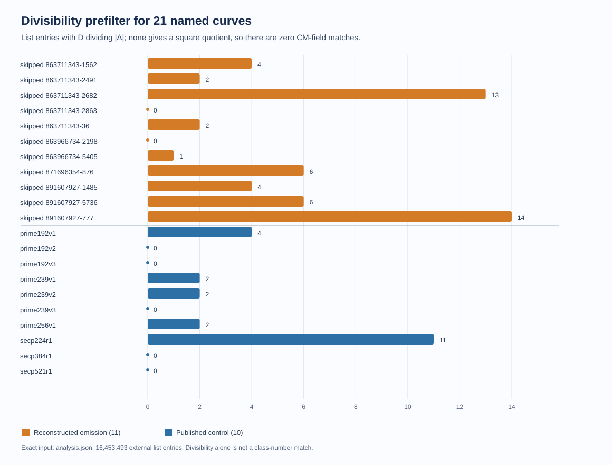
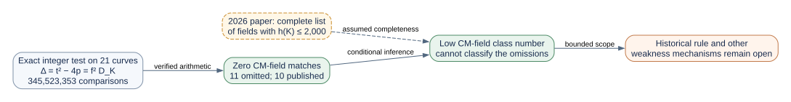

# A low CM-field class number does not mark the eleven omissions

**Date:** 2026-10-23 UTC. **Status:** Complete exact list comparison, conditional on the completeness claim of a newly released mathematical preprint. **Question:** If the original 1997–98 program evaluated all eleven qualifying but unpublished seed classes, could it have rejected them because their imaginary quadratic complex-multiplication (CM) fields had unusually small class numbers?

## Result in plain language

**No, for the concrete threshold tested.** None of the eleven omitted curves, and none of the ten published controls, has a CM field on the newly released list of **every imaginary quadratic field with class number at most 2,000**, if that list is complete as its author claims. The exact comparison checked **345,523,353 curve/list pairs** and found zero curve matches. It found both deliberately inserted positive controls and rejected a negative control. Sage independently recomputed all 21 curve discriminants from the archived field primes and group orders. [Arithmetic result](analysis.json) (`internal`); [Sage check](sage_verification.json) (`internal`); [external theorem and list](https://arxiv.org/abs/2610.21511) (`retrieved`).

This is a substantial restriction on a particular hidden criterion: a rule based on CM **field** class number below 2,000 cannot separate the eleven omitted curves from the published curves. It also implies that all 21 exceed the later ETSI minimum of 200 for the maximal order, conditional on the external list theorem. It does **not** determine why the original program skipped a seed, identify a hidden weakness, or give an ECDLP cost bound. The historical premise that the program reached and rejected every omitted curve remains stipulated, not observed.



*Figure 1. The small counts show how many listed fundamental discriminants divide each curve's Frobenius discriminant. Divisibility is only a prefilter. **None** of the 73 divisors gives the required square quotient, so every curve has zero CM-field matches. Editable generator: [render_visuals.py](render_visuals.py); exact counts: [analysis.json](analysis.json).*

## Exact calculation and provenance

For each ordinary curve, the archived exact prime `p` and prime group order `n` give trace `t = p + 1 − n` and Frobenius discriminant `Δ = t² − 4p < 0`. Its CM field has fundamental discriminant `D_K`, with `Δ = f_π² D_K` for a positive integer `f_π`. Therefore a proposed negative fundamental discriminant `−D` names the curve's CM field **if and only if** `D` divides `|Δ|` and `|Δ|/D` is a perfect square. The test needs neither a factorization of `Δ` nor the representative's full endomorphism ring. The earlier [CM-field screen](../cm_pair_screen/report.md) proved that all 21 fields are distinct and have `|D_K| > 1,000,000`; this round tests the specific low-class-number list rather than a simple magnitude cutoff (`internal`, `derived`).

The external source is Iwao Kimura's [*Imaginary quadratic fields of class number at most 2000*, arXiv:2610.21511v2](https://arxiv.org/abs/2610.21511), revised **2026-10-22**. Its Theorem 2 claims a complete list of **16,453,493** fields with class number at most 2,000, largest `|D_K| = 1,062,350,083`. We used its [versioned release at commit `e451afc`](https://github.com/iwaokimura/cln-imq-2k/tree/e451afc), list `lists/imq_h2000.txt.xz`. The uncompressed file was **227,047,869 bytes** with SHA-256 `07100ea3589ab2b490122fa69b438cd5393bdcd2e547dfc29bb3b5c86f9f24c0`, exactly the checksum published in the paper. The comparison program checked the list's strict order, count, maximum, and class-number range. The 44.3 MiB compressed source and 227 MiB expanded list are in local scratch outside Git, with both digests and paths in [source_manifest.json](source_manifest.json). They are not archived in this PR; the pinned source URL and checksums permit retrieval (`retrieved`, `internal`).

| Exact scope | Count or result |
| --- | ---: |
| Omitted seed classes, counted once per seed | 11 |
| Published controls | 10 |
| External listed fields with `h(K) ≤ 2,000` | 16,453,493 |
| Exact list/curve comparisons | 345,523,353 |
| List discriminants dividing an omitted `|Δ|` | 52 total |
| List discriminants dividing a published `|Δ|` | 21 total |
| Divisors with a **square quotient**, omitted | **0 / 11 curves** |
| Divisors with a **square quotient**, published | **0 / 10 curves** |
| Synthetic positive matches `−3·17²`, `−4·19²` | 2 / 2 |
| Synthetic negative `−5` | 0 / 1 |

The [frozen protocol](PROTOCOL.md) was written before the list was downloaded or tested. [prepare.py](prepare.py) bound the exact EC1 UIDs and recomputed the 21 `Δ` values; [scan.cpp](scan.cpp) used GMP integer divisibility and perfect-square tests on every listed `D`. Its [raw stdout](raw_stdout.tsv), [stderr](raw_stderr.log), [input table](curves.tsv), [input manifest](inputs.json), and [run receipt](run_receipt.json) are retained. The bounded comparison completed in **11.899 wall seconds** on the recorded macOS arm64 host; that timing is local observation, not a claim about 1997 software. [verify.py](verify.py), run with SageMath 10.10.rc0, separately reloaded original `p,n`, recomputed all 21 `Δ` values, and checked both synthetic match equations. It did not reproduce the external paper's completeness proof or computational sieve (`internal`).



*Figure 2. The orange dashed edge is reliance on the 2026 paper's list completeness. The solid arithmetic edge is this study's exact comparison. Editable [Graphviz source](inference.dot).*

## Historical meaning and remaining space

The **1998 ANSI X9.62** generation procedure specified near-primality testing of the curve order, a Miller–Rabin probable-prime test, the MOV condition, and the anomalous-curve condition. It did **not** specify a class-number screen. [ANSI X9.62-1998, Annex A.1–A.3](https://safecurves.cr.yp.to/grouper.ieee.org/groups/1363/private/x9-62-09-20-98.pdf) (`retrieved`). [ETSI TS 102 176-1 (2011), Annex D](https://www.etsi.org/deliver/etsi_ts/102100_102199/10217601/02.01.01_60/ts_10217601v020101p.pdf) explicitly calls its class-number condition an addition absent from the 1998 procedure. Its threshold is **200** for the maximal order. That later rule is useful as a concrete control, but is not evidence that the 1997 program used it (`retrieved`, `inference`). Under the paper's theorem, our 21 CM fields exceed 2,000; class numbers of orders in a field are multiples of the field class number, so the threshold 200 would pass all of them. [Kimura, §6.1](https://arxiv.org/abs/2610.21511) gives the divisibility relation for order class numbers (`retrieved`).

The [2013 President's Review Group appendix](https://www.nsa.gov/portals/75/documents/about/civil-liberties/resources/liberty_security_prgfinalreport.pdf) says that NSA excluded an unspecified potentially weak elliptic-curve parameter class from a NIST standard in its discussion of **SP 800-56A ECDH**. It provides no class definition, curve names, rejection list, timestamp, or link to these 1997–98 seed decisions. That statement cannot supply the missing selector (`retrieved`, limited).

The paper is new and its full classification is an **external dependency**. Its analytic threshold is Lean checked, while its broad sieve program and source class-group tables are not formally verified, as the paper itself states. We verified the downloaded list's published digest and the 21-curve arithmetic against that list; we did not rerun the paper's large-scale sieve or independently prove that no field was omitted. The conditional result is therefore stronger than a small-discriminant search but narrower than an independent theorem. Even if the list were later corrected, the recorded exact tests against this pinned version would remain reproducible (`retrieved`, `internal`).

The open alternatives are an unrecorded software or editorial decision, a criterion outside the conventional screens, or a genuine mathematical advantage that does not depend on low CM-field class number. A hidden-weakness proposal still needs one explicit property and an unknown-scalar algorithm or subgroup-preserving transfer, with its construction/evaluation costs and a matched published control. A matching retrospective label pattern alone would not establish historical use or an ECDLP advantage. The [selection problem](../../../problems/nist-seed-selection-rule-unexplained.md) remains open. The existing seed-selection and canonical ECDLP graphs were checked; this study adds a bounded exclusion, not an attack edge, so their verified content is unchanged.

## Reproduction

The source archive and exact commands are in [run_receipt.json](run_receipt.json). With the pinned list expanded outside Git and GMP installed:

```sh
python3 research/nist_seed_commonality_20261023/class_number_screen/prepare.py
c++ -O3 -std=c++17 research/nist_seed_commonality_20261023/class_number_screen/scan.cpp -o scan $(pkg-config --cflags --libs gmp)
python3 research/nist_seed_commonality_20261023/class_number_screen/run.py /path/to/imq_h2000.txt ./scan
sage -python research/nist_seed_commonality_20261023/class_number_screen/verify.py
python3 research/nist_seed_commonality_20261023/class_number_screen/render_visuals.py
dot -Tsvg research/nist_seed_commonality_20261023/class_number_screen/inference.dot -o research/nist_seed_commonality_20261023/class_number_screen/inference.svg
```

The run script refuses to overwrite the immutable raw outputs. For re-execution, use a fresh copy of this source directory and retain a distinct receipt. This is a structural search report, not a hypothesis-status transition or quantitative speedup claim.
