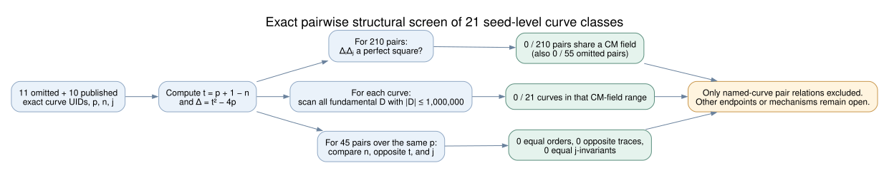
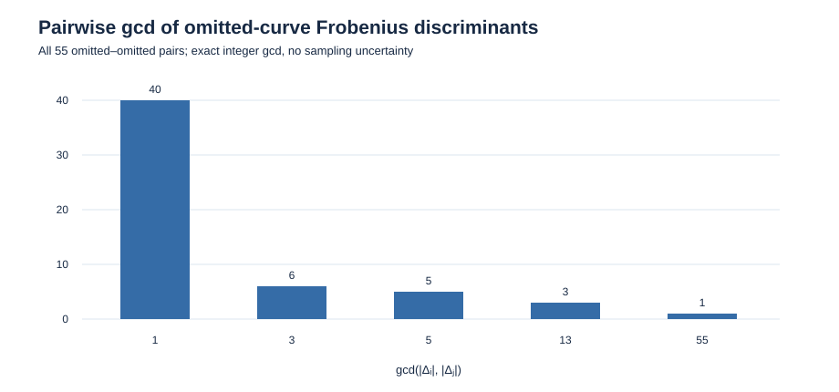

# Could the eleven omitted curves share one CM field or a named isogeny relation?

**Date:** 2026-10-23 UTC. **Status:** Exact structural result, independently checked; historical cause and cryptographic weakness remain unknown.

**Question:** Under the stipulated premise that the original program evaluated all eleven otherwise qualifying but unpublished seed classes and rejected them for an unknown weakness, could that weakness be explained by their sharing one imaginary quadratic complex-multiplication (CM) field, or by a direct isogeny or twist relationship among the named curves?

## Result in plain language

Each ordinary elliptic curve has an imaginary quadratic field attached to its Frobenius endomorphism. The eleven omitted curves have **eleven different fields**. In fact, all **21** named omitted and published seed classes have different fields, and none has a field with fundamental discriminant of absolute value at most **1,000,000**. None of the named same-field curve pairs has the same group order, the opposite Frobenius trace, or the same `j`-invariant. Thus a **single shared CM field, a small CM field in this explicit range, a direct rational isogeny between two named curves, or a named quadratic-twist pairing** cannot be the missing common weakness. The findings apply equally to the published curves, so they do **not** explain which seeds were kept. [Exact matrix](analysis.json) (`internal`); [independent Sage check](sage_verification.json) (`internal`).

This is a restriction on the *form* of a possible explanation. An algorithm or implementation failure could affect curves with different CM fields, and a curve may have an isogeny to an **unlisted** representative. We found no attack, no such endpoint, and no evidence that the original program made these comparisons.

## Exact calculation

The population is the **eleven seed-level omitted classes** in [assessed.json][assessed] and **ten published controls** in [traits.json][traits], with no extra count for the three P-224 coefficient-sign models. The [machine-readable analysis](analysis.json) records every exact EC1 curve UID, field prime `p`, prime subgroup order `n`, one-based seed ordinal, trace and Frobenius discriminant. It binds the source files by SHA-256: `370e79ce0bff8f26bb437fe37d1756f3f8261a5c00e9062ba41cf70f272e8841` and `a1102bd487379d223581863fab731d6eb6957bf0e264b450f1c7b298279b0b67`. Those identities and orders are the comparison objects; familiar curve names are only display labels. The source audit checked group order and primality (`internal`).

For each curve we recompute `t = p + 1 − n` and `Δ = t² − 4p < 0` from source `p,n`. Every `t` is nonzero; for these prime fields of characteristic greater than three, that makes the curves ordinary. For an ordinary curve, `Δ = f_π² D_K`, where `D_K` is the fundamental discriminant of its imaginary quadratic CM field. Consequently, two such fields are equal **if and only if** `ΔᵢΔⱼ` is a perfect integer square. This is an exact test requiring no integer factorization or conjectural conductor value. [Sutherland, *Isogeny volcanoes*, §2.11][volcano] (`retrieved`).

The [Python program](analyze.py) evaluates all `C(21,2)=210` pairs. It separately enumerates every **negative fundamental discriminant** `D` with `|D| ≤ 1,000,000`, then tests whether `Δ/D` is a perfect integer square for each curve. This detects every CM field within that cutoff, even if the Frobenius-order conductor has large factors. There are exactly **303,968** discriminants and **6,383,328** curve/discriminant comparisons, with zero matches. The cutoff is an exploratory test range, not a documented 1997 threshold (`derived`).

| Exact comparison | Result |
| --- | ---: |
| Omitted–omitted pairs | 55 |
| All omitted/published pairs | 210 |
| Pairs sharing a CM field | **0 / 210** |
| Curves with CM-field discriminant magnitude at most 1,000,000 | **0 / 21** |
| Fundamental discriminants in that range | 303,968 |
| Maximum pairwise discriminant gcd among omissions | 55 |
| Pairs over the same prime field `p` | 45 |
| Same-field pairs with equal group order | **0 / 45** |
| Same-field pairs with opposite trace | **0 / 45** |
| Same-field pairs with equal `j` | **0 / 45** |
| Raw P-224 same-invariant positive controls | 3 / 3 |

[Sage](verify.sage) reloads the original sources separately, recomputes every discriminant and pairwise square test, and independently enumerates the small fundamental discriminants with Sage's `fundamental_discriminant` function. It checks every row and pair against the matrix, verifies a Bézout witness, and checks three raw P-224 model pairs as positive controls. The P-224 controls have different `b` values but equal `p,n,Δ,j`, and the square-product predicate returns true for each. Eight synthetic fundamental-discriminant positives and a nonfundamental negative check the range enumeration. The [Sage receipt](sage_verification.json) reports `PASS` on SageMath 10.10.rc0 (`independently verified`).

The omitted-pair discriminant-gcd counts are `40` at gcd `1`, `6` at `3`, `5` at `5`, `3` at `13`, and `1` at `55`. Even the nontrivial gcds do not make the full product a square. The [vector chart](pair_gcd.svg) shows these exact counts; its editable generator is in [analyze.py](analyze.py). There is no sampling uncertainty. The analysis JSON includes one explicit `u|Δᵢ| + v|Δⱼ| = 1` witness for an omitted same-field pair. This is an auxiliary integer check; the product-square test is the actual CM-field certificate (`derived`).

For pairs over the **same** `F_p`, equal group order is equivalent to being `F_p`-isogenous by Tate's theorem. The 45 named same-field pairs all have different orders, so no two named curves are linked by an `F_p`-rational isogeny. Opposite traces are necessary for a quadratic-twist pair, and equal `j` is necessary for geometric isomorphism; neither occurs for the named pairs. [Tate, *Endomorphisms of Abelian Varieties over Finite Fields*][tate] (`retrieved`). An unlisted `F_p`-isogenous endpoint would have the **same trace and CM field** as its source, and a quadratic twist has the opposite trace but the **same `Δ`**. The small-CM bound therefore applies to those endpoints and twists too. These tests do **not** enumerate isogeny classes, compute kernels or maps, or exclude representative-specific transfers to unlisted curves.

## Interpretation for the hypothetical 1997 selector

The premise that a program reached all eleven omissions and screened them for a weakness remains **stipulated**. [Valsorda][valsorda] and [Anthropic][anthropic] report skipped viable seeds but do not supply the historical acceptance code or logs (`retrieved`). The exact pair result rules out a fixed shared CM field or a direct relationship among these named curves as the hidden common feature. Because the same CM-field uniqueness occurs among the published controls, it supplies no keep/skip predicate.

The open mathematical space includes **different weak representatives reached from each curve**, CM fields beyond the explicit cutoff, a common algorithm whose precondition varies with each curve's parameters, or a defect tied to another property such as an implementation's point-counting or validation behavior. The preceding [small-conductor screen][commonality] excludes small squared discriminant factors through 10,000 as a universal omission feature; the [degree screen][splitting] excludes a single rational-isogeny availability bit through degree 10,000 as a perfect selector. None of these screens constructs endpoint maps or measures ECDLP costs. To promote any hidden-weakness proposal, specify a reproducible property and unknown-scalar advantage, prove subgroup transport where used, account for construction and evaluation, and compare it against published same-field controls. A perfect retrospective label split alone would not establish either an attack or historical use (`derived`, bounded).

The next discriminating historical evidence is the original source, run log, or review sheet identifying which candidates were evaluated and why they failed. For a mathematical proposal involving unlisted endpoints, the first concrete task is to give **one** endpoint UID, exact field and order, isogeny degree/kernel/map, a checked subgroup transport certificate, and complete costs for an omitted curve, then test the same frozen rule against a matched published control. The candidate 256-bit omitted block 876 and published P-256 block 1842 are the shortest named same-field first comparison. Until such an object exists, the possible common weakness remains undefined.

The earlier [seed-stream graph][stream-graph] and canonical graphs in `knowledge/frontiers/ecdlp/` were checked. This study adds no verified map, endpoint, attack cost, or frontier movement, so their supported content is unchanged. The editable [diagram source](inference.dot), rendered [diagram](inference.svg), editable [chart generator](analyze.py), [chart](pair_gcd.svg), [Typst source](report.typ), and inspected [PDF](report.pdf) are the visual record for this bounded search.

[assessed]: ../../nist_seed_skipped_curves_20261016/assessed.json
[traits]: ../../nist_seed_skipped_curves_20261016/traits.json
[volcano]: https://msp.org/obs/2013/1-1/obs-v1-n1-p25-s.pdf
[tate]: https://pazuki.perso.math.cnrs.fr/index_fichiers/Tate66.pdf
[valsorda]: https://words.filippo.io/seeds-solved/
[anthropic]: https://www.anthropic.com/research/ecdsa-curve-origins
[commonality]: ../report.md
[splitting]: ../isogeny_screen/report.md
[stream-graph]: ../../nist_seed_selection_deep_20261016/seed_slots.svg
