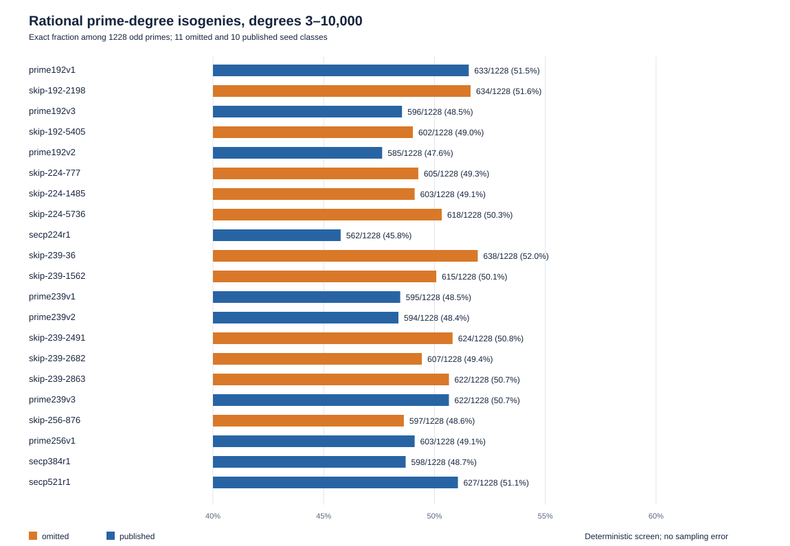
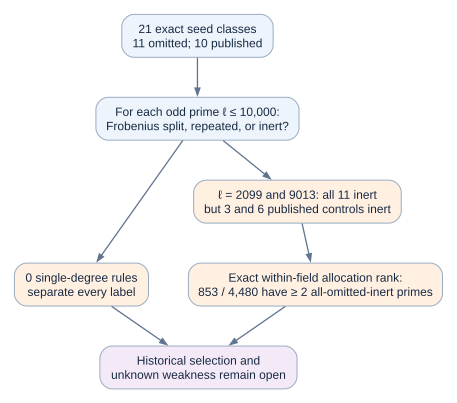

# A larger Frobenius splitting screen of the eleven omitted seed classes

**Date:** 2026-10-23

**Status:** Exploratory, independently checked arithmetic; no historical selection rule or ECDLP advantage identified.

**Question:** Under the conditional premise that the 1997–98 program evaluated all eleven otherwise qualifying but unpublished prime-field seed classes, do they share a simple small-degree rational-isogeny property absent from the ten published classes?

## Plain-language result

For each of the 21 exact curves, we checked all **1,228 odd prime degrees from 3 through 10,000**. No one degree makes the eleven omitted curves all land on one side and the ten published curves all land on the other. Two degrees, 2,099 and 9,013, do make all eleven omitted curves lack a rational isogeny of that degree, but **three** and **six** published curves, respectively, lack one too. The apparent two-degree coincidence has a conditional within-field allocation tail of **853/4,480 = 19.0%** after searching all 1,228 degrees, so it is weak as a label association. This allocation diagnostic is **not** a probability of what the 1997 program did.

There is a partial trend in the *total count* of these degrees: an omitted curve has a higher count than a published curve in **20 of 25 same-field pairs**, with one tie and four reversals. The fixed-10,000-cutoff one-sided allocation rank is **100/4,480 = 2.23%**. This is exploratory and related to the earlier Elkies-coverage screen; it is not a fresh significance test. In particular, omitted P-256 block 876 has **597** such degrees versus **603** for published P-256 block 1842, so the trend cannot be the universal keep/skip rule.

The calculation extends a previously recorded, predeclared Elkies-coverage test at degrees up to 300 and a four-prime character screen. It is a broader **null result for this particular one-degree predicate**, not a new attack or a replay of the original program. [Earlier preregistration][prior] (`internal`); [Anthropic][anthropic] and [Valsorda][valsorda] (`retrieved`).

## Exact population and method

The [source audit][assessed] contains eleven omitted **seed-level classes**; the P-224 coefficient-sign variants in raw `traits.json` are isomorphic models of three classes and are counted once. The ten [published controls][traits] include P-192, P-224, P-256, P-384, P-521 and five ANSI prime-curve examples. The [machine-readable matrix](analysis.json) gives every curve's full `urn:ec-record:1:sha256:...` identity, field prime `p`, subgroup order `n`, seed ordinal, and all 1,228 outcomes. All 21 groups have certified prime order and cofactor one in the earlier audit. Their exact curve IDs and subgroup orders are bound in that input and repeated in the matrix; names in the chart are display labels only. [Audit][assessed] (`internal`).

For each curve, derive the **exact** Frobenius trace `t = p + 1 − n` and discriminant `Δ = t² − 4p`. For each odd prime `ℓ ≤ 10,000`, Euler's criterion determines whether `Δ` is a nonzero square (`E`), zero (`R`), or nonsquare (`A`) modulo `ℓ`. An `E` or `R` outcome means the characteristic polynomial of Frobenius has an eigenline over `F_ℓ`; equivalently, there is an `F_p`-rational cyclic `ℓ`-isogeny. `A` means there is no such eigenline. The Elkies/Atkin discriminant relation and its point-counting role are described by [Shparlinski and Sutherland][elkies] (`retrieved`). This test checks **availability**, not the isogeny endpoint, kernel, map, traversal cost, or ECDLP transport.

The generation code is [make_screen.py](make_screen.py). It asserts 11 omitted and 10 published unique UIDs and writes the full signed matrix, counts, finite-allocation diagnostic and [vector chart](availability.svg). [verify.sage](verify.sage) independently reloads both original input files and recomputes all **25,788** character values with Sage's `kronecker`; [its receipt](sage_verification.json) reports `PASS` on SageMath 10.10.rc0. The two input SHA-256 digests and the analysis digest are recorded in those JSON files. Both programs are deterministic and have no random seed.

**Correction log:** An unarchived first scratch calculation used `2p + 2 − n` for the trace. I caught this before making the durable matrix, replaced it with `p + 1 − n`, and checked every final entry independently with Sage. Only corrected values appear in the attached data and chart.

| Derived comparison | Exact result |
| --- | ---: |
| Single-degree predicates separating all 11 omissions from all 10 controls | 0 / 1,228 |
| Degrees where all 11 omissions have a rational `ℓ`-isogeny | 0 / 1,228 |
| Degrees where all 11 omissions lack one | 2: 2,099 and 9,013 |
| Published controls also lacking it at 2,099 / 9,013 | 3 / 6 |
| Per-curve availability counts, omissions / controls | 597–638 / 562–633 of 1,228 |
| Omission count higher / equal / lower in same-field pairs | 20 / 1 / 4 of 25 |
| Exact within-field allocations with pair score ≥ observed | 100 / 4,480 |
| Exact within-field allocations with ≥2 all-omission-inert primes | 853 / 4,480 |
| Exact within-field allocations with no perfect degree separator | 4,475 / 4,480 |

The allocation diagnostic enumerates `C(5,2) × C(4,3) × C(8,5) × C(2,1) = 4,480` ways to assign the **observed number** of omitted labels within the 192-, 224-, 239-, and 256-bit fields, leaving the 384- and 521-bit published controls fixed. For each allocation it searches all 1,228 degrees again. It preserves the same-field comparison, but those allocations are an analytical reference set, not random historical outcomes. The two inert primes are therefore an observed mathematical commonality with no demonstrated selection or attack meaning.

The pair score counts two for each omitted-greater comparison and one for each tie, so the observed score is `2×20 + 1 = 41`. The 100/4,480 tail is conditional on these 21 records and on this degree cutoff, which was examined **after** the earlier smaller-bound feature search. Counts through 10,000 also include degrees that a 1997 point-counting program may never have used. More available small isogenies would not, by itself, make a curve weak; nor does this count measure actual SEA runtime, which depends on modular-polynomial and continuation costs.

## Historical and security interpretation

Valsorda reports that the extra bit-length rule explains one undocumented filter and that the remaining keep/skip decisions are unresolved; he explicitly raises RNG consumption and point-counting error as possibilities. Anthropic also says viable seeds were skipped and leaves the criterion or accidental cause open. The [NIST retrospective][nist] describes a generic seed → curve → known-attack-screen cycle, but gives no 1997 acceptance trace. These are reports about provenance, not evidence that every reconstructed window was actually evaluated. (`retrieved`)

The public [MIRACL SEA source][miracl], whose visible revision notes begin in **September 1999**, says its first version used Schoof for 3, 5, 7 and then Elkies primes, and that modular-polynomial needs varied by curve. This illustrates how point-counting cost can depend on the Elkies pattern; it is **later and not established as the original NSA program**. Its `-s` search increments `B`, unlike the reported SHA-derived seed windows. The specific 1997 point-counting behavior remains unknown. (`retrieved`, contextual)

The partial count trend also runs **opposite** to a simple story that omitted curves were rejected because too *few* Elkies degrees made point counting slow. That observation does not reject a real runtime or software-error explanation, because count is not runtime and the period implementation is unknown. (`derived`, bounded)

A rational isogeny of a tested degree is not by itself a weak-curve witness. Every tested degree is coprime to the large prime subgroup order, so a defined isogeny transports that subgroup to an equal-order subgroup; a speedup would require a concrete endpoint or other structure, a map, and full costs. None was constructed here. A weakness common to the omitted curves could use combinations of traits, larger degrees, a different representation, extra information, or an undiscovered algorithm. This screen excludes only the simple **single small-prime-degree availability/absence rule** as a complete classifier of these 21 labels.

## Next check and graph status

The highest-value discriminating object remains the original parameter-generator code, point-counting output, or a contemporaneous review sheet: it could establish whether the eleven windows were evaluated and which test rejected them. A mathematical alternative needs a frozen predicate with an unknown-scalar advantage, subgroup transport and construction/evaluation costs, checked first on omitted P-256 block 876 against published P-256 block 1842 and then on all 21 classes without retuning. A mere classifier of these known labels would not prove historical use or a cryptographic weakness.

The earlier [seed stream graph][stream-graph] and canonical ECDLP frontier graphs under `knowledge/frontiers/ecdlp/` were checked. This search adds no verified isogeny map, order relationship, attack cost or frontier movement, so their content remains unchanged. The editable [diagram source](inference.dot), rendered [SVG](inference.svg), [chart source](make_screen.py), [chart SVG](availability.svg), [Typst source](report.typ), and inspected [PDF](report.pdf) are the visual record of this bounded search.

[prior]: ../../nist_seed_provenance_20261016/PREREGISTRATION.md
[assessed]: ../../nist_seed_skipped_curves_20261016/assessed.json
[traits]: ../../nist_seed_skipped_curves_20261016/traits.json
[stream-graph]: ../../nist_seed_selection_deep_20261016/seed_slots.svg
[anthropic]: https://www.anthropic.com/research/ecdsa-curve-origins
[valsorda]: https://words.filippo.io/seeds-solved/
[nist]: https://csrc.nist.gov/csrc/media/projects/crypto-standards-development-process/documents/fips_186_and_elliptic_curves_052914.pdf
[miracl]: https://github.com/miracl/MIRACL/blob/master/source/curve/sea.cpp
[elkies]: https://arxiv.org/abs/1112.3390
