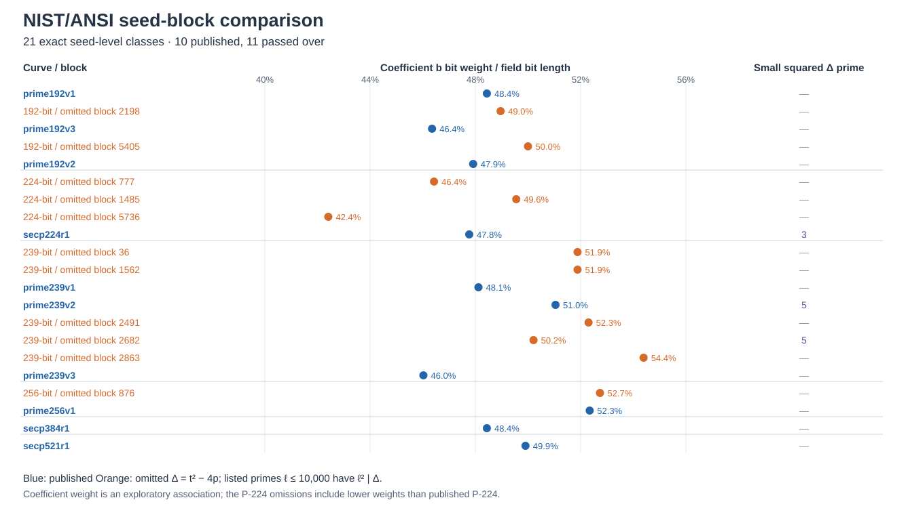
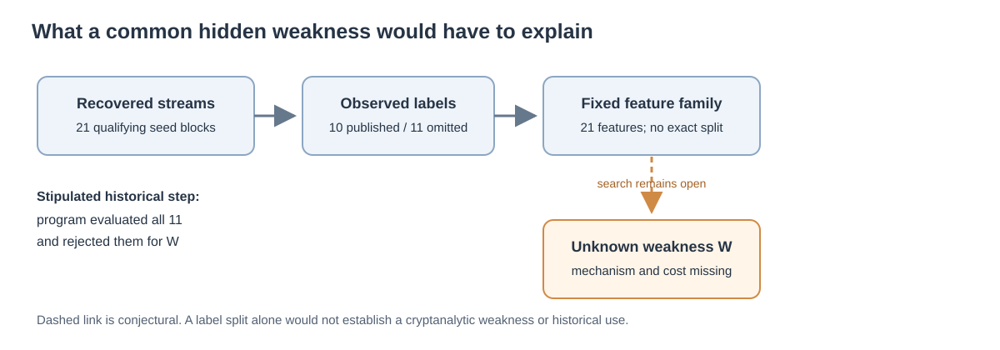

# The skipped-curve commonality search: small conductors and completed twists

**Date:** 2026-10-23 UTC. **Status:** Bounded, retrospective structural search.
**Question:** If the original 1997–98 program evaluated all eleven reported
qualifying but unpublished seed blocks, do they share a simple arithmetic
trait absent from the ten published prime-field curves?

## Result and inference boundary

**Derived:** The fixed 21-feature family in [PROTOCOL.md](PROTOCOL.md) has no
exact separator of all published and passed-over labels, either by one global
numeric threshold or by strict ordering within every field. In particular,
small squared prime factors of the Frobenius discriminant do **not** mark the
eleven omissions: just one omitted curve has such a factor at or below
10,000, while two published controls do. This closes a specific small-prime
conductor proxy, not an arbitrary endomorphism, isogeny, or hidden-route
hypothesis. The strongest association in this bounded family remains the
previously noticed low coefficient-`b` bit weight among published curves. It
has counterexamples and no established cryptanalytic interpretation.

**Cross-checked extension:** The two quadratic-twist factorizations
left censored by the earlier 20-second probe—published prime239v2 and omitted
239-bit block 2682—completed under the separately frozen 300-second limits.
PARI/GP `isprime` returned 1 for every new factor; Sage's proof-enabled
primality check and separately recomputed full-order multiplication passed.
The two primality calls may share underlying libraries, so this is a second
arithmetic check rather than independent primality-algorithm evidence. Together
with the earlier 18 completed probes and the later P-224 block-1485 follow-up,
the named 21-curve set now has complete recorded twist-order factorizations.
The new values do not restore a rule that prefers the largest twist prime
factor: older cross-field counterexamples remain.

The user's working premise—that the historical program actually evaluated all
eleven and rejected them for a weakness—is stipulated here, **not observed**.
The surviving seed streams do not show the original call trace, point-count
state, or rejection reason. Neither an arithmetic label split nor a twist
factorization demonstrates a weakness in the stated prime-order subgroup.



*Figure 1. The exact coefficient bit density and small squared Frobenius-
discriminant primes for all 21 seed-level classes. Blue entries were published;
orange entries were passed over in the reconstructed streams. The P-384 and
P-521 singleton fields appear for completeness but supply no within-field
published-versus-omitted comparison. Source: [analysis.json](analysis.json)
from the pinned [21-curve archive](../nist_seed_skipped_curves_20261016/assessed.json).*

## Exact scope and method

The input is the eleven seed-level classes in
[assessed.json](../nist_seed_skipped_curves_20261016/assessed.json) and ten
published controls in [traits.json](../nist_seed_skipped_curves_20261016/traits.json).
Their SHA-256 digests are `370e79ce0bff8f26bb437fe37d1756f3f8261a5c00e9062ba41cf70f272e8841`
and `a1102bd487379d223581863fab731d6eb6957bf0e264b450f1c7b298279b0b67`.
Each record retains the exact prime field, short-Weierstrass coefficients,
prime subgroup order, cofactor-one group, seed ordinal, and EC1 UID. The
unpublished generators in that archive are study-defined; there is no
historically published generator for those curves. The P-224 sign pair is one
isomorphism class per seed. Existing [curve assessment](../nist_seed_skipped_curves_20261016/report.md)
documents the order, primality, and bounded embedding-degree checks; this
round reuses those inputs and recomputes `t`, `t²−4p`, twist order, and the
seed-to-coefficient relation before feature extraction.

For every curve, [analyze.py](analyze.py) trial-divides the absolute
Frobenius discriminant by every odd prime `ℓ ≤ 10,000` and records exact
valuations. For ordinary curves, `ℓ² | Δ` is necessary for odd `ℓ` to divide
the conductor `f_π` of the Frobenius order; the exact local valuation is
`floor(v_ℓ(Δ)/2)`. This is **not** a certificate for the conductor `f_E` of the
particular representative's endomorphism ring. The study's other fixed
features and controls are specified in the protocol. Every value is in
[analysis.json](analysis.json), with a script and input digest.

| Small squared divisor in `Δ`, `ℓ ≤ 10,000` | Omitted | Published |
| --- | ---: | ---: |
| None | 10 | 8 |
| `3²` | 0 | 1: P-224 |
| `5²` | 1: 239-bit block 2682 | 1: prime239v2 |

The remaining cofactor after bounded trial division was not factored for each
discriminant. Consequently, this table says nothing about squared prime
factors above 10,000 or the complete `f_π` and `f_E` values. It does show
that a small conductor divisor in this range cannot be a property shared by
all eleven passed-over classes. Small horizontal isogenies may exist even
when this conductor test is negative; the test only addresses conductor
change at those primes.

The four fields with both labels contain eight published and eleven omitted
curves, yielding 25 within-field published-versus-omitted pairs. The
predeclared comparison tests all **4,480** allocations that preserve each
field's published count. For coefficient `b` bit weight, the published value
is lower in **22/25** pairs. Its two-sided exact allocation tail is
**67/4,480**. Across all 21 fixed, correlated features, the exact minimum-tail
calibration is **254/4,480**. These are diagnostics of this *retrospective*
family: historical labels were not randomly assigned, earlier investigations
already exposed the coefficient pattern, and the 21 rows are prefixes ending
at published blocks rather than a random population. Neither fraction is a
historical probability or a weakness estimate. In P-224, two omissions have
lower sign-invariant coefficient bit weight than published P-224; therefore
even the leading feature fails as a universal selector.

## Completed twist factorizations

[FACTOR_PROTOCOL.md](FACTOR_PROTOCOL.md) fixed the two residuals, 128 MiB GP
stack, 300-second cap, output paths, and verification before the new attempts.
The exact commands, software versions, stdout, stderr, elapsed wall times,
and results are preserved in the two [factor receipts](factor_runs/).
[Sage verification](sage_verification.json), generated by
[verify_twists.sage](verify_twists.sage), binds both receipts by SHA-256 and
checks every new factor with `is_prime(proof=True)` plus the full twist-order
products.

| Curve / stream block | Small factors | New proven factor sizes | Largest factor |
| --- | --- | --- | ---: |
| Published prime239v2 / 2320 | `19 × 103` | 82 and 147 bits | 147 bits |
| Omitted 239-bit / 2682 | `29` | 95 and 140 bits | 140 bits |

The exact complete products are:

```text
prime239v2 (block 2320):
  19 * 103 * 4346761973611271174729359
           * 103851381678129591032288945463074862302452823

omitted 239-bit curve (block 2682):
  29 * 39155677882068883685288432761
     * 777993948130925423204772521089485491568821
```

The GP factor calls took **15.117** and **29.249** elapsed wall seconds on the
recorded host; these are local run observations, not estimates of 1997 cost.
The older [selection probe](../nist_seed_selection_deep_20261016/twist_factor_probe.json)
had 18/21 complete cases under its 20-second cap; the
[P-224 follow-up](../nist_seed_selection_followup_20261016/verification.json)
completed one more. The two records above close that specific data gap.
Several omitted curves have *larger* largest twist factors than published
curves in the same field, including the 192-bit and P-224 examples documented
in the [selection analysis](../nist_seed_selection_deep_20261016/report.md).
A small twist factor has a protocol-specific effect only when unsuitable
points can reach a relevant scalar operation; these factorizations do not
establish an ordinary-group attack.



*Figure 2. The user's historical-evaluation and hidden-weakness assumptions
are shown as a conjectural branch. The solid arithmetic comparison ends at a
bounded negative result; no attack edge is inferred. Editable source:
[render_visuals.py](render_visuals.py).*

## What remains open

**Proposed, not established:** The eleven curves could fail a multi-part or
field-specific criterion, or they could share a mathematical property outside
the checked family. A property that reduces unknown-scalar work needs a
specific algorithm or transfer, subgroup preservation, matched published
controls, full cold and amortized cost, memory, and any withheld witness or
public reconstruction cost. A hypothetical costly intermediate advantage
would matter even without cheap complete recovery; no such advantage has
been identified here. A post hoc predicate fitted to the 21 labels needs a
genuinely independent historical decision to become a predictive
reconstruction, and provenance of the 1997–98 code or logs to become a claim
about what the designers actually used.

The next discriminating work is to recover original generator, point-count,
or review artifacts, or freeze one mathematically meaningful candidate
weakness `W` and test it on an omitted curve and a same-field published
control before expanding to all 21. The [named selection problem](../../problems/nist-seed-selection-rule-unexplained.md)
remains open. The existing selection graphs and canonical ECDLP frontier
graphs were checked; this study adds exact trait exclusions and two twist
factorizations but no verified map or attack edge, so none is changed.

## Reproduction and provenance

```sh
python3 research/nist_seed_commonality_20261023/analyze.py
python3 research/nist_seed_commonality_20261023/render_visuals.py
sage research/nist_seed_commonality_20261023/verify_twists.sage
pandoc research/nist_seed_commonality_20261023/report.md \
  --metadata-file=research/nist_seed_commonality_20261023/pdf_metadata.yaml \
  --pdf-engine=typst -o research/nist_seed_commonality_20261023/report.pdf
```

The factor attempts are write-once and were already run; see
[factor_twists.py](factor_twists.py) and the receipts rather than rerunning them
over the same paths. Source labels: `internal` for the prior exact curve
archive, census, selection analysis, and factor receipts; `derived` for the
feature table and allocation calculation; `cross-checked` for the Sage
factor verification. Historical context is from the primary
[FIPS 186-2 generation procedure](https://csrc.nist.gov/files/pubs/fips/186-2/final/docs/fips186-2.pdf),
[Valsorda's candidate account](https://words.filippo.io/seeds-solved/), and
[Anthropic's reconstruction](https://www.anthropic.com/research/ecdsa-curve-origins),
all previously retrieved for this study line. This is a search report, not a
research-state transition.
