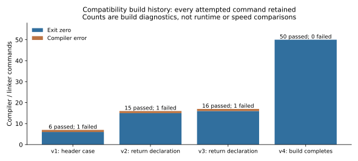
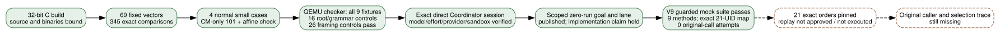

# A 32-bit ECPP build reproduces the certificate-search failure label on an induced control

**24 October 2026 UTC. Compatibility engineering and correctness controls; named historical orders executed: zero.** The recovered ECPP 3.4.1 source now builds as a static 32-bit Linux executable. Its arithmetic passes 345 exact comparisons, its four ordinary small classifications are correct, and an elliptic-curve-only proof for 101 succeeds. With an intentionally empty discriminant catalog and both N±1 routes disabled, the same executable calls the prime 101 composite and exits zero. A missing catalog instead produces a segmentation fault. These are concrete software-control observations, not a keep/skip result for any of the eleven omitted curves.

## Build and runtime identity

The [source acquisition](../nist_seed_ecpp_source_20261024/report.md) binds ECPP V3.4.1 archive SHA-256 `0387e7d180e570d0cf1ff957ed281a46711fb20d50ae0b0669a01a3464d9160f`. The archive's source and data were left unchanged. The build selects its portable C BigNum kernel, serial execution, GNU89, `-O0`, `-fcommon`, `-fwrapv` and Zig 0.16.0's `x86-linux-musl` target. Explicit forward declarations match long/double definitions already present in the source. Changing the include-directory order resolves `bntobnn.h` versus `BntoBnn.h` on the case-insensitive host volume. These are recorded compatibility choices; no original compiler or system-library identity is claimed.

The control process reports four-byte int, long, pointer and BigNumDigit. Execution uses local Linux/386 isolation on an arm64 host. The Alpine index digest is `sha256:d9e853e87e55526f6b2917df91a2115c36dd7c696a35be12163d44e6e2a4b6bc`, with platform selected explicitly. The root and input mounts are read-only, network disabled, capabilities dropped, no-new-privileges set, one CPU and 128 MiB. Static binaries bind the compiled libc; Alpine supplies the execution environment. This is a modern configured-software replay, not a reproduction of a 1997 processor, libc RNG or runtime.

This work uses the BigNum package developed jointly by INRIA and Digital PRL. Source copyright notices are retained in the ignored build copies. The external source package is not redistributed here. [summary.json](summary.json) lists retained local binary locations and hashes; original source URLs and executable build recipes support reproduction. Interactive-session model identity was not exposed in the command receipts and is not inferred.

## Every build and admission failure is retained

*Counts from the four immutable build receipts. The first three attempts fail after 6, 15 and 16 successful compiler commands respectively; the fourth completes all 50 compiler/linker commands. These are diagnostic command counts, not speed or cost comparisons. Editable graph: render.py; source: summary.json.*

- `build-v1`: the case-insensitive include lookup selected the wrong header. Its script returned zero after recording the compiler failure; that producer defect is explicit. Later build scripts exit nonzero on failure.
- `build-v2` and `build-v3`: modern compilation rejected calls preceding long-returning definitions. The fourth build adds declarations extracted from the actual definitions, without changing the source bodies.
- `arithmetic-v1`: a platform-metadata assertion stops admission before binary execution. `arithmetic-v2`: Docker cannot run the selected image by its config ID. The corrected third attempt pins the repository digest plus Linux/386 platform. Neither failure is an arithmetic or curve result.
- `small-v1`: the parser misses the percent-prefixed composite message for 15 after capturing its correct native output. The corrected parser reuses those first three outputs and executes only the remaining cases.

The full commands, compiler diagnostics, raw outputs and amendments remain under [attempts](attempts/). Only `build-v4` supplies the executables used by completed controls.

## Completed controls and independent checks

| Control family | Observation | Scope of the check |
| --- | --- | --- |
| Fixed integer arithmetic | 69 vectors, 345 matching results | Add/subtract/multiply/divide/remainder, sizes 1–521 bits; independently recomputed with Python integers |
| Ordinary classifier inputs | 101 and 65537 prime; 15 and 341 composite | Fresh process per input, original data, proving enabled; labels checked against exact small trial division |
| CM-only 101 | Prime label and a generated certificate | N−1/N+1 disabled; source selects D=4 and a curve with order 104 |
| Independent CM-control arithmetic | E over F101: a=21, b=0, P=(20,80), exact #E=104 and ord(P)=26 | Separate affine arithmetic and exhaustive point enumeration in summarize.py |
| Empty catalog, 101 | Two no-next-D messages, one retry, composite label, exit 0 | Deliberately induced search exhaustion; all original-catalog outcomes remain untested on named orders |
| Missing catalog, 101 | Exit 139, segmentation fault, no final label | Dependency/error control; no mathematical inference |

The [frozen control protocol](CONTROL_PROTOCOL.md), [branch amendment](CONTROL_AMENDMENT.md), raw receipts and [separate summary replay](summarize.py) bind those statements. The CM-control certificate's remaining legacy-checker invocation is pending; the independent affine check verifies the stated control curve and point facts, not the general certificate verifier.

## A bundled certificate exposed a fixture/reader discrepancy

The separate checker builds successfully. It accepts the first bundled certificate and rejects the first two steps of the second, whose validity had been assumed for the initial control plan. The failed expectation is retained in `checker-controls-v1`. [CHECKER_FIXTURE_CORRECTION.md](CHECKER_FIXTURE_CORRECTION.md) records the additive diagnosis.

The current reader divides N−1 by every listed factor and uses the leftover cofactor for theorem 3. In the second fixture the lists already consume all of N−1 at N=3167 and N=1583, leaving cofactor 1. Independent modular arithmetic predicts the observed rejections. A separately named variant leaves cofactors 1583 and 113 and satisfies the stated theorem-3 arithmetic conditions. [fixture_diagnostic.py](fixture_diagnostic.py) records the exact edits, hashes and integer checks. The archive does not establish whether the original example was stale or intentionally negative; neither the example nor the checker was rewritten.

The variant and remaining positive/negative checker controls have **not executed**. Their continuation stalls in Docker image metadata before creating a started record. Bounded daemon queries also time out. After revalidating its exact parent/child PIDs, the metadata child was ended under a watchdog and the parent returned an infrastructure error. [The stop record](attempts/checker-controls-v2/infrastructure_stop.json) asserts no fixture results. The simultaneous system-volume exhaustion and later free-space recovery do not establish Docker's cause.

Completed temporary source/render payloads were relocated byte-for-byte to the data volume, preserving the original temporary paths as symlinks. The relocation manifest is retained in the visualization workspace's `research-source-cache-20261024` directory. The shared Docker service was not restarted. An independent local runtime is the next infrastructure route; it requires its own bindings and admission controls.

## What this establishes and what remains

**Observed:** A period-source program can map an induced certificate-search failure on a true prime to a composite label. That turns the earlier generic certificate-bottleneck suggestion into a demonstrated software failure path under explicitly modified data. It supplies no failure frequency for the original catalog and no classification of the eleven omissions. The user premise that they were all visited remains conditional.

**Unresolved:** Finish the fixture/checker continuation and the complete fail-closed launcher. Freeze the complete 21-order behavior comparison with exact identities, original catalog and tactics, fresh-process state, watchdogs and immutable records. A split would still require wider-cohort prediction, independent validation and historical caller provenance; an all-success result would exclude only the fixed tested configuration. The [historical-selection problem](../../problems/nist-seed-selection-rule-unexplained.md) remains open.

Build timings and elapsed control times are in receipts; CPU use and peak RSS were not measured. Container limits are configuration, not measured consumption. No historical runtime, ECDLP attack-cost, or performance advantage is claimed. Canonical ECDLP frontier sources and earlier selection diagrams were checked and receive no verified attack, isogeny or cost edge. The new admission diagram records the remaining gates explicitly. The PDF was rendered and every page visually inspected. No official scientific status changes.
