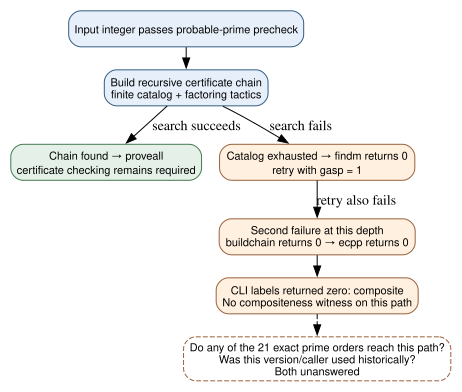
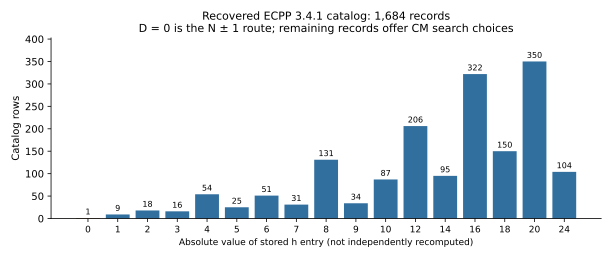

# Recovered period ECPP code gives a concrete certificate-search failure hypothesis

**24 October 2026 UTC. Retrospective source audit; no named curve order executed.** A preserved ECPP V3.4.1 package contains the original C implementation, arithmetic dependencies, discriminant catalog, factoring parameters and certificate checker. Two mirrors provide identical bytes. A thesis defended in October 1996 references this exact distribution filename. The source has a conditional path from finite certificate-search exhaustion to a zero return which its command-line caller labels “composite.” This is an identifiable software mechanism to test; no result here shows that any of the eleven omitted orders reaches it, or that the original NIST/ANSI generator used this package.

## What was recovered

The [FUNET copy](https://mirrors.nic.funet.fi/pub/crypt/math/ecpp.V3.4.1.tar.Z) and [GWDG copy](https://ftp3.gwdg.de/pub/misc/crypt/math/ecpp.V3.4.1.tar.Z) are byte-identical: **1,481,933 bytes**, SHA-256 `0387e7d180e570d0cf1ff957ed281a46711fb20d50ae0b0669a01a3464d9160f`. The internal version file identifies V3.4.1 with a September 25, 1991 timestamp. [Chabaud's thesis](https://www.di.ens.fr/reports/1996/liens-96-14.A4.pdf), defended October 22, 1996, references `ftp.inria.fr/INRIA/ecpp.V3.4.1.tar.Z` on printed page 135, PDF page 136. Its cover and reference page were visually checked; PDF SHA-256 is `4b2c43b1ee5a516a27be0a385c9edbaef5c6a53329cd69edc726c2e04e87d950`.

**Provenance limit:** The contemporary citation verifies that the named distribution existed before May 1997. It supplies no digest for the bytes then served. Agreement between today's mirrors and the archive's internal date does not authenticate those exact bytes as a 1991 or 1996 capture. No source connects this package, version, caller or configuration to Reiter's curve generator. The code and its tables are a concrete period-software candidate, not the recovered original generator.

[source_audit.json](source_audit.json) binds both downloaded payloads, twelve selected file hashes, version text, complete archive inventory, the supplied parameter/catalog rows and the thesis. The archive was read in memory; no bundled executable or installer was run. The two direct author-site retrievals failed to connect. A bounded CDX query on the named author `Prgms` prefix returned three 1999 page captures; the named INRIA archive-prefix query returned an empty list. These limited queries do not prove absence elsewhere. Their raw responses and [retrieval manifest](retrieval.json) are retained.

## The conditional failure chain in the actual source

The [1997 X9.62 draft](https://archive.org/download/x962-11-17-97/x962-11-17-97.pdf), §F.2.3, offers optional Goldwasser–Kilian–Atkin certificates and refers to IEEE P1363. Its parameter-generation path does not require this optional proof. The prior [certificate assessment](../nist_seed_1997_selection_extension_20261023/report.md) therefore left a software-dependent certificate failure open. Its `n−1` factor proxy does not execute ECPP's elliptic-curve certificate search.

The recovered source now makes one candidate mechanism explicit:

1. `nextD` in `Ecpp/C/c/findd.c` advances through a finite catalog and returns zero on the rank guard or end of the input file. The header declares `RGDMAX=1685`; the supplied catalog actually has **1,684 records**, so file exhaustion is independently relevant. The guard value is not the number of stored records.
2. `findD` returns zero when no next entry is available. `findm` in `ecpp.c` propagates that result rather than supplying a compositeness witness.
3. `buildchain` retries a failed search once at that recursion depth with `gasp=1`, enabling additional factoring tactics. If that search also fails, it returns zero. It has no implemented backtracking at that point to revise an earlier chain choice.
4. `ecpp` propagates the `buildchain` failure as zero. In `runecppfromfile`, the command-line caller's corresponding branch prints the composite label.
5. A successful chain follows a different route through `proveall`. The default `noproof` flag is zero, but options can alter the workflow; a future replay must preserve and report them.

*Solid edges are the manually inspected source branches, with reproducible text guards in source_audit.json. The dashed edge marks the missing execution and historical evidence. Neither the diagram nor the guards prove a false classification on a real prime input.*

**Derived, conditional interpretation:** If a true prime reaches this exhaustion path, the printed classification is not a mathematical compositeness proof. Such a failure could make an external caller discard an otherwise valid prime-order curve. Establishing that a named order actually does so requires a correct executable replay. Establishing that this happened historically additionally requires the original caller or a provenance-backed trace. Neither requirement is met by inspecting the branch.

This distinction preserves the earlier statement about correct probable-prime tests: a correct compositeness test cannot reject a true prime because a valid witness exists against it. A finite search for a separate certificate can fail to produce one. The recovered CLI's labeling of that latter condition must be recorded separately from a validated verdict.

## Supplied search space and tactics

The exact catalog contains one special `D=0` record for the `N−1`/`N+1` routes and 1,683 CM entries. Its largest D is **58,507**. The chart counts the stored absolute h entries; this audit does not independently recompute their mathematical class numbers or certify the Weber polynomials.

*All 1,684 records from the hash-bound `Ecpp/Data/ecpp.DfD`. Values are exact catalog counts, with no sampling uncertainty. The special h=0 entry is not an ordinary CM class. Source: source_audit.json; separate parser: verification.json; editable chart: render.py.*

The factoring parameter file supplies fourteen length thresholds with trial-division, rho and Pollard parameters. The selected strategy also depends on `gasp`, arithmetic word length, compilation flags and command-line choices. A modern port that silently changes word size or format-string behavior could change the result or fail; that is an implementation issue to resolve before interpreting any candidate output. The original package also has a separate certificate checker. Exit status and the words “prime” or “composite” alone are insufficient admission criteria for a replay.

## What changes next

The optional-certificate explanation now has an acquired implementation and data to test. [REPLAY_REQUIREMENTS.md](REPLAY_REQUIREMENTS.md) fixes the outstanding implementation obligations: a verified compatibility build, fail-closed launcher/checker, controls, complete 21-order cohort, fresh-process state, original catalog/tactics, proving phase, immutable traces and declared process limits. That document is not an approved experiment or a claim of readiness. No candidate was executed in this source audit.

If the fixed software accepts all inputs, it does not explain the omissions under that configuration. If some fail, the exact cause must be replayed before adjusting anything. If all eleven split from published controls, that would justify wider historical-cohort prediction and independent validation; it would still identify software behavior rather than prove a hidden ECDLP weakness or actual 1997 use. A shared weakness remains unidentified.

The [selection-rule problem](../../problems/nist-seed-selection-rule-unexplained.md) stays open and now links the executable-source lead. The earlier selection diagrams and canonical ECDLP frontier sources were checked; this search contributes no verified attack, isogeny or cost edge. The new diagram records a software path with its unverified historical attribution explicit.

## Reproduction and scope

Download both archive URLs and the thesis to the local paths in [audit.py](audit.py), preserving their bytes. In a fresh copy without output JSON, run `python3 audit.py`, `python3 verify.py`, `sage -python render.py`, `dot -Tsvg failure_path.dot -o failure_path.svg`, then `typst compile report.typ report.pdf`. The scripts refuse to overwrite static evidence records. The separate same-session parser checked both payloads, twelve source/data file hashes, all 1,684 catalog rows, fourteen parameter rows and the source-text guards. These guards supplement a manual branch walk; they are not a compiler control-flow proof, independent research review or a runtime demonstration of failed prime inputs. Both report PDF pages were visually inspected.

Sources are `retrieved`; catalog counts and conditional branch interpretation are `derived`; verification is a separate same-session static replay; the original generator linkage and all 21 runtime outcomes are `unknown`. The external package and full PDFs are not redistributed. No scientific status or ECDLP cost claim changes.
