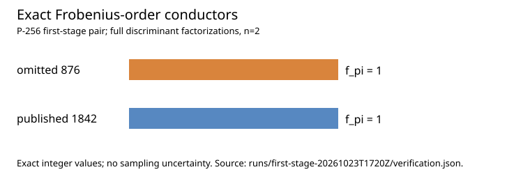
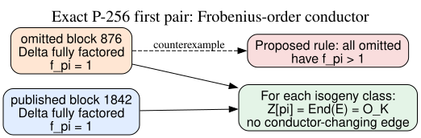

# Exact Frobenius conductor on the omitted and published P-256 pair

**Date:** 2026-10-23 UTC. **Status:** Exact first-stage arithmetic audit, not a historical selection result or full curve-security verdict.

## Result

**Separately verified arithmetic:** The omitted seed block **876** and published P-256 block **1842** both have Frobenius-order conductor `f_pi = 1`. Their full negative Frobenius discriminants are squarefree and fundamental, so `Delta_pi = D_K` in both cases. The [raw GP factors and receipts](runs/first-stage-20261023T1720Z/results.json) were checked by [Sage proof-enabled primality and exact multiplication](runs/first-stage-20261023T1720Z/verification.json). Sage recomputed these identities from the GP output; this was not a second factorization, and its arithmetic may share PARI internals with GP. The omitted result is a direct counterexample to the proposed rule that **all eleven passed-over curves have nontrivial `f_pi`**. The original program's decision rule and any other weakness mechanism remain unknown.

| EC1 curve identity | Block | Proven prime factors in `Delta_pi` | `f_pi` |
| --- | ---: | ---: | ---: |
| `EC1P256Cskip871696354i876hfeefe060817f` | 876 | 6, each exponent 1 | **1** |
| `EC1P256Cprime256v1hbb60dc2a4430` | 1842 | 5, each exponent 1 | **1** |

The full curve UIDs, exact decimal `Delta_pi = D_K` values, and certified
factor lists are in the [verification record](runs/first-stage-20261023T1720Z/verification.json)
and [raw result](runs/first-stage-20261023T1720Z/results.json). The archived
curve data bind each EC1 identity to the exact field, coefficients, generator,
prime group order, and cofactor.



*Figure 1. Exact integers for the two predeclared rows; there is no sampling uncertainty. [render_visuals.py](render_visuals.py) is the editable chart source. This is a comparison of a proposed selector, not ECDLP work.*

## Why `f_pi=1` is class-wide here

For an ordinary curve, `Delta_pi = f_pi² D_K`, and its endomorphism orders satisfy `Z[pi] = O_(f_pi) subseteq End(E) = O_(f_E) subseteq O_K`, with `f_E | f_pi` ([audit protocol](../../knowledge/techniques/KN-TECH-6a2ef9.md), `internal`). Thus `f_pi=1` forces `f_E=1` on each of these exact curves **and every curve in its same-field rational isogeny class**. There is no conductor-changing vertical edge to an order with extra integral endomorphisms in either class. Horizontal isogenies and representative-specific formula behavior are still possible; this result supplies no transfer map or unknown-scalar advantage. The two curves have different group orders and different CM fields, so no direct same-field isogeny between this pair follows from the comparison.



*Figure 2. Solid arrows are exact arithmetic implications. The dashed line marks the falsified universal nontrivial-conductor hypothesis. Editable source: [inference.dot](inference.dot).*

## Frozen method, controls, and failure history

The [pre-run protocol](PROTOCOL.md) fixed exactly this first pair, three synthetic discriminant controls, a 180-second per-case wall watchdog, source SHA-256s, the decision rule, and required artifacts. `run.py` at the recorded clean commit `21857a0f0d31588854918aa84a18c626c9ae008c` used GP/PARI 2.17.3 on macOS arm64; Sage separately checked all five cases. A [post-run environment supplement](environment_supplement.json) records SageMath 10.10.rc0 and binds the sealed verification hash; Sage's version was not captured at run start. GP factored the omitted discriminant in **13.052 seconds** and published P-256 in **7.692 seconds** on this host. These are local factorization timings, not estimates of 1997 screening costs. The first three controls gave `(-75, D_K=-3, f=5)`, `(-7, -7, 1)`, and `(-12, -3, 2)` exactly. The synthetic `-12` case tests the nonfundamental-order correction. Two launcher controls exited nonzero without a completion marker; see [control receipts](controls/results.json).

The first two launch attempts failed **before** any real factorization. [Attempt 1](attempt1.log) misread GP's version banner from stdout; [attempt 2](attempt2.log) hit macOS rejection of a 2 GiB virtual-address limit. Their partial directories and the [additive correction](CORRECTION.md) are retained. The successful run used a 1 GiB GP arithmetic stack and a 2 GiB sampled resident-memory watchdog; the [run receipts](runs/first-stage-20261023T1720Z/results.json) record elapsed time and sampled peak memory for each case. Fast synthetic controls finished before the 100 ms memory sample and record zero sampled peak, which is **not** a zero-memory measurement. `complete.ok` was written only after Sage verification succeeded.

## Interpretation and next check

**Observed:** The first-stage omitted curve does not have a nontrivial Frobenius-order conductor. Under the frozen outcome policy, this rejects only that proposed universal omitted-curve criterion. It does not show that the historical program reached block 876, explain why it was passed over, or rule out another shared mathematical property. The earlier [21-curve trait screen](../nist_seed_commonality_20261023/report.md) found small squared discriminant factors in only one omission and two published controls; this exact P-256 result closes the residual large-square possibility for the decisive first pair. A full eleven-curve `f_pi` census is unnecessary to falsify the universal `f_pi>1` hypothesis but remains possible as broader structural catalog work.

The [selection obstruction](../../problems/nist-seed-selection-rule-unexplained.md) remains open. The next useful test needs a *different* attack-relevant predicate specified before its results are read, with a same-field published control and an explicit subgroup attack or transfer consequence. Original generator code or run logs would independently resolve whether the eleven were ever evaluated. The canonical ECDLP graphs were checked; no attack or cost edge changes from this conductor result.

## Reproduce

```sh
python3 research/nist_seed_exact_conductor_20261023/run.py --out NEW_WRITE_ONCE_DIRECTORY
python3 research/nist_seed_exact_conductor_20261023/render_visuals.py
```

The raw successful directory is write-once and should be inspected rather than overwritten. Its `started.json` binds the clean commit, host, Python/GP versions and source hashes; each `*.gp`, `*.stdout`, `*.stderr`, `results.json`, `verification.json`, and `complete.ok` is retained. Curve identity and order certificates are `internal` from the pinned archive; factorization is `measured` as a local computation; prime factors and discriminant identities are `separately checked` by Sage with the independence limit stated above; the class-wide conductor implication is `derived`. No official hypothesis status changes here.
