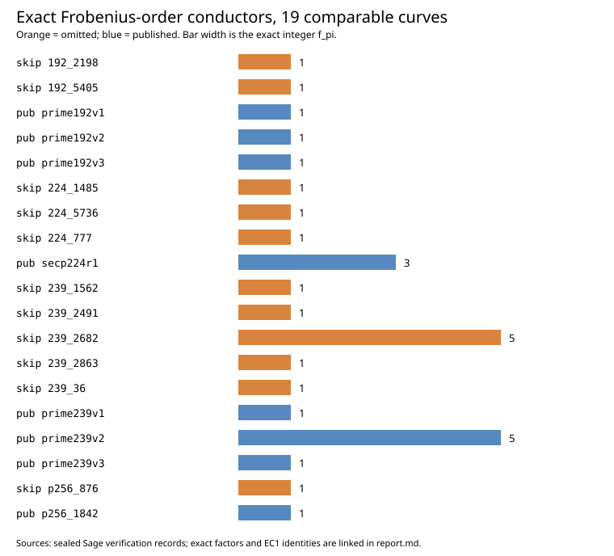
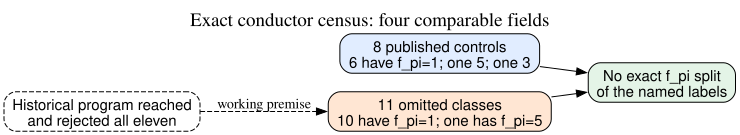

# Exact conductor census of the eleven omitted prime-field curves

**Date:** 2026-10-23 UTC. **Status:** Complete exact arithmetic for the four fields containing both published and omitted seed-level classes. This is a retrospective structural comparison, not a recovered historical selection rule or a curve-security verdict.

## Result

The eleven omitted curves have Frobenius-order conductors `f_pi = 1` (ten curves) or `5` (one curve). The eight published controls in those same fields have `f_pi = 1` (six curves), `5` (one), or `3` (one). The omitted 239-bit block 2682 and published prime239v2 both have **the same nontrivial conductor, 5**. Exact conductor does not separate the named published and skipped labels, whether the proposed rule is `f_pi = 1`, `f_pi > 1`, or a global numeric threshold.

| Field | Omitted blocks and exact `f_pi` | Published curves and exact `f_pi` |
| --- | --- | --- |
| 192-bit prime | 2198: **1**; 5405: **1** | prime192v1: **1**; prime192v2: **1**; prime192v3: **1** |
| 239-bit ANSI prime | 36: **1**; 1562: **1**; 2491: **1**; 2682: **5**; 2863: **1** | prime239v1: **1**; prime239v2: **5**; prime239v3: **1** |
| P-224 prime | 777: **1**; 1485: **1**; 5736: **1** | secp224r1: **3** |
| P-256 prime | 876: **1** | prime256v1: **1** |

## What was computed

The [frozen protocol](PROTOCOL.md) fixed all eleven omissions and eight same-field published controls. The previous [sealed first-stage record](../nist_seed_exact_conductor_20261023/runs/first-stage-20261023T1720Z/verification.json) supplies the omitted and published P-256 pair without rerunning it. For the remaining 17 curves, the [new write-once run](runs/census-20261023T1733Z/) used the exact archived `p` and prime group order `n` to compute `t=p+1-n` and `Delta_pi=t²-4p`, completely factored `|Delta_pi|` with GP/PARI, and derived `Delta_pi=f_pi² D_K` with fundamental `D_K`. Each result is bound to its curve UID. The full integer discriminants, factors, output transcripts, commands and receipts remain in that run directory.

The [Sage verification](runs/census-20261023T1733Z/verification.json) re-read the pinned archived curves, verified all 20 complete products and prime factors with proof-enabled primality, checked the fundamental discriminant identities, and matched every raw GP transcript hash. The 20 cases are 17 new curves plus three synthetic controls: `(-75,-3,5)`, `(-7,-7,1)`, and `(-12,-3,2)` as `(Delta_pi,D_K,f_pi)`. Both injected launcher failures exited nonzero without completion markers ([receipts](controls.json)). Sage and GP may share PARI internals; this is a separate check of the output, not independent factorization. The P-256 first stage has its own verifier and [environment supplement](../nist_seed_exact_conductor_20261023/environment_supplement.json).

The new run started at clean commit `1cd641ce23023efe379cd17770d05480529fc815` on macOS arm64 with Python 3.12.8, GP/PARI 2.17.3 and SageMath 10.10.rc0, recorded in [started.json](runs/census-20261023T1733Z/started.json). The 20 serial GP calls consumed 49.581 seconds in aggregate, with a longest individual factorization of 30.519 seconds and a maximum sampled resident size of 36,732,928 bytes. These are local computation measurements, not 1997 screening-cost estimates. The run stayed within the per-case 180-second wall and sampled 2 GiB memory watchdogs; only after Sage verification passed was `complete.ok` written. The full run was copied byte-for-byte from its scratch directory and archived, leaving the source and verification receipts unchanged.



*Figure 1. The bar length is the exact integer `f_pi`, grouped by field. Orange identifies the omitted classes; blue identifies published controls. The editable chart source is [render_visuals.py](render_visuals.py).*

## Inference boundary

For any ordinary curve in this set, `f_E | f_pi`. Thus the sixteen curves with `f_pi=1` have maximal endomorphism order throughout their same-field rational isogeny classes. For the three classes with `f_pi>1`, this census **does not** determine the actual endomorphism-ring conductor `f_E` of the listed representative, a useful rational isogeny, or an unknown-scalar advantage. A nontrivial Frobenius-order conductor is a structural permission for different orders, not by itself a weakness. The published and omitted 239-bit curves with `f_pi=5` have different group orders and CM fields; equal conductor does not make them isogenous.

The exact fundamental discriminants also give a class-wide degree bound. All nineteen have `D_K ≡ 1 (mod 4)`; the smallest `|D_K|` is the omitted 192-bit block 2198's `8414124017300985115354808730810798330685690037040240202027`. For any noninteger endomorphism `α=a+b(1+√D_K)/2` with `b≠0`, its degree is its norm `((2a+b)²+|D_K|b²)/4 ≥ (|D_K|+1)/4`. Since each actual endomorphism ring is contained in the maximal order, every noninteger endomorphism on these classes has degree **greater than `2^190`**. This excludes a low-degree non-scalar endomorphism but says nothing by itself about the evaluation cost of a high-degree map, and it does not bound arbitrary higher-dimensional transfers.



*Figure 2. Solid arrows summarize exact arithmetic. The dashed historical premise remains unverified. Editable graph: [inference.dot](inference.dot).*

The assumption that the original 1997–98 program evaluated and rejected all eleven remains a **working premise**. [Anthropic's reconstruction](https://www.anthropic.com/research/ecdsa-curve-origins) reports the omitted candidates but says it does not know the criteria or whether the skips were an unintentional artifact (`retrieved`, primary). The [NIST 2013 presentation](https://csrc.nist.gov/csrc/media/events/ispab-december-2013-meeting/documents/nist_elliptic-curves.pdf) says selection checked candidates against known attacks, but does not give the original 1997 call trace or rejection reasons (`retrieved`, primary). No exact mathematical weakness common to the eleven has emerged from this census. It neither proves that no such property exists nor identifies why the published curves were selected.

The useful next discriminator is an attack-relevant predicate specified before testing: an actual subgroup-preserving transfer, endomorphism, or algorithm with a matched published control and complete costs. Independently, locating the original generator and review logs would establish which candidates were evaluated. The [selection-rule obstruction](../../problems/nist-seed-selection-rule-unexplained.md) remains open. No canonical ECDLP graph edge changes because this census establishes no transfer or attack-cost improvement.

## Reproduce and provenance

```sh
python3 research/nist_seed_exact_conductor_census_20261023/run.py --out NEW_WRITE_ONCE_DIRECTORY
python3 research/nist_seed_exact_conductor_census_20261023/render_visuals.py
```

Inspect the archived run rather than overwrite it. Source labels: `internal` for pinned curve identity/order records and prior P-256 verification; `measured` for local GP factorization receipts; `separately checked` for Sage output verification; `derived` for the 19-curve table and conductor implications. No official hypothesis status changes here.
