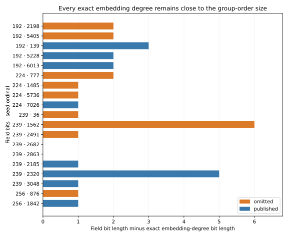
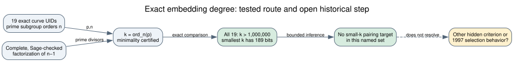

# Exact embedding degrees of the skipped NIST/ANSI seed candidates

**Date:** 2026-10-23 UTC. **Scope:** Eleven omitted prime-field seed candidates and eight published same-field controls. **Status:** Exact arithmetic result, separately checked in Sage. This is one attack-precondition screen, not a full curve-security verdict or a historical program replay.

## Result

Every one of the nineteen named prime-order groups has an **enormous exact embedding degree** `k = ord_n(p)`. The smallest `k` in the set has **189 bits**; the smallest among the eleven omissions has **190 bits**. None is at or below the predeclared bounds `100`, `1,000`, `10,000`, or `1,000,000`. Thus an extra small-embedding-degree rejection rule at any of those bounds would reject **none** of the eleven; it cannot explain the observed keep/skip labels. The exact 19 `k` values and their factorization/minimality witnesses are in the [sealed result](runs/exact-20261023T1811Z/exact/results.json), with a [Sage cross-check](runs/exact-20261023T1811Z/verification.json) and [derived summary](analysis.json).

| Field | Omitted seed ordinals: `k` bit lengths | Published seed ordinals: `k` bit lengths |
| --- | --- | --- |
| 192 bits | 2198: 190; 5405: 190 | 139: 189; 5228: 190; 6013: 190 |
| 224 bits | 777: 222; 1485: 223; 5736: 223 | 7026: 223 |
| 239 bits | 36: 238; 1562: 233; 2491: 238; 2682: 239; 2863: 239 | 2185: 238; 2320: 234; 3048: 238 |
| 256 bits | 876: 255 | 1842: 255 |

*Figure 1. The bar is `bitlen(p) − bitlen(k)` for each exact archived curve. Orange marks omissions and blue published controls. A zero bar means the exact degree has the full field bit length, not zero degree. Source: [draw.py](draw.py) and the sealed result; 19 curves.*

The exact values also overlap in ordering within fields. In the 25 omitted-versus-published same-field pairs, the omitted `k` is **smaller in 8** and **larger in 17**; no pair is equal. These pairs share curves and are a descriptive comparison, not independent statistical trials. The P-256 omitted value is slightly smaller than published P-256, but both have 255-bit degrees. There is no consistent rule that accepts a larger exact `k` in every field.

## Exact method and controls

The [frozen protocol](PROTOCOL.md) bound the curve UIDs, field primes, prime subgroup orders, complete `n−1` factorization archive and four thresholds before any `k` was calculated. The archive's `n−1` factors were already checked with proof-enabled Sage primality and exact multiplication in the [order-certificate study](../nist_seed_order_certificate_20261023/report.md). For each row, the [worker](compute.py) starts at `n−1` and removes a prime factor `q` whenever `p^(k/q) = 1 mod n`. Its final certificate verifies `p^k = 1 mod n` and `p^(k/q) ≠ 1 mod n` for every distinct prime `q | k`. Since `n` is certified prime and the factorization is complete, these checks prove minimality. The [separate Sage verifier](verify.py) recomputed all nineteen values with `Mod(p,n).multiplicative_order()`, checked subgroup primality, factor products, row identities, and the reported witnesses; all passed. The two computations share the archived `p,n` but use different multiplicative-order implementations.

The fixed arithmetic controls returned `ord_11(2)=10`, `ord_13(3)=3`, and `ord_17(4)=4`. The composite-modulus control at `n=15` was rejected. The [launcher receipt](runs/exact-20261023T1811Z/receipts.json) also records an injected unexpected exception returning nonzero and an injected early return lacking the completion marker; neither was accepted. The exact worker ran from clean commit `190694fd05d4f85734c74f92d3ca8cddaff97374` under Python 3.12.8 on macOS. Its elapsed time was **1.082 seconds**, with maximum sampled resident size **22,937,600 bytes**; these are local calculation resources, not attack timings. The complete command, 120-second cap, 1 GiB sampled-RSS watchdog, stdout/stderr hashes and controls are in the write-once run directory. The RSS watcher samples every 10 ms and is not a kernel hard cap.

An [earlier launcher attempt](runs/exact-20261023T1810Z/failure.json) failed before the arithmetic worker started because this macOS host rejected a requested address-space limit in `preexec_fn`. Its receipt and [operational amendment](AMENDMENT.md) are preserved. That failure carries no curve result; the successful run used a fresh directory and source commit.

## What this excludes, and what remains

The MOV/Frey–Rück route relates an elliptic-curve subgroup DLP to a finite-field DLP when a suitable pairing is constructed; a *small* `k=ord_n(p)` can make that target field feasible. This is the historical reason to test embedding degree ([Menezes–Okamoto–Vanstone](https://doi.org/10.1145/103418.103434), `retrieved`, primary; [ANSI X9.62-1998, Annex A.3.2](https://safecurves.cr.yp.to/grouper.ieee.org/groups/1363/private/x9-62-09-20-98.pdf), `retrieved`, primary). Here the exact `k` values are hundreds of bits as integers. The result excludes the **specified small-embedding-degree selector** for these nineteen curves. It is not a finite-field DLP cost measurement, a hardness proof, or a statement about every possible transfer or algorithm. P-384 and P-521 are not in this same-field comparison because the named candidate streams have no omitted controls for those fields.

*Figure 2. Solid arrows bind exact data to the fixed-threshold exclusion. The dashed historical step is unresolved. Editable source: [inference.dot](inference.dot).*

Under the user's working premise that the original program reached all eleven omissions and rejected them because of a weakness, this result removes a natural 1990s attack criterion beyond the earlier bounded MOV check. The exact criterion that separated the named candidates is still unknown. A different class-invariant attack, representative-specific method, implementation behavior, operational filter, or human selection remains possible only with its own specified mechanism and evidence. [Anthropic's seed reconstruction](https://www.anthropic.com/research/ecdsa-curve-origins) (`retrieved`, primary) does not supply the original program's rejection trace. The [selection-rule problem](../../problems/nist-seed-selection-rule-unexplained.md) remains open. The canonical ECDLP graphs were checked; no new attack or transfer edge is supported by this result.

## Reproduction and provenance

From a clean checkout containing the pinned inputs, run `python3 research/nist_seed_exact_embedding_degree_20261023/launch.py NEW_WRITE_ONCE_RUN_DIRECTORY`, followed by `sage -python research/nist_seed_exact_embedding_degree_20261023/verify.py NEW_WRITE_ONCE_RUN_DIRECTORY`. The archived run directory must never be reused. The [analysis script](analyze.py) reads the sealed result and its verification; [draw.py](draw.py) and [inference.dot](inference.dot) produce the editable visuals. Source labels: `internal` for exact curve identities and certified factor archive; `derived` for `k` and pair comparisons; `separately checked` for Sage; `retrieved` for historical literature and ANSI's documented test. No official hypothesis or goal status changes in this search report.
