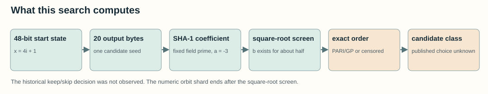
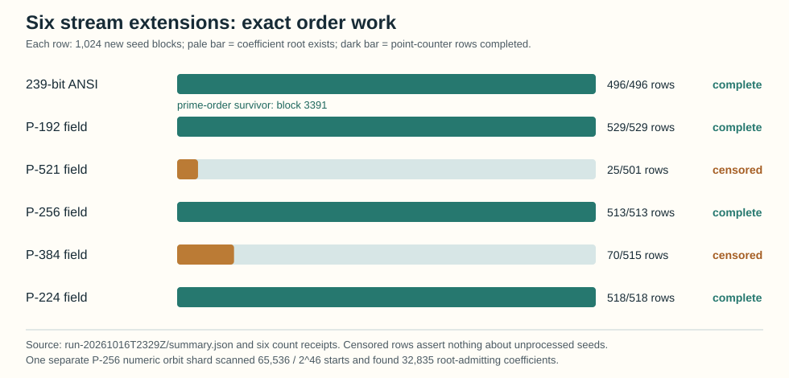

# First extension and exact-state shard of the NIST prime-curve seed generator

**Date:** 2026-10-16. **Status:** Bounded search and exact curve checks. This is a census of the stated slices, not of the full generator orbit or the original 1997–98 decision process.

## Question and frozen scope

Can we enumerate further curves from the recovered clock-seeded generator, and can we split its entire strict `2^46`-state candidate-start orbit into nonoverlapping search jobs? The [stream protocol](protocol.json) fixed six extensions of **1,024 blocks each**, immediately after the last published seed of each recovered timestamp/field pair. The [orbit protocol](orbit_protocol.json) fixed P-256 candidate-start indices **0 through 65,535**, where first output state `x = 4i + 1`. Each orbit index determines exactly 20 consecutive top-byte outputs; the orbit stage applies only the seed-to-coefficient square-root screen. These are two different slices and their counts must not be added as unique curves.

The [generator and point-counter source](scan.py), [partial-run classifier](summarize_partial.py), [numeric orbit scanner](orbit_scan.py), [independent group-law verifier](verify.py), and [visual source](render_visuals.py) are preserved. The main run's [manifest](runs/run-20261016T2329Z/prepare_manifest.json) binds the protocol, scanner, archived traits, point-counter source, local Python, PARI/GP 2.17.3 and installed `pari-seadata` path. The [orbit manifest](orbit-runs/run-20261016T2344Z/manifest.json) binds its own source, controls, counters, output digest and 139.0-second wall time. Raw records were committed at `9ee3d0cf9a` before this report.

## Observed results

The six extensions generated **6,144** seeds. **3,072** passed the coefficient square-root precheck. PARI/GP processed **2,151** of those candidates; **921** remain unprocessed in the two censored fields. Of the processed rows, `ellsea(E,1)` returned an early-abort zero for **2,039** and an exact primary-curve order for **112**. The zero rows are screened candidates, not exact-order measurements. [Summary and classification outputs](runs/run-20261016T2329Z/summary.json) and the six `count_receipt_*.json` files contain the per-field counts and hashes.

| Fixed field | Blocks generated | Root-admitting | GP rows / planned | Final-screen survivors | Other recorded outcomes |
| --- | ---: | ---: | ---: | ---: | --- |
| ANSI 239-bit | 1,024 | 496 | **496 / 496** | **1**, block 3391 | none in the named special classes |
| P-192 | 1,024 | 529 | **529 / 529** | 0 | block 6402 has prime order but 193-bit order |
| P-521 | 1,024 | 501 | **25 / 501**, censored | 0 among processed rows | 476 rows unprocessed |
| P-256 | 1,024 | 513 | **513 / 513** | 0 | none in the named special classes |
| P-384 | 1,024 | 515 | **70 / 515**, censored | 0 among processed rows | 445 rows unprocessed |
| P-224 | 1,024 | 518 | **518 / 518** | 0 | block 7449 has prime 225-bit order; blocks 7166 and 8008 have prime-order twists |

**New curve in this search.** Over the published ANSI 239-bit prime
`0x7fffffffffffffffffffffff7fffffffffff8000000000007fffffffffff`, block **3391** from `srand48(863711343)` gives seed `d069603c0e4a2aed7fade42cf4be32702ef27a62` and curve `y^2 = x^3 - 3x + b`, with `b = 0x3d48e28ebaa1de492f4c544f84043b7abe52e3b45e8c7fc4f1ed80451ef0`.

Its recorded group order is
`0x7fffffffffffffffffffffff8000003785b40f8877738976d79dd01f7f0d`, a 239-bit prime. It passes the [frozen classifier](../nist_seed_provenance_20261016/classify.gp): order bit length no larger than the field's, order unequal to `p`, and no embedding-degree match below 1024. The quadratic-twist order is recorded in the [verification receipt](runs/run-20261016T2329Z/verify_863711343_3391.json); it is divisible by 29. This is a modern generated curve in the same stream **after** the published prime239v3 block, not evidence that a 1997 program reached or considered it.

The independent [Python verifier](verify.py) checked the seed-derived coefficient equation, a nonsingular model, GP's primality result, and `nP = O` for a deterministic nonidentity point under a separately implemented group law. Since `n` lies in the Hasse interval and exceeds its width, that also fixes the full group order. The final [block-3391 receipt](runs/run-20261016T2329Z/verify_863711343_3391.json) binds the complete order file; an earlier partial-file verification and its reconstructed [snapshot binding](runs/run-20261016T2329Z/snapshot_binding_3391_partial.json) were retained. The same independent method checked the two long-prime examples: [P-192 block 6402](runs/run-20261016T2329Z/verify_863966734_6402.json) and [P-224 block 7449](runs/run-20261016T2329Z/verify_891607927_7449.json). Their prime orders have 193 and 225 bits respectively, so the reported extra order-bit-length screen rejects them. The two P-224 twist-prime cases are GP/classifier observations without a separate twist group-law receipt.

## Direct orbit shard

The numeric scanner covered **65,536 of `2^46`** possible strict candidate-start states for the fixed P-256 field, exactly `2^-30` of that orbit. It recorded **32,835** root-admitting coefficients, **32,701** nonsquares, and **0** forbidden coefficients; [every candidate line](orbit-runs/run-20261016T2344Z/root_admitting_candidates.jsonl) has an index, first state, seed, `c`, and `b`. The candidate-file hash and count match the [manifest](orbit-runs/run-20261016T2344Z/manifest.json). As controls, all ten published prime-field seeds regenerated from their timestamp/ordinal-derived first states. No group order was computed for this numeric shard, so its 32,835 rows are **not** a count of prime-order curves. A numeric start index also does not by itself represent a plausible 1997 timestamp and short run.

## Failed and censored work

The first [run directory](runs/run-20261016T2320Z/) retained empty GP outputs: a launcher used `read()` on a GP script containing `quit`, and GP exited successfully before producing any order rows. The scanner was corrected to require one output row per candidate. The second [run directory](runs/run-20261016T2323Z/) retained a 197-row P-239 partial file after a local stop to install `pari-seadata`. The third [run directory](runs/run-20261016T2328Z/) retained another interrupted P-239 partial file while switching to four independent field workers. The final [run directory](runs/run-20261016T2329Z/) completed four fields; its [stop record](runs/run-20261016T2329Z/stop_record.json) and count receipts show P-521 stopped at 25/501 after 601.2 observed wall seconds and P-384 at 70/515 after 322.4 seconds. Those stops are resource decisions and assert nothing about the remaining candidates or their mathematics. No failed output was rewritten into a success.

## Meaning and next check

The exact-state indexing answers the **enumerability** question for the strict 20-draw generator: numeric ranges of `i` partition all `2^46` starts. It does not make full exact point counting cheap. This local implementation took 139.0 seconds to do the cheap square-root stage on one 65,536-state P-256 shard; that measurement is specific to this Python/macOS run and should not be extrapolated as a hardware limit. The 6,144-block extension shows that the same fixed-prime recipe continues to produce prime-order curves after the published endpoints, including one that passes the frozen final screen. It adds no historical acceptance labels and therefore cannot explain why earlier qualifying blocks were skipped.

The next discriminating implementation step is a **resumable per-candidate point-counter** that preserves completed ordinals and imposes a recorded wall stop on each expensive candidate, followed by a new run covering the 476 P-521 and 445 P-384 rows still open here. For orbit-scale screening, the next protocol must name a particular property and a cheaper filter before adding more numeric shards; a large unlabeled curve list would not test an unknown historical criterion. The existing [historical-selection problem](../../problems/nist-seed-selection-rule-unexplained.md) remains open. The canonical ECDLP frontier graph sources were checked; this search adds no verified attack or isogeny edge, so they were left unchanged.

**Source provenance:** [Anthropic's recovered generator and block positions](https://www.anthropic.com/research/ecdsa-curve-origins) (`retrieved`), [Valsorda's reported candidate list and bit-length screen](https://words.filippo.io/seeds-solved/) (`retrieved`), the [FIPS 186-2 seed procedure](https://csrc.nist.gov/files/pubs/fips/186-2/final/docs/fips186-2.pdf) (`retrieved`), and the prior [local provenance reproduction](../nist_seed_provenance_20261016/README.md) (`internal`). The code, controls, raw receipts, and generated plots named above are `internal` evidence for this bounded search.
