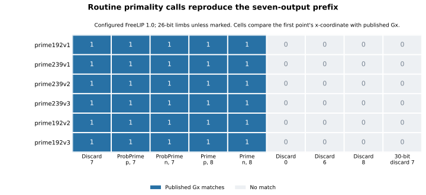
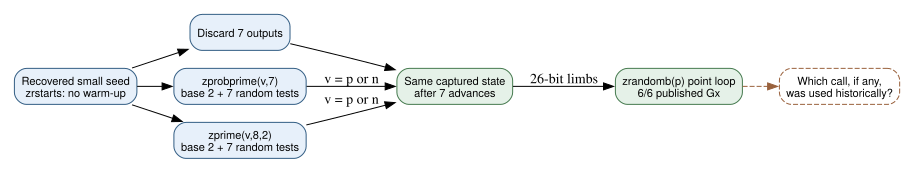

# A routine FreeLIP primality call can supply the seven-output base-point prefix

**Date:** 2026-10-24 UTC. **Question:** Can a normal call in a period library account for the seven discarded random outputs in the reconstructed May 1997 base points? **Verified configured-software result:** Yes. In the tested portable 26-bit FreeLIP 1.0 build, `zprobprime(v,7)` and `zprime(v,8,2)`, with **either `v=p` or `v=n`**, produce exactly the seven RNG advances and then all six published May `Gx` values. All **24** proposed primality-call/curve combinations match, as do the six manual-discard-seven baselines. The **24** wrong-prefix or 30-bit controls match none. This supplies several routine call-level reconstructions; it does not identify the historical call or explain the eleven seed omissions.

## Source and the software clue

**Retrieved:** The [FreeLIP 1.0 archive](https://ftp.kh.edu.tw/Linux/Debian/debian-archive/dists/Debian-1.3.1/main/source/math/freelip_1.0.orig.tar.gz), SHA-256 `cd168c2ba0f9052d84072664b559219506050f583fdf58060517d59422f5bccc`, contains the original `lip.c` used here, SHA-256 `5c507451e8c13323f106a66b5f76cdf17dfbe9eb7f289eb1ac0c706855625bff`. Its `zrstarts` initializes the seed without consuming seven outputs. `zprobprime` first uses fixed base 2 and then the requested number of random bases; `zprime(...,8,2)` uses base 2 first and seven random bases. A `zrandom` call can internally reject an RNG state, so state equality was measured rather than assumed.

The [Anthropic reconstruction](https://www.anthropic.com/research/ecdsa-curve-origins) had already supplied the six small seeds, seven-output prefix and 26-bit packing. This study searches no new seed and claims no new base-point discovery. Its new question is whether a documented library call can replace the unexplained explicit discard in that numerical recipe. The [protocol](PROTOCOL.md) fixed both call families, both arguments p/n, exact identities and all controls before execution.

## What actually ran

The original library source was unchanged. The first `SINGLE_MUL` build compiled but its first direct-prefix point case exceeded the ten-second watchdog; no complete point result was obtained. Its [failure record](runs/prefix-v1/failure.json), raw case and original [launcher](run_v1.py) remain preserved. [BUILD_AMENDMENT.md](BUILD_AMENDMENT.md) then fixed a portable `PLAIN` build with an explicit `NBITS=26` override; the 30-bit control used `PLAIN`'s default width. Modern compatibility was limited to the previously used malloc-header shim, standard string declarations, and 64-bit C-long declaration. The timeout's cause remains unclassified and supplies no evidence about a historical executable.

The amended [run record](runs/prefix-v2/results.json) contains all **77 completed cases**, compiler diagnostics, configuration, library and executable hashes, exact commands, public curve UIDs, initialization/prefix/final states, call returns, point attempts and x-coordinates. The [C wrapper](replay.c) uses the actual FreeLIP functions. A separate [Python replay](verify.py) independently implements the multiplicative RNG, rejection bounds, limb packing and modular residue point loop. Its [passed verification](runs/prefix-v2/verification.json) checks every captured state and point result, with no new calls or tuned seed choices. Local elapsed time is recorded in the run receipt; memory use was not measured, and this study makes no performance claim.

| Published curve | Previously recovered small seed | Point attempts after each matching prefix |
| --- | ---: | ---: |
| prime192v1 / P-192 | 20000 | 2 |
| prime239v1 | 20420 | 3 |
| prime239v2 | 20507 | 2 |
| prime239v3 | 20509 | 1 |
| prime192v2 | 20512 | 5 |
| prime192v3 | 20517 | 1 |

*Each cell is one exact Gx comparison. The first five columns use 26-bit limbs and yield 30 matches; the remaining 24 controls yield none. `ProbPrime` denotes `zprobprime`; `Prime` denotes `zprime` with fixed first base 2. Source: `prefix-v2/results.json`, independently replayed by `verification.json`. Editable plotting code: [render.py](render.py).*

## What this means for the original process

**Derived:** The seven-output prefix has a routine software explanation available in this library: an eight-base probable-prime check can produce it. This is a concrete example of an apparent unexplained RNG offset arising from another call in the workflow. However, all four variants—two routines, each on p or n—have the same observed state effect here, so these outputs cannot distinguish them. They also do not prove that any such call occurred before the published base points were chosen.

**Important source limit:** The [November 1997 X9.62 draft](https://archive.org/download/x962-11-17-97/x962-11-17-97.pdf), §F.2.1, requires at least fifty tests for its specified probable-prime test. The eight-base calls here therefore cannot be silently equated with that mandatory standard check. They could represent an auxiliary check or another private procedure; neither is documented by this fit. The recovered limb width likewise does not establish the original compiler flag or processor.

**Independently checked observation:** The same `zprime(n,8,2)` call accepted **all 21** large prime orders—eleven omitted and ten published—and consumed exactly seven RNG advances for every one. The small controls n=101 and n=15 returned prime/composite as expected without consuming RNG output. Thus this tested call does not provide a curve-selection criterion that distinguishes the eleven. The omitted curves' historical base points were not supplied or inferred.

**Unknown:** Reiter's actual program, configuration and candidate logs remain absent. This result narrows a software-workflow detail and demonstrates nonuniqueness of its reconstruction; it supplies no common hidden weakness. The [selection-rule problem](../../problems/nist-seed-selection-rule-unexplained.md) remains open. The existing seed-selection and canonical ECDLP graph sources were checked; this call-level result changes no verified attack, isogeny or cost edge. A versioned original caller or trace could distinguish p-testing, n-testing, explicit discards and other equivalent consumers. A further mathematical selector still needs an independently predictive property and a concrete advantage.

**Reproduction:** Run [run.py](run.py) with `--tarball /path/to/freelip_1.0.orig.tar.gz --out NEW_DIRECTORY` under the protocol and build amendment, then `python3 verify.py NEW_DIRECTORY`. Generate the chart using `sage -python render.py`, the diagram using Graphviz, and the inspected PDF using Typst on [report.typ](report.typ). Archive/source code is `retrieved`; published identities and prior reconstruction are `internal`/`retrieved`; call outputs are `observed`; RNG and point replay are `independently checked`; historical attribution is `unknown`.
