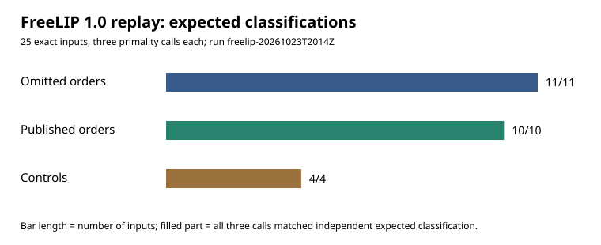

# FreeLIP 1.0 order-test replay on the skipped seed curves

**23 October 2026.** This report records one narrowly specified software test. Its observation is that the tested FreeLIP 1.0 calls classify all 11 reconstructed omitted curve orders and all 10 published curve orders alike. It does not establish which program selected the historical curves or why. The user-stipulated premise that the original program reached and rejected all 11 remains unverified.

## Question and source

Could a plausible 1990s prime-order check itself reject the omitted curves? The [FreeLIP 1.0 Debian source archive](https://ftp.kh.edu.tw/Linux/Debian/debian-archive/dists/Debian-1.3.1/main/source/math/freelip_1.0.orig.tar.gz) is a period source; its tarball SHA-256 is `cd168c2ba0f9052d84072664b559219506050f583fdf58060517d59422f5bccc`. The precise claim tested is the behavior of its `zprobprime(n,1)`, `zprobprime(n,5)`, and `zprime(n,1,2)` calls under the recorded modern build. FreeLIP is a lead because a separate reconstruction linked it to six published base points; no source shows that the historical curve-selection program called this prime-order routine.

The [frozen first protocol](PROTOCOL.md) binds the 11 omitted EC1 curve UIDs and 10 published EC1 UIDs through the input hashes in [the launcher](run.py). Those UIDs and exact `n` values appear individually in the [raw results](runs/freelip-20261023T2014Z/results.json). An independent order-certificate study already established that these 21 `n` values are prime. The four controls were 101, 15, 221, and three times the published prime192v1 order.

## Execution record

The first run, [freelip-20261023T2007Z](runs/freelip-20261023T2007Z/failure.json), stopped at missing `<malloc.h>`; zero orders were tested. [Protocol 2](PROTOCOL_2.md) allowed a temporary shim including `<stdlib.h>` and left the archival source untouched. Its [second run](runs/freelip-20261023T2010Z/failure.json) stopped because modern Clang required declarations for `strlen` and `strrchr`; zero orders were tested. [Protocol 3](PROTOCOL_3.md) added `-include string.h`. Both failed runs and the successful run are immutable records.

The [third run](runs/freelip-20261023T2014Z/results.json) used commit `c91151558cbf6a4bd730be2da576e3ed17b7c16b` with a clean tree, macOS 26.6 arm64, Apple Clang 17.0.0, `-std=gnu89 -O0 -DSIZEOFLONG=8`, `PLAIN`, the temporary header shim and standard string declarations. It compiled the unmodified archival `lip.c` and `lip.h` with the committed [wrapper](replay.c). The run command, compiler warnings, source hashes, executable hash, individual outputs, exit codes, and machine details are in the record. End-to-end local elapsed time was 1.442 seconds; it is an operational observation, not a performance comparison.

## Observations

All 11 omitted orders returned `(1, 1, 1)`. All 10 published orders returned `(1, 1, 1)`. The prime control returned `(1, 1, 1)`; all three composite controls returned `(0, 0, 0)`. That is 25/25 expected input classifications and 75/75 expected individual call outputs. The figure comes directly from the [raw results](runs/freelip-20261023T2014Z/results.json) through [chart.py](chart.py); its counts are derived from those recorded outputs.

## Interpretation and remaining space

This result eliminates **this exact FreeLIP 1.0 build and call pattern** as a direct prime-order rejection criterion separating the 11 from the published curves. It says nothing conclusive about another FreeLIP version, flags, RNG state, use inside point counting, implementation bugs, or an entirely different program. It also does not test a mathematical trapdoor. A hypothesized weakness shared by the skipped curves would need a mechanism, a measurable property that separates them from published controls, and an independent check of what advantage that property gives an adversary.

The original 1997 code or candidate logs remain the decisive missing evidence for whether those 11 were evaluated and why they were rejected. A next software test should be chosen from an actual period implementation or recovered source, with its call path fixed before observing classifications. Existing canonical graphs were checked: this result concerns a software candidate filter and changes no verified curve, isogeny, or attack-cost edge, so none was modified.
