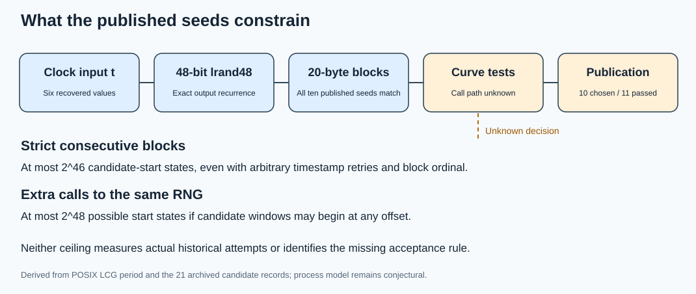
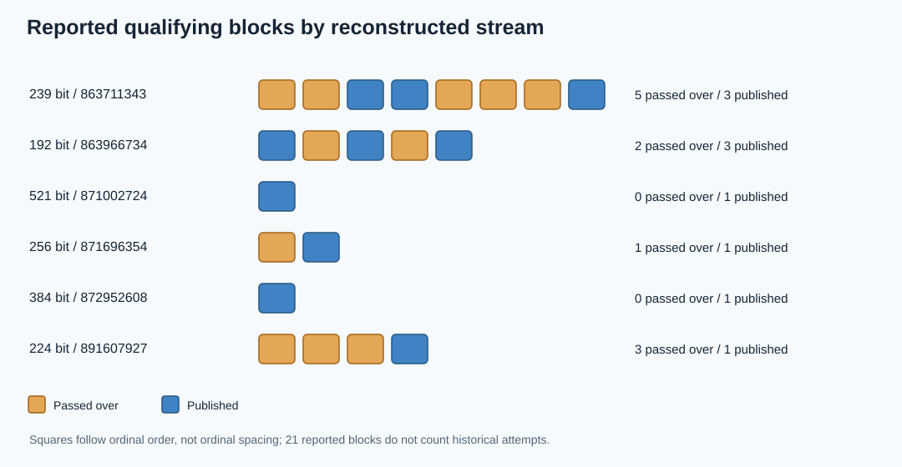

# What remains open in the NIST prime-curve seed-generation process?

**Date:** 2026-10-16

**Scope:** The ten published prime-field curves and eleven other qualifying 20-byte blocks reported in six reconstructed 1997–98 `srand48` streams.

**Status:** Derived process constraints; the historical acceptance rule is unresolved.

## The answer in plain terms

The mystery has split in two. The **seed bytes** have a strong, reproducible explanation: the ten published prime-field seeds are exact 20-byte blocks from `lrand48` streams initialized with six Unix timestamps. The **decision to publish those particular blocks** remains unexplained. Eleven other reported blocks in those same streams also yield prime-order, cofactor-one curves of the required order size. Four precede P-256 or P-224, and seven are interleaved with the 1997 ANSI example curves. These are candidate windows in the reconstructed streams; the original program might not have evaluated every one. [Anthropic's discovery][anthropic], [Valsorda's complete reported list][valsorda], and our [prior exact assessment][traits-report] support that distinction.

The open space is now more precise than “anything could have happened.” The visible standards tests and simple coefficient-sign choice do not explain the omissions. A program that consumed extra generator calls, a point-count or certification program that rejected some mathematically valid curves, or an undocumented extra test remain possible. None has a reproduced call trace, historical source, or independently predictive rule. Separately, arbitrary timestamp restarts could have occurred; the six recovered starts do not count all attempted starts.

## A new sign-choice check

I rechecked the [archived coefficients and orders][traits] with [process_audit.py](process_audit.py); exact outputs and source hashes are in [process_checks.json](process_checks.json). For **all 17 reported qualifying blocks over fields with `p ≡ 3 (mod 4)`**, including nine published and eight passed-over blocks, the recorded prime-order coefficient `b` equals the usual exponentiation root of `-27/c`, namely `(-27/c)^((p+1)/4) mod p`. Thus the rule “compute this root and ignore the opposite sign” retains all eight passed-over blocks. A simple lower-root or parity convention also conflicts with published coefficients. This result concerns the 21 archived blocks and says nothing about unenumerated ones.

The four P-224 blocks need a different argument. Its field satisfies `p ≡ 1 (mod 4)`, so the two signs `b` and `-b` define **isomorphic** curves: a field element with square `-1` gives the scaling between them. The archived point counts agree for the two signs at each of the three omitted P-224 blocks. Changing the sign cannot turn those prime-order curves into disqualified ones. The published P-224 sign is likewise one representation of the same isomorphism class. This closes the simplest sign-selection explanation across all 21 reported blocks, while leaving a more complex implementation error logically open.

## Exactly what the historical standards would have tested

[ANSI X9.62-1998 Annex A.3.2][x962] specifies near-prime order, a MOV condition with exponent bound at least 20, and exclusion of anomalous curves. Its Annex A.3.3.2 allows a coefficient pair derived from the seed and does not prescribe a unique square-root sign or how to choose the next seed. [FIPS 186-2 Appendix 6.4][fips] likewise says to choose an arbitrary 160-bit seed, derive the coefficient, and retry if the order is unsuitable; Appendix 6.5 verifies the published seed-to-coefficient relation. FIPS lists prime-order curves with `a=-3`, but neither document gives the 1997–98 acceptance log. The X9.62 text postdates the May 1997 runs, so it describes the published method rather than the exact code that ran then.

The new audit verifies for every one of the 21 reported blocks that `n > 2^160`, `n > 4 sqrt(p)`, the seed-derived coefficient equation holds, and `p^k != 1 (mod n)` for `1 ≤ k ≤ 20`. The [earlier study][selection-report] established prime order/cofactor one, excluded anomalous order, and checked embedding degree through one million. Valsorda identified an extra condition, `bit_length(n) ≤ bit_length(p)`, which all 21 also satisfy. The stronger `n < p` rule is false for published `prime239v2`. These checks do **not** prove the historical implementation evaluated each block correctly.

## A hard bound within the recovered generator model

The reconstructed generator uses a 48-bit state with update `x -> (0x5DEECE66D*x + 0xB) mod 2^48`. Its increment is odd and its multiplier is 1 modulo 4, so its state period is `2^48`. `srand48(t)` initializes the low 16 bits to `0x330E`, which is 2 modulo 4. The first output state of every consecutive 20-draw candidate block is 1 modulo 4. Moving from one candidate to the next advances 20 states, and `gcd(20, 2^48)=4`. Consequently, **one uninterrupted stream cycles through exactly `2^46` candidate-start states** before repeating; changing the timestamp only selects another starting point in this same residue class. The 20 output bytes are determined by that state, so there are **at most `2^46` distinct candidate seeds** under this strict extraction rule, regardless of how many timestamps or block ordinals were tried. The [derived checker][checks] records the constants and congruences. This is a mathematical ceiling, not an estimate of work actually done.

If other work consumed arbitrary extra calls from the *same* generator **between** consecutive 20-byte windows, a window's first state could lie in any of the four residue classes. The broader ceiling is then `2^48` start states. That ceiling still assumes each candidate seed takes 20 consecutive draws; interleaving calls *within* byte assembly or changing the extraction rule would be a different model and could permit more outputs. For the published seeds, the observed windows align to 20-draw boundaries relative to their recovered timestamps. A process explanation involving extra calls must reproduce those alignments; multiples of 20, compensated call counts, or separate RNGs can do so. Anthropic's reconstruction of the six May 1997 base points uses a **different FreeLIP generator**, making their search a weaker explanation for consumption of the timestamp stream. The later four base-point origins remain open.

These state ceilings hold for **fixed field prime, `a=-3`, and the recovered SHA-1 coefficient procedure**. They do not include earlier freedom to choose field primes, a different seed source, or a secret algorithm that attacks honestly generated curves. They also do not turn a 48-bit state into 48 bits of observed historical selection: no attempt count, completion time, or total restart count has been recovered. As a conditional illustration only, a uniformly distributed weak class of density `2^-61` would have expected hit count at most `2^-15` across `2^46` distinct strict-block states. That random-class model is unverified, and less rare or correlated properties would behave differently. Valsorda's approximately 30-bit estimate uses the much narrower assumption of a roughly year-long timestamp window and a small number of viable candidates per start; it is a scenario, not an observed attempt count.

## Candidate process models and the test each needs

| Model | What the 21 blocks say | Discriminating evidence |
| --- | --- | --- |
| First suitable curve after each start | Refuted by the reported qualifying blocks before P-256 and P-224 and by the interleaved ANSI sequence. | A different definition of “suitable” fixed before inspecting these labels. |
| Fixed sign or ordinary X9.62 screen | All 17 non-P-224 prime-order signs match the exponentiation root; P-224 signs are isomorphic; all 21 pass the checked ordinary screens. | A precise overlooked standard criterion and a replay on every reported block. |
| Extra `lrand48` calls or changing candidate boundaries | Mathematically possible; published blocks constrain cumulative call offsets to the recovered boundary phase. | Original code or an exact trace reproducing all published ordinals and skipped windows. |
| Point-count, primality-proof, timeout, or bookkeeping behavior | Mathematically valid curves can be rejected by a faulty or resource-limited historical program. Modern certificates do not reveal that program's outcomes. | A 1997-compatible implementation reproducing the same acceptance and failure pattern, with original inputs and limits. |
| Extra curve-quality test or manual curation | Unconstrained predicates can fit the known labels; checked trace, twist, and embedding traits have no consistent simple separator. P-224 omitted block 1485 has a **122-bit** largest twist prime factor versus **118-bit** for published P-224, refuting a “maximize that factor” rule there. | Specify a motivated predicate in advance, then predict independent historical decisions or find contemporaneous documentation. |
| Multiple timestamp restarts or candidate-run selection | Recovered timestamps show six successful starts; they cannot count discarded starts. | Contemporaneous logs, filesystem timestamps, or source with provenance; a timestamp encoded in the seed is not proof of the wall clock. |

The ranking is about **how to investigate**, not a probability assignment. I would first seek Bob Reiter's original generator or contemporaneous parameter-generation artifacts, then reproduce likely historical software behavior with a frozen call-count and acceptance model. Search for a mathematical criterion only with a specific predeclared rule and a held-out historical decision; otherwise the 21 labels are easy to overfit. A fuller independent enumeration of all candidate blocks through the published endpoints would strengthen the dataset but would still not reconstruct what the original program actually evaluated.

## Scope, obstruction, and artifact record

The exact obstruction remains the missing original program/acceptance trace, tracked in the [open problem record][problem]. The 21-block dataset is the primary bounded sample here, not a census of all generated curves or all historical attempts. Two 239-bit twist factorizations remain censored in the earlier work; neither is needed for the new sign or LCG-state bounds. No curve-specific attack or official hypothesis-status transition follows from this assessment. The earlier [stream graph][prior-graph] and canonical ECDLP frontier graphs were checked; these process constraints add no new isogeny or attack edge, so those graphs are unchanged.

**Artifacts:** [process_audit.py](process_audit.py) and [process_checks.json](process_checks.json) bind the prior checked records and derive the 17/4 sign split, standard screens, six-stream counts, and state ceilings. [render_visuals.py](render_visuals.py) is editable source for [process_space.svg](process_space.svg) and [stream_counts.svg](stream_counts.svg). [report.typ](report.typ) builds the inspected [PDF](report.pdf).

[anthropic]: https://www.anthropic.com/research/ecdsa-curve-origins "retrieved primary discovery account"
[valsorda]: https://words.filippo.io/seeds-solved/ "retrieved primary candidate list"
[x962]: https://pdfcoffee.com/x9-62-1998-ecdsa-pdf-free.html "retrieved text copy of 1998 ANSI standard"
[fips]: https://csrc.nist.gov/files/pubs/fips/186-2/final/docs/fips186-2.pdf "retrieved NIST standard"
[traits-report]: ../nist_seed_skipped_curves_20261016/report.md "internal exact curve study"
[traits]: ../nist_seed_skipped_curves_20261016/traits.json "internal exact curve records"
[selection-report]: ../nist_seed_selection_deep_20261016/report.md "internal selection comparison"
[checks]: process_checks.json "derived checker output"
[prior-graph]: ../nist_seed_selection_deep_20261016/seed_slots.svg "internal stream graph"
[problem]: ../../problems/nist-seed-selection-rule-unexplained.md "internal obstruction record"
