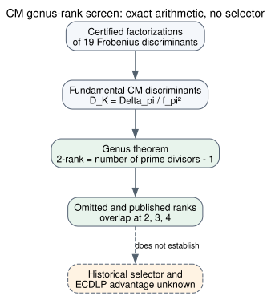

# CM genus ranks do not select the eleven skipped curves

**Date:** 2026-10-23 UTC. **Scope:** A retrospective exact-arithmetic comparison of the eleven qualifying but unpublished seed-level prime curves against eight published curves in the same four prime fields. This tests a possible class-group trait under the user's working premise that all eleven were evaluated and rejected; that premise is not historical evidence.

## Result

The associated imaginary quadratic CM fields have overlapping class-group **2-ranks**. The omitted ranks are `2, 2, 3, 3, 3, 3, 4, 5, 5, 7, 9`; the published ranks are `1, 2, 2, 3, 3, 3, 4, 6`. Ranks **2, 3, and 4 occur on both sides**, so neither a unique rank nor a global rank threshold chooses all eleven omissions while retaining all published controls. Every one of the nineteen fields has even class number, so that binary trait also separates none.

| CM class-group 2-rank | Omitted | Published, same fields |
| ---: | ---: | ---: |
| 1 | 0 | 1 |
| 2 | 2 | 2 |
| 3 | 4 | 3 |
| 4 | 1 | 1 |
| 5 | 2 | 0 |
| 6 | 0 | 1 |
| 7 | 1 | 0 |
| 9 | 1 | 0 |

The largest observed rank, 9, belongs to omitted ANSI 239-bit block 2682. A high rank in the CM **field's class group** is not an elliptic-curve discrete-logarithm method or a demonstrated selection reason. This screen says nothing about the class group's higher 2-power structure, its odd-order part, or the cost of any isogeny route.

{width=30%}

## Calculation and checks

For a negative fundamental discriminant `D_K` with `t` distinct rational prime divisors, [Gauss genus theory](https://link.springer.com/article/10.1186/s40687-017-0109-x) (`retrieved`, primary research article) gives an imaginary quadratic class group with `2^(t−1)` elements killed by 2, hence 2-rank `t−1`. The [exact conductor census](../nist_seed_exact_conductor_census_20261023/report.md) and its [P-256 first stage](../nist_seed_exact_conductor_20261023/report.md) (`internal`) supplied the complete factorizations of `Delta_pi=t_E²−4p`, fundamental `D_K`, and Frobenius-order conductor `f_pi`. The cited genus theorem concerns the **maximal order of the CM field**. For the three curves with `f_pi>1`, the listed representative's actual endomorphism order has not been determined and may be nonmaximal; the result is not an exact class-group statement about that order.

The [derivation script](analyze.py) enforces both source-result SHA-256 digests in [analysis.json](analysis.json), checks synthetic rank-zero (`D=-3`) and rank-one (`D=-15`) cases, rechecks `Delta_pi=f_pi² D_K`, multiplies every certified factorization, checks that `|D_K|` is exactly the product of its distinct prime divisors, binds each row to its curve UID, and checks the eleven/eight label counts. All nineteen `D_K` values are `1 mod 4`, so 2 does not add a separate prime divisor. The source factorization verifiers and their own controls remain in the linked runs; this calculation reuses those immutable records rather than claiming a new independent factorization.

This trait was proposed **after seeing the labels**. Its failure to separate them is exact for the named nineteen curves, but the exercise provides no statistical inference about the original 1997–98 selection process. Even a separator would require a defined weakness mechanism and an independent historical prediction before it could support the user's conjecture. The [selection-rule obstruction](../../problems/nist-seed-selection-rule-unexplained.md) remains open. Existing canonical ECDLP graphs were checked; this result supplies no attack edge, so none was changed.

## Reproduction

```sh
python3 research/nist_seed_genus_rank_20261023/analyze.py
dot -Tsvg research/nist_seed_genus_rank_20261023/inference.dot -o research/nist_seed_genus_rank_20261023/inference.svg
pandoc research/nist_seed_genus_rank_20261023/report.md --resource-path=research/nist_seed_genus_rank_20261023 --metadata-file=research/nist_seed_genus_rank_20261023/pdf_metadata.yaml --pdf-engine=typst -o research/nist_seed_genus_rank_20261023/report.pdf
```

The [machine-readable output](analysis.json) contains all nineteen UID-bound rows, exact ranks, source digests, and overlap counts. This is a substantive negative search result under the stated premises, not a research-state transition or a security verdict.
