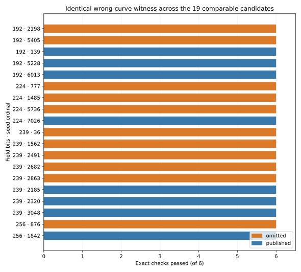
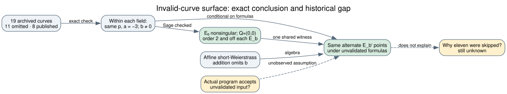

# Could an invalid-curve weakness distinguish the eleven omissions?

**Date:** 2026-10-23 UTC. **Status:** Exact check complete for eleven omitted candidates and eight published controls over the same four field primes. This is a conditional analysis of unvalidated point input. The historical program's rejection criterion remains unknown.

## Result

Under the usual affine short-Weierstrass addition formulas, **the configured coefficient `b` does not determine which alternate curves can be processed when input points are not checked against the configured curve equation**. For a fixed field prime `p` and coefficient `a`, points on any nonsingular `E_b′: y²=x³+ax+b′` are operated on by the same formulas. The 19 exact archived candidates all have `a=-3` and nonzero configured `b`; within each of the four fields they therefore share this conditional invalid-curve surface. A weakness based solely on feeding points from one of these alternate curves into that kind of implementation cannot explain why an otherwise identical implementation would be safe on the published `b` and unsafe on an omitted `b`.

This is an equality of **available wrong-curve inputs under a specified arithmetic model**, not an assertion that a deployed implementation accepts them or that a particular secret-key protocol leaks useful information. The [EFD's short-Weierstrass formulas](https://www.hyperelliptic.org/EFD/g1p/auto-shortw-jacobian.html) and [Antipa et al.'s public-key-validation analysis](https://iacr.org/archive/pkc2003/25670211/25670211.pdf) describe the underlying arithmetic and attack context (`retrieved`, primary). The exact candidate coefficients and checks are [here](results.json) (`internal`, exact computation); [Sage separately confirmed](verification.json) every order-two witness (`internal`, separately checked).

| Field | Omitted seed ordinals | Published seed ordinals |
| --- | --- | --- |
| 192 bits | 2198, 5405 | 139, 6013, 5228 |
| 239 bits | 36, 1562, 2491, 2682, 2863 | 2185, 2320, 3048 |
| 224 bits | 777, 1485, 5736 | 7026 |
| 256 bits | 876 | 1842 |

Every row shares `p,a` within its field and the witness `E₀: y²=x³−3x`, `Q=(0,0)` over that field.

*Figure 1. Every bar is one exact archived candidate. Orange denotes an omitted curve, blue a published control. Each bar reaches all six checks: `a=-3`, `b≠0`, nonsingular `E₀`, `Q∈E₀`, `Q∉E_b`, and `2Q=O`. Editable source: [draw.py](draw.py).*

## Why the result follows

For distinct points, the affine slope is `(y₂−y₁)/(x₂−x₁)`; for doubling it is `(3x₁²+a)/(2y₁)`. The output coordinates are `x₃=λ²−x₁−x₂` and `y₃=λ(x₁−x₃)−y₁`. None of these expressions contains `b`. With the usual identity, inverse and vertical-line cases handled correctly, the formulas form the group law on **whichever** nonsingular `E_b′` contains the input point. If an implementation accepts an input point without first verifying its configured equation, fixing a different `b` does not remove that `E_b′` from the arithmetic it can perform. This algebraic statement does not require that `E_b′` itself be one of the eleven named omitted curves.

There is a simple exact witness on every archived row. With `a=-3`, `E₀: y²=x³−3x` is nonsingular for these field primes. `Q=(0,0)` lies on `E₀`, is its own inverse, and has order two. Each configured `b` is nonzero, so `Q` fails its equation. The [frozen protocol](PROTOCOL.md) required these checks for all eleven omissions and eight same-field controls. The [first implementation](check.py) verified them against pinned archived JSON SHA-256 digests and retained every `p,a,b`, curve UID and Boolean result. An [independent Sage verifier](verify.py) rebuilt each exact curve in `GF(p)`, checked nonsingularity and `Q.order()==2`, and bound its output to the results hash. All 19 passed. The small-field controls at `p=101` found `[Q,2Q,3Q]=[Q,O,Q]` for two different configured `b` values, and an ordinary nonzero-`y` point on a third curve doubled onto that third curve. These are arithmetic controls, not protocol exploits.

The order-two point can at most distinguish a secret scalar's parity when a protocol exposes the relevant output and the implementation actually accepts this input. A practical invalid-curve key-recovery attack would additionally need points of suitable orders, repeated secret use, observability, and a complete protocol analysis. We have not tested any deployed implementation or secret-key protocol here. For the named eleven omitted curves specifically, the archived group orders are prime, so their *own* full groups do not offer small subgroup factors. Choosing an omitted `b` as an invalid curve against a published configuration therefore does not by itself supply a small-subgroup attack.

*Figure 2. Solid edges are algebraic implications or exact checks; dashed edges identify assumptions and the still-unobserved historical rejection step. Editable source: [inference.dot](inference.dot).*

## Scope and historical implication

The statement applies to an implementation that uses `b`-independent short-Weierstrass formulas on attacker-supplied points without equation validation. It does not cover `b`-dependent complete formulas, validation and subgroup checks, x-only ladders, faults, fixed-base-only operations, or a protocol that reveals no secret-dependent result. Those choices may create implementation differences, but no such difference has been tied to the eleven historical keep/skip decisions.

Under the user's working premise that the program reached all eleven candidates and rejected them for a hidden weakness, this study rejects one simple version of that premise: **the omitted `b` alone creates a unique invalid-curve input surface while the published `b` avoids it**. The remaining space includes a property of the honest prime-order groups, an implementation or workflow criterion with specified code, an undiscovered construction that exploits other information, or an unrecorded historical decision. None has been demonstrated. [Anthropic's reconstruction](https://www.anthropic.com/research/ecdsa-curve-origins) (`retrieved`, primary) recovers the timestamp-seeded sequence but reports no original acceptance program or complete log. The [selection-rule problem](../../problems/nist-seed-selection-rule-unexplained.md) stays open. The canonical ECDLP graphs were checked; this conditional input-validation observation creates no verified attack edge.

## Reproduction and provenance

Run `python3 research/nist_seed_invalid_curve_surface_20261023/check.py` only in a fresh copy with no existing `results.json`; it refuses to overwrite a record. Run `sage -python research/nist_seed_invalid_curve_surface_20261023/verify.py` only where no `verification.json` exists. The raw `results.json` records a clean source commit `32df781f76be8ef1d0d11f1c4ce2d8f8d4cd8bf3`, host and Python version; `verification.json` binds the exact result and verifier source hashes. Source labels: `internal` for archived candidate data, `derived` for the formula implication, `exact computation` for the 19 rows, and `separately checked` for Sage. No official hypothesis or goal status changes here.
