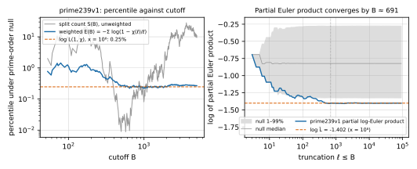

**Status:** complete. Protocol `PROTOCOL.md` committed and pushed (`dd218eb5`)
before any study statistic was computed. One deviation (D1): the first launch
was killed by a harness time limit before writing results, and the identical
command was rerun. Analysis only: no ECDLP cost changes, and no hypothesis
status changes.

> **Independent replication (added 2026-10-30):** `research/nist_seed_l1chi_20261030/` reached the same result
> with separate code and a frozen `experiment.protocol/v1` record. On the 61 shared curves, log L̂ at x = 10⁶
> agrees to 2.9 × 10⁻¹⁴; prime239v1 is at the 0.246th percentile there. Consolidated statement:
> [`../nist_seed_l1chi_20261030/CROSSCHECK.md`](../nist_seed_l1chi_20261030/CROSSCHECK.md). Nothing in this study's records changed.

## Answer

`papers/nist-seed-split-null/paper.md` §6 left open whether prime239v1's
low split count reflects a small L(1, χ_{D_K}), or only low early Euler
factors with an ordinary L-value. **The L-value is low.**

| prime239v1 | value |
|---|---|
| f_π, D_K | 1, D_K = Δ, \|D_K\| ≈ 2^240.9 |
| L̂(1, χ_{D_K}), Euler product to x = 10⁸ | **0.2461** (log L̂ = −1.4019) |
| percentile under prime-order null | **0.25%** (second seed 0.23%) |
| rank of log L̂ among the 61 curves | **1 of 61** (lowest) |
| protocol decision (Q1) | **low** (< 1st percentile) |
| implied class number h = √\|D_K\|·L/π | ≈ 2^116.8, against ≈ 2^117.6 at the null median |

**Where the L-value comes from.** log L̂ = −1.402 splits as:

- ℓ = 2: −0.405, the same for every odd prime-order curve here, since Δ ≡ 5 (mod 8);
- 3 ≤ ℓ ≤ 691: −0.998;
- ℓ > 691: +0.002.

So the first 124 odd primes carry essentially all of the deviation. The
weighted statistic E(B) = −Σ_{3≤ℓ≤B} log(1 − χ(ℓ)/ℓ) has percentiles of 1.0
at B = 101, 0.69 at 251, 0.36 at 397, 0.24 at 691, 0.22 at 997, 0.24 at 2003,
and 0.25 at 5003.



*Left: the unweighted split count's percentile (grey, from the split-null
study's 655-cutoff sweep) moves from 0.009% to about 20% as B grows. The
weighted E(B) (blue) settles at the L-value's percentile (dashed) by
B ≈ 500 and stays there. Right: the partial log-Euler product leaves the null
1–99% band before B = 100 and has converged to log L̂ by B ≈ 691.*

## What this corrects

The paper's "possible explanation, not established" was wrong: prime239v1's L-value
is not ordinary. Between B = 691 and 5003 its *split-count* percentile rises
from 0.06 to 11. That rise is an artefact of counting primes without weight.
The added primes near B contribute about 1/ℓ each to log L, so they cannot
move it. Yet each of them shifts the unweighted count by a full unit.

## What this does not show

- **No new independent evidence.** prime239v1 was picked out because its S
  was extreme. Across the 61 curves, corr(E(691), log L̂) = 0.95 and
  corr(S(691), log L̂) = 0.46. The low L-value restates the same anomaly in a
  weighting that does not fade. If nothing had been selected, the chance that
  some curve among 61 reaches the 0.25th percentile is
  1 − (1 − 0.0025)^61 ≈ 0.14. Among the 8 published curves it is about 0.02.
- **No published/unpublished shift.** The median log-L percentiles are 39
  for the 8 published curves, 49 for the 11 named omitted curves, and 52 for
  the 42 held-out curves.
- **No CM-method curve.** |D_K| ≈ 2^241, and h is within a factor of about
  2 of its null median.
- **No ECDLP consequence.** No known ECDLP attack, generic or structural,
  depends on L(1, χ) or on the class number of the CM order. Within a level
  of the isogeny volcano, JMV random self-reducibility makes the problem
  uniformly hard. The atlas leads `LEAD-STR-jmv-random-self-reduction` and
  `LEAD-STR-torsion-module-leak` are unaffected.
- **Conditional on GRH.** L̂ is a truncated Euler product. Under GRH the
  truncation error is expected to be of order 10⁻³; this is not a proved bound.

## Controls (all passed)

| control | result |
|---|---|
| estimator against exact class numbers (20 random fundamental D, 80–110 bits) | max \|log L̂ − log L\| = 4.0·10⁻⁵ at x = 10⁸ (6.7·10⁻⁴ at 10⁶); threshold 0.01 |
| χ: S(691) recomputed for all 61 curves against the committed held-out run | 0 mismatches |
| A/A implementation: vectorized χ against Python `pow`, ℓ ≤ 10⁶, 3 curves × (Δ, D_K) | 0 mismatches |
| D_K and f_π against the exact conductor census | 17 of 17 match |
| A/A Monte Carlo (seeds 20261030, 20261031) | log L 0.247 / 0.226%; E(691) 0.238 / 0.213% |
| closed-form null law against `analysis_lib.probs`, ℓ < 400, four fields | exact |
| convergence, every curve | max \|log L̂(10⁸) − log L̂(10⁷)\| = 2.3·10⁻⁴ |
| null calibration: 42 held-out log-L percentiles against uniform | KS D = 0.066 (5% critical value 0.210) |

## Method

- **Curves:** the 61 curves of the held-out test (19 named and 42 held-out,
  in four fields), loaded from the same three inputs.
- **D_K:** D_K = `coredisc(Δ)` from PARI 2.17.2. Exact class numbers were
  infeasible here: `quadclassunit` takes 38 s at 140 bits and grows about
  6× per 20 bits, so roughly a day per 241-bit discriminant.
- **Estimator:** log L̂ = −Σ_{ℓ≤10⁸} log(1 − χ_{D_K}(ℓ)/ℓ), with χ computed
  vectorized (16-bit Horner residues, then Euler's criterion in int64).
- **Null:** Frobenius uniform in GL₂(F_ℓ) with determinant p and no
  eigenvalue 1, independent across ℓ, in closed form. 200,000 draws over
  3 ≤ ℓ ≤ 10⁵ per field; the ℓ > 10⁵ tail has variance below 10⁻⁶.
- **Runtime:** 10 m 43 s wall on 4 vCPUs.
- **Provenance:** `runs/commit.txt` and `runs/env.txt`.

## Reproduce

```sh
cd research/nist_seed_lvalue_20261030
python3 lvalue.py ../nist_seed_1997_selection_extension_20261023/sea_signature/runs/scan-20261023T1840Z/raw.json \
  ../nist_seed_1997_acceptance_20261024/analysis.json \
  ../nist_seed_selection_20261016/raw/full_prime_order_certificates.jsonl \
  ../nist_seed_exact_conductor_census_20261023/runs NEW_OUT_DIR
python3 figures.py
```

Outputs: `runs/lvalues.json`, `runs/controls.json` and `runs/rows.jsonl`.
