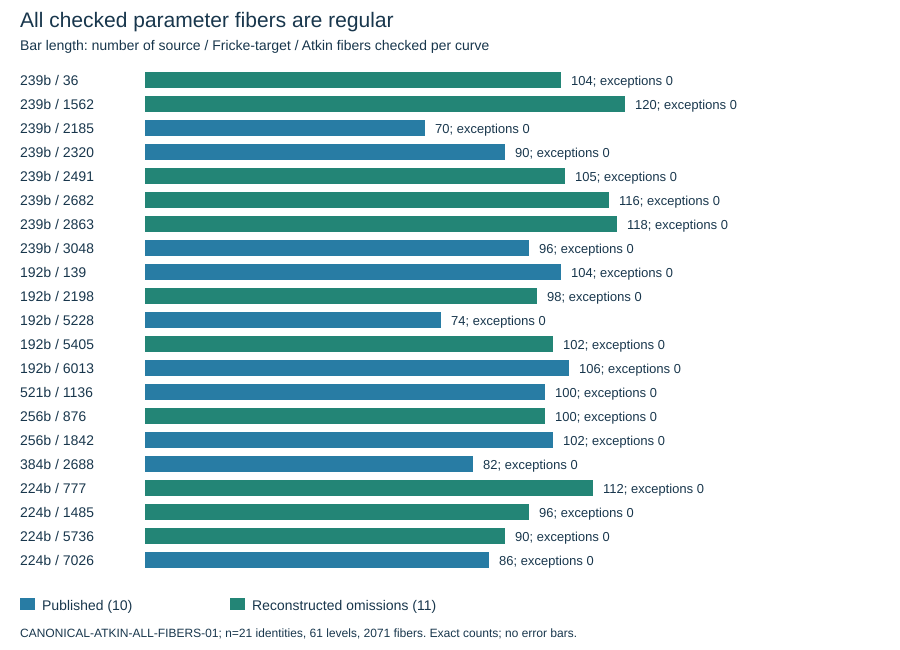
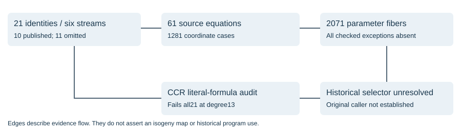

# Canonical/Atkin coordinate guards and the CCR printed-formula correction

2026-10-27. T-5518. Observation report; no formal hypothesis decision. The historical selector remains unknown. All 11 reconstructed omissions and all ten publications pass the bounded modular-coordinate predicates tested here, across all six streams. A newly recovered draft contains a real printed-formula discrepancy, but using those coefficients literally fails every cohort curve at degree 13 and therefore does not preserve the publications.

## Fixed identities and scope

The source cohort SHA-256 is `93ac4774b993a994a17d9327df92e0f2b287e66755cd933fdc683015fec1d545`. [comparison.csv](comparison.csv) lists all 21 full curve UIDs, fields, coefficients, orders, seeds and ordinals. The model is y^2=x^3-3x+b; b is reconstructed with c*b^2=-27 mod p. P-224's two signs are one isomorphism class and appear once. The 192-bit published ordinals5228 and 6013 retain their distinct v3/v2 identities. No post-endpoint or broader69-position additions enter the cohort. These are reconstructed omissions, not documented historical rejection events.

## Canonical and Atkin equations

Morain's1995 paper, sections3.2.1-3.2.2, gives field-dependent canonical and Atkin modular-coordinate paths. The available later LiDIA tables supply61 odd-prime levels 3..293:46 canonical and 15 Atkin. Their lineage is fixed at commit 23dac491f4cd96eb7de648a5cf90eb9ec77653c8; this is not authenticated1997 source. Each table is parsed as integer tokens, as the real reader does, retaining unconsumed opaque trailers. A native C++ control binds every coefficient at p=1009,j=34 for all 61 tables to the unmodified public meq_prime reader. This control does not call the inherited eigenvalue compatibility amendment in the earlier SEA build.

Native PARI computes the full polynomial gcds of F(X,j) with each partial derivative, plus F(0,j). Independent Python specializes the raw source tables, recomputes derivatives and checks2568 exact Bezout identities including controls. All 1281 cohort cells have nonzero F(0,j) and constant derivative gcds. Thus no algebraic parameter root, including any rational one, hits either tested first-stage derivative locus.

The extension follows every rational parameter root, proved complete independently using FLINT gcd(F,X^p-X). Canonical parameters generate both source and Fricke-target fibers, with target parameter ell^s/alpha and s=12/gcd(12,ell-1); Atkin parameters generate invariant fibers. For every fiber G(Y), exact certificates check gcd(G,G_Y), gcd(G,G_X), G(0) and G(1728). All 1185 rational parameters and 2071 resulting cohort fibers have zero checked exceptions. Source-mode extra j roots are contextual, not claims that the caller traverses them.

Constructed ordinary positive controls are independently point-counted: p=1009, j=779 has trace 58 and a level 17 derivative exception; p=1009, j=24 has trace-47 and both level 53 exceptions. The fiber audit retains five control fibers, including three exceptional ones. The level 17 X-exception search found none in the frozen j scan and records that absence rather than manufacturing a control. The real exceptions demonstrate that the tests can detect their stated condition.

## Recovered CCR draft and source-based test

Three author-hosted retrievals return the same 24-page draft, SHA-256919f089a7c5de6ca3d23050151d44995c9352572b7d675671fbdc5ccb8f54d39. Morain 1995 cites CCR as 1991; Schoof 1995 cites it as 1992. The recovered scan's metadata dates its scanning to 2018, so the exact draft version is not established. All 24 pages were OCRed; the formulas on pages 8-9 and Morain printed 275 were visually compared. No historical executable attribution is inferred.

Let p_k=sum x(iP)^k for i=1..(ell-1)/2, and p_0=(ell-1)/2. The literal draft coefficients are Anew=A+5*(p2+A*p0) and Bnew=B+7*(5*p3+3*A*p1+2*B*p0). Its own equations 4.4, 4.7 and 5.1 instead give Anew=A-10*(3*p2+A*p0) and Bnew=B-14*(5*p3+3*A*p1+2*B*p0). Morain's footnote explicitly identifies the correction. The power-sum normalization is the same in both documents.

CCR-LITERAL-COEFFICIENTS-01 freezes degree 13, all 21 inputs and one constructed ordinary p=101, A=2, B=3 control before running. Native PARI evaluates x(kP), k1..6, in the full degree 84 division-polynomial algebra. Independent integer arithmetic reconstructs psi13 and verifies132 multiple-coordinate relations, 44 corrected identities, and exact common-zero certificates for the two literal coefficient residuals. The common-zero gcd has degree 0 for every curve and the control. Derived coverage: all 14 cyclic degree 13 subgroups per curve over the algebraic closure, 294 across the 21 cohort curves; no individual subgroup enumeration or full point count is claimed.

The literal formula fails for all 11 omissions and all 10 publications. A universal use-and-reject rule based on it cannot reproduce the publications. This does not test a caller that conditionally enters the faulty code, alternative degrees, root-pair selection, later recurrence errors or a different implementation.

## Integrity, failures and limitations

The raw archive seals148 files and is 56, 570, 199 bytes, SHA-256`6a1d693b88e7c1eb61f6c61e3203b98a972b6e160b3640bdc75db82568f66629`. It retains native stdout/stderr, frozen inputs, protocols, source-table bytes, GPL notice, source-reader control and failures. Three zero-run preparation mistakes concerned physical rows, opaque trailers and line wrapping. Two earlier verifier attempts assumed monic Bezout gcds and suffixed filename traces; the actual source/outputs require unit-scaled gcds and paths printed before appending_II. The amendment preserves those failures and changes no native output. A later amendment strengthens exact UID/cohort binding. Packaging initially joined a derived CSV on a nonexistent index; the corrected join uses full curve_uid without changing the sealed archive or rerunning a producer.

The native coordinate run completed in7.8944s, table-reader control in0.7459s, fiber run in358.2656s and literal CCR run in0.2349s. These are measured diagnostic wall times under uncontrolled load on modern macOS ARM64, not historical runtimes, comparisons or performance claims. Native stdout sizes are78, 772, 631 and 21, 045, 312 bytes for the coordinate/fiber studies. No source-based mathematical rejection is inferred from an operational failure.

Local LMFDB manifests were checked complete first. The bounded genus 1, q=1009 query returned zero rows; no catalog identity was used. The av_fq extraction ended 2026-10-19T16:45:49.243703+00:00 from postgresql://devmirror.lmfdb.xyz:5432/lmfdb/public.av_fq_isog. Cryptographic fields lie outside that selected index. Controls were independently enumerated over their exact fields.

This is not a full SEA replay through level 293: kernel recovery, eigenvalue finding, CRT/stopping/resource policies and original candidate visitation are not established. Neither these guards nor the literal coefficient error supplies a selector, alone or in their directly tested combination. The original generator/caller/configuration and a predictive historical rule remain missing. Existing ECPP, all-root SEA and FreeLIP figures retain their prior sealed scopes; this round adds separate figures and changes no formal decision or canonical frontier claim.

## Replay and sources

Extract evidence.tar.zst, then run `python3 -B evidence/verify.py`. Add `--fibers` under Python with python-flint 0.9.0 for independent rational-root completeness. The ordinary replay uses the standard library; the full root audit uses FLINT in process. Neither invokes the external PARI/C++ producers or network. FLINT wheel digest and official URL are retained in FLINT-RUNTIME.json. The public export deliberately excludes publisher PDFs, scanner images, duplicate normalized GP tables, binaries, the venv and wheel; SOURCE-BOUNDARY.json describes reconstruction and custody.

Primary sources: [Morain 1995](https://jtnb.centre-mersenne.org/item/10.5802/jtnb.143.pdf), [CCR draft in the author's archive](https://www.lix.polytechnique.fr/Labo/Francois.Morain/Introuvables/Drafts/ccr.pdf), [LiDIA source](https://github.com/mkoeppe/LiDIA/tree/23dac491f4cd96eb7de648a5cf90eb9ec77653c8). Exact acquisition receipts and source hashes are retained. Object-store publication returned a guarded HeadObject403; no remote upload is verified. The existing large-file-ok PR exception retains the bytes in Git. This does not resolve store permissions or inherited PR merge collisions.
