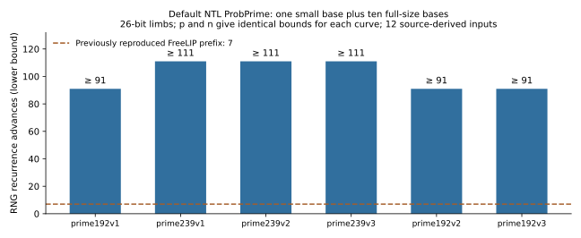
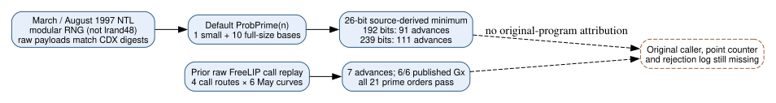

# Period NTL source narrows the seven-output prefix explanation

**24 October 2026 UTC. Retrospective source audit, without an NTL executable run.** Four Internet Archive payloads match their CDX SHA-1 digests. The March and August 1997 source snapshots contain identical normalized bodies for `ProbPrime(const ZZ&,long)` and `SqrRootMod`. The default NTL prime test uses one small random base followed by ten full-size random bases. With 26-bit limbs, this requires **at least 91 RNG recurrence advances for the 192-bit inputs and 111 for the 239-bit inputs**. Those bounds hold for both p and n on all six published May curves. This is a different literal call count from the previously reproduced seven-output FreeLIP prefix. It supplies no rejection rule for the eleven omitted curves.

## Primary-source acquisition and dates

The [May 10, 1997 NTL homepage](https://web.archive.org/web/19970510214400id_/http://www.cs.wisc.edu:80/~shoup/ntl/index.html) already advertises NTL 1.5 and links its archive. This precedes the recovered May timestamp inputs. The [August 1 source capture](https://web.archive.org/web/19970801214429id_/http://www.cs.wisc.edu:80/~shoup/ntl/ntl-1.5.tar.Z) is consequently not a release date. It also does not prove that its exact bytes were available in May. The [March 1 source capture](https://web.archive.org/web/19970301122540id_/http://www.cs.wisc.edu:80/~shoup/ntl/ntl.tar.Z) gives a pre-May source comparison; the two relevant normalized function bodies agree. This audit calls it the March snapshot without assigning an unverified release label.

| Raw payload | Capture in UTC | Bytes | SHA-256 |
| --- | --- | ---: | --- |
| March source archive | 1997-03-01 12:25:40 | 335,767 | `72145a0816ea3b2686e1b86fef690ec179f131015b8a2819a930083c364b9b53` |
| August NTL 1.5 archive | 1997-08-01 21:44:29 | 446,513 | `c2d80c5293c824b16f89ac7e5e0aeb29e3996f8560b877c44858f41c43717e1c` |
| May homepage | 1997-05-10 21:44:00 | 1,915 | `7b90940769232f73902161df48ee8f933d1ee8827c4a843934338b292ad2181a` |
| [March tour](https://web.archive.org/web/19970301122459id_/http://www.cs.wisc.edu:80/~shoup/ntl/tour.html) | 1997-03-01 12:24:59 | 23,563 | `6ec28dcab22de01e7d02b65a7dc3b4dd55caa8c85dfc906f7ef4af209aab477b` |

Every raw payload was checked against its exact CDX digest, protecting this comparison against a silently substituted nearby capture. The retained [CDX response](cdx.json) has SHA-256 `a06e06adadadf9769b819a0287c8e4f5fd32674455f1be23483646902d9fba7d`. [analysis.json](analysis.json) binds those digests, exact URLs, extracted source-file hashes, function-body fingerprints and archive inventories. The source archives are externally retrievable and are not redistributed in this change.

**Search provenance:** The commit-pinned [LLFourn/secg-curves base-point report](https://github.com/LLFourn/secg-curves/blob/58013550beefc692ed8e9bb5483d6126966ba1df/src/secg/basepoints/RESULTS.md) supplied the NTL-archive lead. It is a secondary pointer; none of its other conclusions is treated as an independently replayed result here. The findings above come from the retrieved primary payloads. The [scope](SCOPE.md) was written after the relevant functions had been read: this is explicitly retrospective, not a prospective discovery test.

## The source-derived bound

`ZZ.h` supplies default `NumTrials=10`. For these known large prime inputs, the trial division and witness tests do not return composite early. `ProbPrime` first calls `RandomLen(ZZ_NBITS)` for one small base, then `RandomBnd(W,n)` ten times. The long-returning `RandomBnd` calls `zrandom` once; the full-size overload calls `zrandomb`, which consumes `input_limbs+1` calls of `zrandom(ZZ_RADIX)` for each base. Thus, in the 26-bit configuration,

```text
minimum advances = 1 + 10 * (ceil(bit_length(input) / 26) + 1)
192-bit input: 1 + 10 * 9  = 91
239-bit input: 1 + 10 * 11 = 111
```

Each `zrandom` call advances the modular RNG at least once; internal rejection can add advances. These are exact source-derived lower bounds on recurrence advances, not measured times, measured final states, or an estimate of the historical workload. The default call cannot literally be a seven-advance call. Final-state equivalence across arbitrary call sequences or RNG periods is not established or excluded by a lower-bound calculation alone.



*Twelve exact input rows, p and n for each of six curves. Both arguments have the same bound for each named curve, so each bar represents two rows. No statistical uncertainty: the conditional integer bounds are derived from the inspected source. The unmeasured number of internal rejections remains unspecified. Data: analysis.json; independent static/integer replay: verification.json; editable graph: render.py.*

The six identities are `prime192v1`, `prime239v1`, `prime239v2`, `prime239v3`, `prime192v2` and `prime192v3`; their full curve UIDs and exact p,n are in [analysis.json](analysis.json), inherited from the hash-pinned [trait catalog](../nist_seed_skipped_curves_20261016/traits.json). In the prior [FreeLIP call replay](../nist_seed_freelip_prefix_20261024/report.md), raw `zprobprime(v,7)` or `zprime(v,8,2)` consumed exactly seven states and then reproduced all six Gx values. The higher-level NTL default uses a different base-selection path. A shared low-level RNG does not make these routines interchangeable.

## What this leaves open



**Derived distinction:** NTL/FreeLIP's modular RNG is separate from the clock-seeded `lrand48` stream used for the 160-bit curve seeds. An NTL call does not by itself shift that separate stream. Any claim that library work skipped seed windows must specify and reproduce the original program's coupling between the streams. The present audit supplies no such caller.

**Retrieved square-root detail:** Both snapshots implement a randomized Cipolla-style `SqrRootMod`: it draws trial values using `RandomBnd` until a quadratic-nonresidue condition holds. Its header assumes an odd prime modulus and a square input. This can consume a variable number of RNG calls when used correctly. There is no evidence here that the original program invoked it at a particular point, violated its precondition, or rejected any named curve because of it. The numerical function-body agreement is not a source-identical replay of Reiter's generator.

**Remaining alternatives:** A caller could choose another trial count, use another API, insert further calls, initialize or restore RNG state elsewhere, use a different limb configuration, or use another library. The original point counter could also have had an extra test, an error or a stopping rule. These remain hypotheses, not observed explanations. The prior eight-base FreeLIP call accepted all 21 named prime orders; neither that result nor the present source bounds identify a shared mathematical weakness among the eleven omissions. The 1997 draft's fifty-test requirement still prevents identifying those eight-base calls with its mandatory standard check.

The existing [selection problem](../../problems/nist-seed-selection-rule-unexplained.md) stays open. The next source discriminator is a dated caller, build configuration and candidate trace that links the relevant RNGs and reproduces all published seed ordinals and omitted decisions. A mathematical discriminator must instead give an explicit property, a subgroup advantage and a prediction on independent historical data. The study's source diagram is updated; the existing seed-selection diagrams and canonical ECDLP frontier sources were checked and receive no new verified attack, isogeny or cost edge.

## Reproduction and evidence limits

Download the four exact `archive_url` objects in [analysis.json](analysis.json) to its declared local paths, preserving their raw bytes. With a fresh output directory or a copy of this study without generated JSON, run `python3 analyze.py`, `python3 verify.py`, `sage -python render.py`, `dot -Tsvg inference.dot -o inference.svg`, and `typst compile report.typ report.pdf`. The scripts refuse to overwrite the arithmetic and verification records. The archive comparisons and all twelve integer rows passed the separate verifier; no NTL binary was compiled and no historical CPU, point-counting runtime or final RNG state was measured. Rendering is a derived view, and every PDF page was visually inspected.

Provenance: archival objects and source routines are `retrieved`; exact curve inputs and earlier FreeLIP state replays are `internal`; the call bounds are `derived` and separately checked within the same authoring session. That check is not an independent research-state review. No experiment, hypothesis or goal status is changed.
