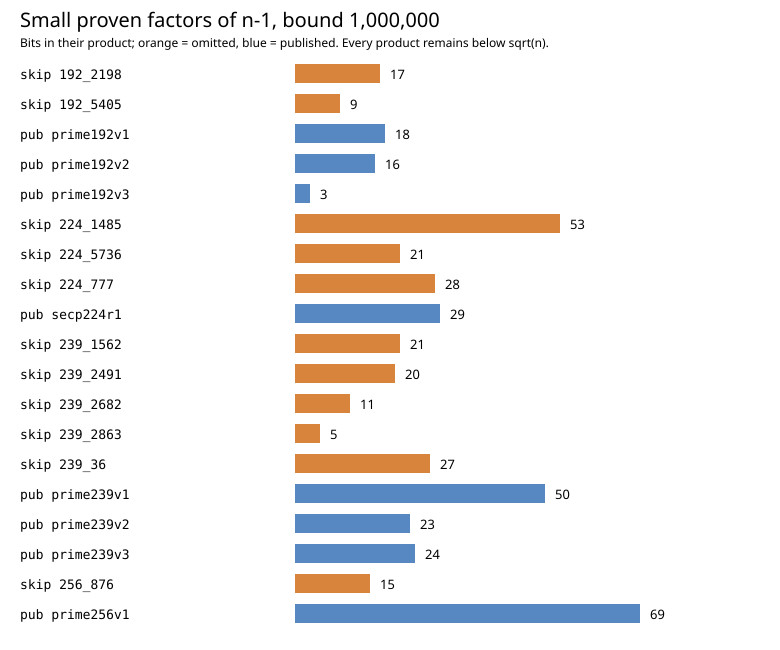
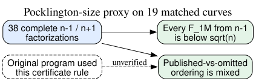

# Did easier prime-order certification select the published curves?

**Date:** 2026-10-23 UTC. **Status:** Complete exact factorization of `n−1` and `n+1` for all nineteen same-field published and omitted curves. This tests one possible 1997 workflow proxy; it does not reproduce the original program.

## Result

**No exact separator appears.** For every one of the nineteen prime group orders `n`, the product `F` of *all* factors of `n−1` at or below one million is smaller than `√n`. Thus a Pocklington proof using only these small factors is unavailable for **every** published and omitted curve. Complete `n−1` factorizations exist in the [sealed run](runs/certificate-20261023T1747Z/), but they require at least one larger proven factor to cross the theorem's size condition.

The size of this small-factor product is mixed by label. In the 239-bit field and P-256, published curves mostly have more small factors of `n−1`; across all four fields, the published value is larger in **19 of 25** within-field published-versus-omitted comparisons. Those pairs share curves and are not independent trials. The pattern fails as a universal selector: omitted P-224 block 1485 has a **53-bit** small-factor product versus the published P-224's **29-bit** product, and published prime192v3 has only **3 bits** versus **9** and **17 bits** for the two omitted 192-bit curves. The negative-control `n+1` comparison also favors published curves in **16 of 25** pairs.

| Field | Omitted `n−1` small-factor product bits (`B=10⁶`) | Published controls, same metric |
| --- | --- | --- |
| 192-bit | blocks 2198: 17; 5405: 9 | prime192v1: 18; prime192v2: 16; prime192v3: 3 |
| 239-bit | blocks 36: 27; 1562: 21; 2491: 20; 2682: 11; 2863: 5 | prime239v1: 50; prime239v2: 23; prime239v3: 24 |
| P-224 | blocks 777: 28; 1485: 53; 5736: 21 | secp224r1: 29 |
| P-256 | block 876: 15 | prime256v1: 69 |



*Figure 1. Exact bit lengths of products of prime powers with prime base at most one million; orange marks omitted candidates, blue published controls. None crosses `√n`. Editable source: [analyze.py](analyze.py).*

## Method and checks

The [pre-run protocol](PROTOCOL.md) fixed the 11 omitted classes, eight same-field published controls, both neighbors `n−1` and `n+1`, four factor bounds and Pocklington-size metrics. It pinned the archived input digests and a 180-second per-case watchdog. The resulting **38 real factorizations** and three arithmetic controls (`15`, `60`, `101`) all completed. For every case, [Sage verification](runs/certificate-20261023T1747Z/verification.json) matched the raw GP transcript and source curve UID, checked the full product, and checked each factor with proof-enabled primality. Sage separately checked the GP outputs but may share arithmetic internals; this is not a second factorization. Two injected launcher failures returned nonzero with no completion marker ([control receipts](controls.json)).

The run started from clean commit `895cfe6d51e22e44649272f2da1aa263525e68c0` on macOS arm64 with Python 3.12.8, GP/PARI 2.17.3 and SageMath 10.10.rc0 ([environment](runs/certificate-20261023T1747Z/started.json)). The 41 serial GP calls took **62.948 seconds** in aggregate; the longest took **20.695 seconds**, and the maximum sampled resident size was **34,488,320 bytes**. These are measurements of the modern local factorization, not a model of 1997 certificate effort. The raw external run was copied byte-for-byte into this write-once directory. The [derived analysis](analysis.json) contains every row, every bound, exact pair counts and the source verification hash.

## What this does and does not say

Pocklington's theorem gives a deterministic primality certificate when a completely factored divisor `F` of `n−1` exceeds `√n` and suitable modular witnesses are supplied. That was a known route in the 1990s ([Morain's 1997–98 account](https://algo.inria.fr/seminars/sem97-98/morain.html), `retrieved`, primary). We tested the *size condition* and factor structures, not the modular witnesses, recursive proof effort or the original software. The 1998 [ANSI X9.62 standard](https://safecurves.cr.yp.to/grouper.ieee.org/groups/1363/private/x9-62-09-20-98.pdf) specifies a probabilistic primality test in Annex A.2.1; a correct probable-prime test does not require factoring `n−1` and cannot reject a truly prime `n` as composite. A historical implementation error, timeout or additional proof policy remains possible but is not evidenced by this calculation.

Even with complete `n−1` factors, "easier to prove" needs a specified algorithm. Taking the largest prime-power components first, the minimum number needed to exceed `√n` is either one or two across these nineteen curves. This metric is also mixed: omitted P-256 block 876 needs one large component whereas published P-256 needs two, although the published curve has a larger product of small factors. The different proxies rank this pair in opposite directions. None is a curve-group weakness. Factors of `n−1` are **not** factors of the prime group order `n`, so they do not create a Pohlig–Hellman shortcut. An auxiliary-input DLP model would need its own explicit oracle and attack analysis.



*Figure 2. Solid arrows are exact computations and bounded inferences. The dashed historical selection premise remains unverified. Editable source: [inference.dot](inference.dot).*

Under the user's working premise that all eleven candidates were reached and passed over, this study excludes the simple rule "reject when the prime order lacks enough small `n−1` factors for a Pocklington certificate" at every predeclared bound through one million: **all nineteen** lack enough. It also rules out a global monotone threshold on this small-factor product, because same-field published and omitted values overlap in both directions. It does not identify what the original program checked or any common cryptanalytic weakness. The [selection-rule problem](../../problems/nist-seed-selection-rule-unexplained.md) remains open; the canonical ECDLP graphs were checked and gain no attack edge from this workflow proxy.

## Reproduction

```sh
python3 research/nist_seed_order_certificate_20261023/run.py --out NEW_WRITE_ONCE_DIRECTORY
python3 research/nist_seed_order_certificate_20261023/analyze.py
```

The archived directory has exact commands, raw stdout/stderr, factors, versions, resource receipts, Sage checks and a completion marker. Source labels: `internal` for pinned curve and earlier selection records; `measured` for this local run; `separately checked` for Sage factor verification; `derived` for the bounded size and pair comparisons. No official hypothesis status changes here.
