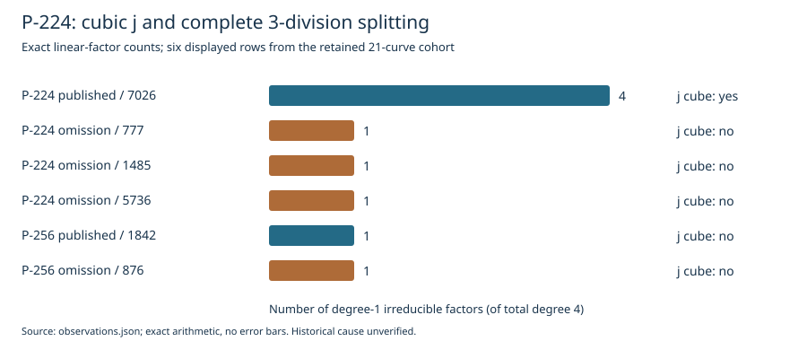

# P-224 cubic j and 3-division splitting observation

Date: 2026-10-25. Scope: archived observations on the fixed 21-curve comparison
(ten published controls, eleven reconstructed omissions, six base-field streams).
Historical selection status: **unresolved**. This record preserves a specific
lead; it does not establish that the original program required a cube root of j.

## Observation

For `y^2 = x^3 - 3x + b` over `F_p`, compute
`j = 6912/(4-b^2) mod p`. A cubic residue means `j = u^3 mod p` for some
field element `u`, not merely that j has a complex cube root.

| Exact candidate | Published? | j is a cube in F_p? | Irreducible degrees of the 3-division polynomial |
|---|---|---|---|
| P-224 / secp224r1, block 7026 | yes | yes | 1, 1, 1, 1 |
| P-224 stream, block 777 | no | no | 1, 3 |
| P-224 stream, block 1485 | no | no | 1, 3 |
| P-224 stream, block 5736 | no | no | 1, 3 |
| P-256 / prime256v1, block 1842 | yes | no | 1, 3 |
| P-256 stream, block 876 | no | no | 1, 3 |



The factor-count figure displays six rows; the machine-readable inputs and
observations retain **all 21** rows. No sampling uncertainty applies to these
exact arithmetic values. The figure is not a timing or attack-cost comparison.
Full curve UIDs, field characteristics, equations, subgroup orders, generators,
cofactors, seeds, timestamps and ordinals are retained in [inputs.json](inputs.json).

The normalized 3-division polynomial is
`x^4 - 6*x^2 + 4*b*x - 3`; its roots are the x-coordinates of nonzero 3-torsion
points, with P and -P sharing an x-coordinate. This is a statement about small
torsion, not a recovered transfer or an attack on the prime-order subgroup.

## Controls and replay

[replay.py](replay.py) uses Python's modular arithmetic for the j/residue checks
and PARI/GP for native j computation, irreducible polynomial factorization,
factor-product checks and p/n primality checks. It also regenerates every seed
from its timestamp and ordinal, checks the hash-derived coefficient relation,
and verifies that the explicit p,b,n match the inherited exact identity.
It compares every result with [observations.json](observations.json).
Coefficient and seed-ordinal tampering controls must fail.

```sh
python3 research/nist_seed_p224_j_cube_20261025/replay.py --gp gp
```

The checked replay completed all 21 cases and both tampering controls; see
[replay-receipt.json](replay-receipt.json). The inherited prime-order curve
certificates are not replaced by this check: the replay does not rerun SEA or
claim an independently authenticated historical implementation.

The coefficient derivation intentionally reproduces the reconstruction's
bit-length formula; it does not silently substitute a later standard revision.
Legacy display fields were not used to replace the exact identity parameters.
The source archive hashes are in [source-provenance.json](source-provenance.json).

## Interpretation and counterexamples

**Observed:** all three P-224 omissions are non-cubic, while its publication is
cubic and has a completely split 3-division polynomial.

**Counterexample to a universal requirement:** published P-256 is non-cubic.
Its omitted block 876 has the same cube/non-cube and 3-division degree pattern.
In the 192-, 239- and 384-bit fields, p is 2 modulo 3, so every field element
is a cube; those rows supply controls but no cube-residue discrimination.

**Proposed historical question:** did a field-dependent point-counting or
validation branch require a base-field cube root of j, and reject or abandon
the candidate when that root was unavailable? Existence of the observed pattern
does not establish such a branch. The original source, configuration and logs
have not been recovered.

An exploratory conditional rule, "when p is 1 modulo 4, require j to be a
cube", preserves all ten publications and excludes only the three P-224
omissions. P-224 is the only such field in this cohort, so that formulation is
not an independent cross-field prediction. It leaves eight omissions
unexplained. The broader local feature/pair search is not republished here as
an authenticated selector or a closed hypothesis.

## Next discriminating check

Locate a dated implementation whose actual caller selects this branch, and
identify its input conditions, cube-root failure handling, fallback and return
status. Before calling it an explanation, replay the same declared path on the
complete cohort, including non-cubic published P-256. A fallback that proceeds
normally weakens that implementation hypothesis; a documented rejection that
matches P-224 keeps the branch-specific lead open but still requires explaining
the other eight omissions. Fit and historical use remain separate obligations.

This PR adds no experiment/goal status transition, performance advantage,
weakness verdict or original-code provenance claim. The existing historical
selection problem remains open. No canonical isogeny graph changes: this
observation certifies no new isogeny map or transport edge. The new scoped
figure and PDF are derived views of the retained observations.

## Sources

- `internal`, retrieved and replayed 2026-10-25: the exact earlier 21-curve
  receipts and local j/3-division outputs, bound by SHA-256 in
  [source-provenance.json](source-provenance.json).
- `retrieved`: [the original seed reconstruction](https://www.anthropic.com/research/ecdsa-curve-origins),
  which leaves the omission criterion versus generation artifact unresolved.
- `retrieved`: [Sage finite-field curve documentation](https://doc.sagemath.org/html/en/reference/arithmetic_curves/sage/schemes/elliptic_curves/ell_finite_field.html),
  for the distinction between j, twists and base-field isomorphism. Equal j
  does not in general prove F_p-isomorphism.

The PDF is a compact presentation of this report; the JSON and replay are the
arithmetic record. This is an observational lead, not the criteria they used.
