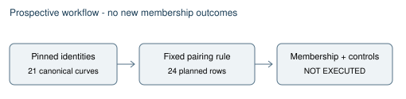

# Fixed-x test: source and protocol validation

27 October 2026. This report describes source engineering only. The new omission-to-point memberships remain unevaluated. The full GOAL-NISTSEED-ab8949 commonality objective remains active and unresolved.

## Question and fixed scope

Could the next published Gx have been held fixed while earlier qualifying curves in the same recovered timestamp stream were considered? The proposed exact checker pairs each of the eleven canonical omissions with the next publication in its stream, retains ten published self checks, and adds three distinct P-224 opposite-sign representations with x unchanged. The planned main batch has 24 correlated rows, followed by an identical A/A batch and fixed planted/corruption/circularity controls. These counts describe a prospective workload, not measured outcomes.

The source uses Euler and Euclidean Jacobi calculations with agreement required, and accepts symbol zero as membership. A full fixed(x,y) predicate is recorded only as a circularity diagnostic: fixed p,a,x,y already determine b. A positive fit cannot establish original chronology. The broader 69-position draft-compatible census is outside this necessary-condition test; the complete research objective is not reduced to these 24 rows.

## Sources and observations

The primary Anthropic reconstruction was retrieved and its base_point_x recipe and open questions read: https://www.anthropic.com/research/ecdsa-curve-origins. The existing base-point workflow and direct-stream reports, the committed parameter records, exact identity metadata, and experiment-protocol schema/tool were inspected. search_knowledge was unavailable. Earlier six final-curve replay outcomes informed this post-observation model choice; the new cross-curve memberships were not inspected while authoring.

Coordinator source-authoring task TASK-20261027-82d8a8 returned four exact files read-only. The original response is retained in authoring-response.json. Its Python source matched SHA256 b85f9275bd80ba46984e328d39ee2ce70691195afb3748614244f74f6310acc7 and compiled without execution. Native JSON schema checking and the actual repository validator both found two uncertainty-enum errors. The failed actual validator output is retained.

The Coordinator approved exact pre-freeze corrections in authoring-correction.json: use none_exact for both uncertainty fields, and bind checker/protocol/input bytes to the observed committed revision while recording unrelated dirty paths. The corrected source SHA256 is 7c70b0b9e4843efa19c7301cb1884229621a525812528ace70bf913eb4580de1. Source syntax compilation and the actual repository protocol validator pass; validation-attempt-2 has zero findings. No checker import, main invocation or study membership computation was performed.

An initial in-memory schema attempt used bundled Python, which lacked jsonschema. Native Python supplied the installed validator. The initially suggested negative fixture b=2 at p=101,a=-3 is singular; the source author corrected it to nonsingular b=3 before data. These are source-authoring corrections, not discarded scientific trials.

## Coordination and preservation

MCP task-card/conflict requests and the official CLI status/check/doctor timed out during authoring. No writes proceeded while current ownership could not be checked. The service subsequently returned the same T-5500 claim, attempt 1 and fencing epoch 1; a fresh conflict check allowed materialization. No task, attempt cap, model route or scientific budget was reset. The isolated node_repl retrieval suggested by the child returned unavailable in the parent; exact public delivered source was instead recovered from the parent's own agent_message event, without reading private reasoning.

The source snapshot belongs to TASK-20261027-701621; later result publication is assigned TASK-20261027-99dad5. Declared file hashes and actual Git publication facts are recorded separately. Neither a static pass nor a frozen protocol is scientific approval, an executed experiment, a historical selector, or completion of the commonality goal.

No canonical historical-selection, isogeny or ECDLP cost edge changes: the new diagram is explicitly prospective and there are no new mathematical observations. The earlier point-first chronology and base-point workflow diagrams were checked as source context.

## Next gate

Commit and push exact source; bind and freeze the prospective protocol before new data. Complete a lawful specification, trial plan, handoff, queue, archive, lane and independent-review route, obtain the actual prospective preapproval result, and only then record approval and use the run entry point. Existing ECPP source work remains a separate unfinished path and its zero-run contract grants no authority to this test.
