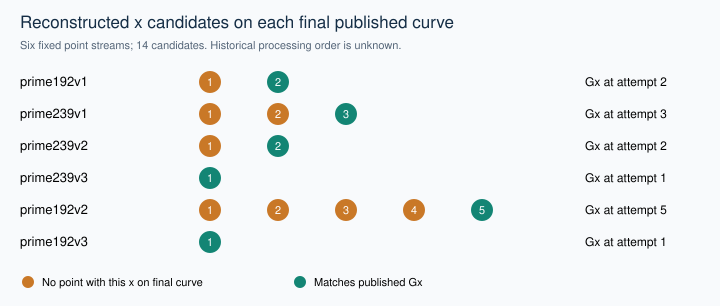
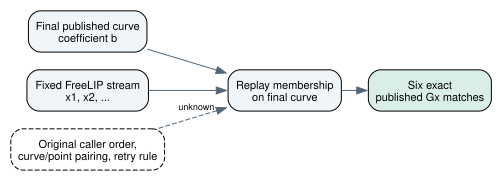

# Do the published base points fit a point-first selector?

27 October 2026 UTC. Post-observation deterministic verification of retained records; no historical selector or official scientific status is established. Conductor task T-5500, UUID 7eb3c0fb-bf10-4507-bc87-8f6ea5dc9db6. The broader GOAL-NISTSEED-ab8949 commonality objective remains unresolved.

## Question and exact scope

The user asks whether generator points might have been picked before curves, with curves retained only when the selected points lie on them. This check distinguishes three propositions: generate an x-coordinate and test it; use exactly the first x after a recovered initialization and reject the curve on failure; or maintain a point stream while trying successive curves. Full preselected (x,y) pairs are a separate algebraic case.

This is a replay of existing frozen inputs, not a prospectively discovered criterion. No new seed, prefix, packing, attempt limit or assignment of points to omitted curves was searched. The existing FreeLIP prefix protocol and build amendment remain unchanged. The independent-verifier implementation is reused, so this session is not a new independent review.

## Method and sources actually checked

The additive replay_check.py pins the old 77-case results, existing verify.py and ten published parameter records. It calls the existing verify(directory) function without invoking its writing CLI. It then exposes the same fixed 26-bit, discard-seven point-loop intermediates, retaining its original 32-attempt cap. Each candidate is tested against the final published coefficient using the existing modular-residue method. Final Gx, retry count and RNG state must agree with the retained actual-library output. The ten published full coordinate pairs are also checked against their exact recorded equations.

Primary code/reconstruction: https://www.anthropic.com/research/ecdsa-curve-origins (retrieved in the conversation; its base_point_x source and six listed counts were read). Repository inputs: research/nist_seed_freelip_prefix_20261024/PROTOCOL.md, BUILD_AMENDMENT.md, verify.py and runs/prefix-v2/results.json; research/nist_seed_skipped_curves_20261016/traits.json (internal, committed, hash-pinned). Prior workflow limits: research/nist_seed_selection_workflow_20261023/report.md and research/nist_seed_1997_selection_extension_20261023/basepoint_stream/report.md (internal, read). No search_knowledge tool was available; direct source records were used.

## Replayed observations

The existing verifier passed all 77 retained cases: 30 of 30 matching point routes, zero matches among 24 wrong-prefix/limb-width controls, and all 21 large-order state checks plus two small controls. These are rechecks of the earlier records, not 77 new legacy-library runs. All ten published full coordinate pairs satisfy their recorded curve equations.

| Curve | Recovered seed | First x works on final curve? | Published Gx appears at attempt |
| --- | ---: | --- | ---: |
| prime192v1 | 20000 | no | 2 |
| prime239v1 | 20420 | no | 3 |
| prime239v2 | 20507 | no | 2 |
| prime239v3 | 20509 | yes | 1 |
| prime192v2 | 20512 | no | 5 |
| prime192v3 | 20517 | yes | 1 |

Six fixed initializations yield fourteen replayed candidate x values: eight non-residues on the final published curves precede the six published Gx matches. These are reconstructed intermediates, not authenticated historical rejection events. The full integers, full curve UIDs, residues and RNG states are in replay-1/point-traces.json. No timing, sampling probability or security advantage is inferred.

## What follows and what remains unknown

Derived: the exact model that uses only the first x after each recovered seven-output prefix cannot reproduce four of the six published May points. The arithmetic reconstruction with point retries reproduces all six. A common finite attempt cap for that reconstruction must be at least five; this does not show that a cap existed or classify any omitted curve.

Unresolved: the broader point-first chronology. Later x values could also arise if a point stream advanced while the caller tried different curve candidates. Final coordinates and the recovered stream alone do not reveal those earlier pairings. No historical point-stream assignment to the eleven omissions is known here, and none is invented. In particular, the eight non-residues on final published curves are not eight identified omitted curves.

The point recipes for P-224, P-256, P-384 and P-521 remain unknown. Their valid published points establish membership, not how or when those points were generated. For a fully preselected pair on a fixed field with a=-3, the equation determines one b via b=y^2-x^3+3x modulo p; the recovered hash construction would still require a compatible explanation.

Next discriminator: freeze one historically grounded rule for initializing and advancing the point stream and pairing it with curve candidates. Require it to match published Gx values and the full keep/omit sequence without choosing per-curve states after seeing outcomes. Original caller source or logs could supply that rule. This report does not design or approve that future experiment.

## Preservation, controls and delivery

The first replay attempt completed with exit zero; stderr is empty. No previous run or source file was overwritten. Raw outputs, exact command, source head, dirty state, platform, Python version and hashes are retained in replay-1/started.json, existing-verifier.json, point-traces.json and completed.json, with separate stdout/stderr. New seed searches, new legacy-library invocations and ECPP/VM executions are all zero. The work is separate from BATCH-a41798's zero-run integration task.

The first PDF-rendering attempt failed before writing artifacts because the bundled Python lacked svglib. Its stdout/stderr remain retained. The renderer was repaired to use existing ReportLab primitives for the chart and Graphviz PNG for the diagram; no dependency installation or scientific rerun was needed.

The new report records coordinate arithmetic and an inference boundary. No verified historical-selection, isogeny, attack or cost edge is added to a canonical graph. The existing workflow and basepoint-stream diagrams were checked as source context; no established edge changes. Publication and PR state are recorded separately from this rendering.

## Exact published identities

- prime192v1: `urn:ec-record:1:sha256:cdd1002da8b8992058e8b419334326a941a367e2e9298b81ba5759a58a3e1126`; recovered point recipe available.
- prime192v2: `urn:ec-record:1:sha256:6d3064894aabfbf742aeb34e6fe0f9d8b3cd487243e283adf7470ad08821f6a2`; recovered point recipe available.
- prime192v3: `urn:ec-record:1:sha256:4bb29f37591675d48b0805ec04181b0c22237f21a56c9bf32078a11b81238aa3`; recovered point recipe available.
- prime239v1: `urn:ec-record:1:sha256:05c3ea5b5307bc83a37a42e8a79bdeaed732b01b42d4fb274d3aaea8f6c536d5`; recovered point recipe available.
- prime239v2: `urn:ec-record:1:sha256:fa37ac33825f29e49eace88076d505bb9c04b946332fd29003c9ebac7cddeceb`; recovered point recipe available.
- prime239v3: `urn:ec-record:1:sha256:5422f32365cfedfd11fa09d91e55b32c202c11b78e44a4153e2c99b3e10c25b6`; recovered point recipe available.
- prime256v1: `urn:ec-record:1:sha256:bb60dc2a4430532d22dc1a27ec2f7b78068bb317ede125594ce89219e65d1e4a`; recovered point recipe unknown.
- secp224r1: `urn:ec-record:1:sha256:db6c3a1e40ae241e8e4fb0695a6e68df7b430c74c4cc0a37e32da95808e4df10`; recovered point recipe unknown.
- secp384r1: `urn:ec-record:1:sha256:d2e852530dd59cb7720c2e3af16270f51a4e294c89762848642da1331fdbc88f`; recovered point recipe unknown.
- secp521r1: `urn:ec-record:1:sha256:87a5992f487705d9729eb5c559a2e6667a448b8b9d8b71cf762a9607452bde36`; recovered point recipe unknown.

## Reproduction

Replay command: PYTHONDONTWRITEBYTECODE=1 python3 research/nist_seed_point_first_20261027/replay_check.py --out NEW_DIRECTORY. It refuses an existing output directory. The exact first command is in replay-1/started.json. Render with the bundled Python and render_report.py. Rendering performs no new curve computation. Source input hashes and the intermediate-value record digest remain machine-readable in the replay files.
