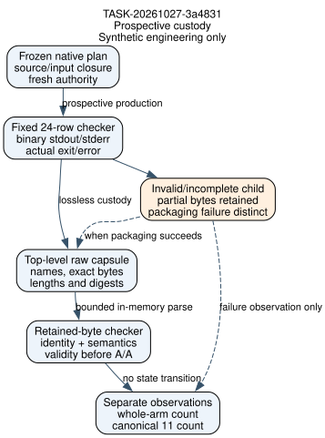

# Fixed-x native source engineering

TASK-20261027-3a4831. Observations below describe guarded synthetic engineering only. Scientific execution, scientific readiness and official state transitions are not established.

Latest retained invocation: exit 0; passed 60; failed 0.

The fixture has 24 explicit p101 representation rows: ten self rows, eleven canonical-domain rows and three sensitivity rows. Its constructed main count is 13 and canonical count is 0; these fixture values exercise distinct count domains. Named inputs are inspected only for identity and chronology metadata. The scientific contract remains 21 canonical identities, 24 representation rows, four correlated whole-batch export rows, and the original broader 69-position limitation.

Actual guard totals from the latest complete suite JSON: {"child_calls": 63, "fake_cli_processes": 1, "forbidden_process": 0, "legacy": 0, "named_membership": 0, "scientific_runs": 0, "storage": 0, "synthetic_predicates": 3286, "vm": 0}

Retained invocation history:

- Sequence 1: exit 0; passed 55; failed 0; stdout 69b85600d8a106eae40671a51c5829fad6bdc768b6b3594a7368ffd80212e455.
- Sequence 2: exit 1; passed 55; failed 5; stdout 0ace44656837b3faa8eb24ed6c7cde4bbaff7d90809bd3f7b348bbf6b81e8232.
- Sequence 3: exit 0; passed 60; failed 0; stdout 9e1847e71c7b6c36f50ee4661020c93386a302c927a6be3470664f0f371a2770.

Latest failing checks:

- None reported by the parsed latest suite.

Source changes: v2 provenance binds exact unchanged inputs to main27256e880ee2f7838b5aba2eaf193826148d2934; root resolution reflects the task directory; current committed-byte checks remain. The wrapper retains binary captures, actual exit or invocation error, and packaging status separately. A normalized bounded gzip/JSON capsule stores exact raw bytes; its checker does no extraction. The local checking path reconstructs identity/chronology and semantics without importing the producer. Individual validity precedes A/A equality. Whole-arm lift_count/main_lift_count and canonical_omission_lifts remain distinct.

Test seams and limits: production load_plan/authorize and Git committed-byte calls are replaced only inside explicit synthetic context tests. The actual complete_manifest function and guarded wrapper/checker functions are invoked by the suite; their actual outcomes are in the retained check rows. The explicit-fake CLI is a local isolated process using the same synthetic seams. Guards reject other process/network operations. No production scientific supervisor launch is covered by those seams.

Source review: AGENTS.md, agents/executor.md, complete literature/observation rules, historical checker/bridge/protocol and prior engineering review, source-inputs.json, native supervisor and ledger run-schema source (provenance internal, verified_by TASK-20261027-3a4831). Official Python subprocess, gzip and JSON documentation was retrieved during authorship. External-source review followed the first proposed snippet; repository review preceded design. This ordering deviation is retained. URLs: https://docs.python.org/3/library/subprocess.html ; https://docs.python.org/3/library/gzip.html ; https://docs.python.org/3/library/json.html .

Original frozen core: 8960ab8353246733c09a707a9f559fe69d5fb2f71a8f1c7f579a52db2ca05c28. All three exact input pins remain in source-lineage.json. Original exhibits and protocol bytes are unchanged. The successor protocol amendment remains draft.

Remaining gates: assess all actual failures; parent snapshot/publication; independent engineering invocation review and archive; exact successor scientific protocol/freeze and full archive coverage; actual preapproval true; committed/pushed approval; selector ready; lawful scientific lane/claim; separate independent scientific review. Historical visitation, initialization and selection across all69 positions remain unestablished. Full goal criteria are unchanged.

Canonical graphs checked by scope: the historical ECPP runtime/admission graphs and frozen scientific records are outside this task's write scope. No mathematical edge changes; this task adds the engineering custody diagram only. PDF generation does not constitute visual inspection: the hash-bound pdf_inspection receipt records the later actual inspection.

Artifact hashes:

- checker_v2.py: 4efdf9d8bf8ae75fe06366473e2cfecbb6a4e01608c29ba96426c7cdce99f753
- native_bridge_v2.py: 97b76fb64140ddec0a63cac83b8b241f1e4476f5c4885aeb15dd74b8ddeea886
- raw_capsule.py: 6b91d5ecc54f45cb359546913695f6494ef0af2bfd6b8971a0f219dc87bdc6ad
- native_schema.json: 408905a97a068514193c81e29a06011b7df0584bd6e4872b9a775637ff893d38
- test_native_bridge.py: 0765d746c0189a31febd40f33452490247e9f74f4332f5e27a2e4f5d9777db35
- source-lineage.json: bb17633ea3b431e606312bca4078c8105013f1d8e44493384d68d65baa5fb878
- protocol-amendment-draft.json: 1fa378879abc64dbc27df962d30d2eb562e3255ecb3f1e9af6acd3ebdf6a1918

Actual tool-version invocations:

- ["/opt/homebrew/bin/dot", "-V"]; exit 0; retained output: dot - graphviz version 16.1.0 (20260904.0139)
- ["/opt/homebrew/bin/typst", "--version"]; exit 0; retained output: typst 0.15.1 (unknown commit)
- ["/opt/homebrew/bin/pdfinfo", "-v"]; exit 0; retained output: pdfinfo version 26.04.0
Copyright 2005-2026 The Poppler Developers - http://poppler.freedesktop.org
Copyright 1996-2011, 2022 Glyph & Cog, LLC
- ["/opt/homebrew/bin/pdftoppm", "-v"]; exit 0; retained output: pdftoppm version 26.04.0
Copyright 2005-2026 The Poppler Developers - http://poppler.freedesktop.org
Copyright 1996-2011, 2022 Glyph & Cog, LLC
- ["/opt/homebrew/bin/pdftotext", "-v"]; exit 0; retained output: pdftotext version 26.04.0
Copyright 2005-2026 The Poppler Developers - http://poppler.freedesktop.org
Copyright 1996-2011, 2022 Glyph & Cog, LLC

Retained earlier failing checks:

- Sequence 2: native_raw_schema_extra_key: AssertionError('invalid fixture accepted: native raw schema')
- Sequence 2: native_raw_schema_missing_required: AssertionError("wrong gate expected native raw schema got KeyError('driver_manifest_sha256')")
- Sequence 2: native_raw_schema_wrong_type: AssertionError("wrong gate expected native raw schema got ValueError('outer/raw summary disagreement')")
- Sequence 2: outer_promotion_historical_selector_established: AssertionError('invalid fixture accepted: forbidden outcome promotion')
- Sequence 2: outer_promotion_official_transition: AssertionError('invalid fixture accepted: forbidden outcome promotion')
