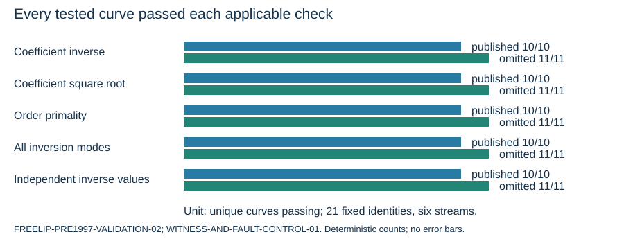
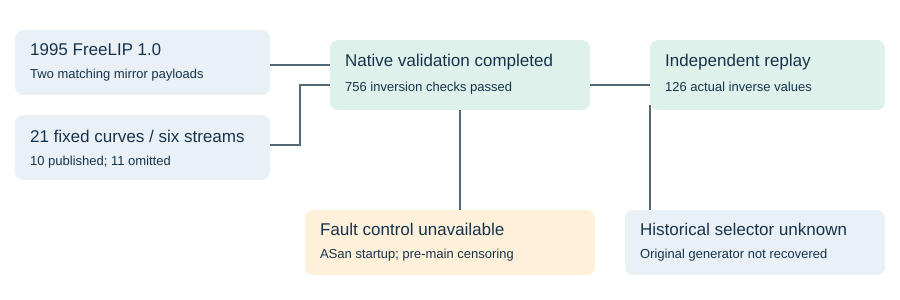

# Pre-1997 FreeLIP validation on the fixed NIST/ANSI curve cohort

2026-10-27. T-5518. This is an observation report, not a formal hypothesis decision. The missing historical selector remains unresolved. Recovered FreeLIP 1.0 passes the tested validation operations on all 11 reconstructed omissions and all 10 publications, across all six streams. These are reconstructed omissions, not documented rejection events.

## What changed in the evidence

Two mirrors supplied the same 201,037-byte FreeLIP 1.0 archive. Its README is dated May 1, 1995 and both HTTP Last-Modified headers report April 30, 1996. The archive SHA-256 is `6ef1e0bb398eec0c6cbd22f51b06cbbbbd4d995673ae8da942de6f9d3a7ecec5`. Neither mirror establishes that Reiter used these exact bytes.

The previously tested FreeLIP 1.1 README is dated July 21, 1997. It reports a fixed extended-Euclidean defect that could cause incorrect answers, hangs or memory errors. Source comparison found changes in `zxxeucl`, prime iteration and other helpers, so top-level routine similarity was insufficient to reuse the earlier native result. The bodies of `zsqrtmod`, `zprobprime`, `zprime`, `zrandom`, `zrandomb` and `zrstarts` match after removing whitespace and comments. This is a scoped comparison, not whole-library equivalence.

## Executed observations

- FreeLIP 1.0, 26- and 30-bit limbs, four RNG seeds: all 21 orders pass `zprobprime(n,20)`. That is 168 unique parameterized calls and 336 calls including the predeclared A/A repeats. Both complete baseline runs match byte for byte in each configuration.
- All 21 coefficient inversions and square roots pass in both builds. Square roots use zero FreeLIP RNG calls; each 20-round primality test uses 20 calls. Both leave the separately seeded libc rand48 stream unchanged.
- At 26 bits, seven discarded draws reproduce all six May-1997 base-point x-coordinates. At 30 bits, none of those six x-coordinates matches. The 30-bit result is a configuration mismatch, not a mathematical rejection.
- Three inverse inputs per curve (`c`, nonzero `b`, and `27*b^2-108 mod p`), three output modes (distinct, in place, and pre-sized in place), two limb sizes, two versions: 756 of 756 native checks pass. Each of the 21 identities has 36 passing checks.
- 126 actual inverse integers returned by FreeLIP 1.0 match independent Python modular inversion: three inputs per curve in both limb sizes. Each identity has six independently checked integer witnesses.
- Ordinary controls pass: 68 prime/composite cases, four square-root controls, and 40 independently replayed RNG words across four build configurations.

## Preserved failures and limits

Attempt 01 stopped at the first compile because the archive omits its generated `lippar.h`. No curve ran. The source Makefile bootstraps that header as empty; the frozen attempt-02 amendment supplies it with all arithmetic choices explicit on the compiler command line.

The constructed ASan fault demonstration is unavailable. The first control timed out without producing probe output. A second control was sampled in dyld/libSystem/ASan initialization, recursively entering the sanitizer allocator and spinning in its initialization mutex, with no `main` frame. It was interrupted; its stdin remains, with missing terminal output/receipt explicitly recorded. The remaining ASan arms did not start. This is operational censoring, not evidence of a FreeLIP fault or curve rejection. All 126 value witnesses completed before that subrun.

All native arithmetic ran on modern macOS ARM64/LP64, with `SIZEOFLONG=8`, explicit 26/30-bit limbs and generic arithmetic. No original-CPU timing, original allocator behavior, or original generator is established. A read-only translation of quotient batching also passed 252 checks before the native run; it is supplementary and does not replace native evidence.

## Historical point-counter cross-check

The 1994 Lehmann-Maurer-Mueller-Shoup paper constructs eta-quotient modular equations with coefficients expressed directly in `j(E)` (page 5), so that presented path has no prerequisite that a cube root of `j` lie in the base field. It handles special j-values separately (page 4), checks both x and y in its Frobenius identity (page 6), and verifies full points after matching stored x-coordinate fingerprints (page 9). The paper describes an algorithm, not the missing generator. All 10 pages were inspected visually; OCR covered only pages 1-7.

The recovered 1995 MIRACL archive contains arithmetic/factoring software, not a recovered prime-field point counter. The available MIRACL Schoof/SEA source is dated 1999. The 1995/1996 elliptic packages inspected use characteristic two. LiDIA-history has empty GitHub and Software Heritage branch snapshots; no older implementation of the known later fixes was recovered. These are bounded searches, and network timeouts are not proof that a source never existed.

The P-224 cube/splitting pattern remains a specific field-dependent lead. This round supplies no source-based cube-root gate and no predicate that selects all publications while excluding all omissions. Another point counter, application-level selection or stopping logic, or an unrecorded criterion remains possible.

## Exact identities, custody and replay

`comparison.csv` and `SUMMARY.json` retain every full curve UID, seed stream, ordinal, field, order, c and b. The curve model is `y^2=x^3-3x+b` over `F_p`. The unchanged cohort digest is `93ac4774b993a994a17d9327df92e0f2b287e66755cd933fdc683015fec1d545`. Published 192v2 is ordinal 6013; published 192v3 is 5228. P-224 coefficient signs identify one isomorphism class here.

The 190,218-byte evidence archive seals 3,688 files and retains 912 completed external-process receipts, including the initial compile failure and sanitizer timeout. `BUNDLE.json` binds the archive and manifest; `SOURCE.json` binds original source bytes and retrieval metadata; `SOURCE-COMPARISON.json` binds the scoped function comparisons. Library binaries and original licensed source are retained locally and are not redistributed in this derived-evidence archive.

Extract `evidence.tar.zst`, run `python3 -B evidence/verify.py`, then `python3 -B audit_bindings.py evidence`. Both passed after relocation. The first checks custody, curve identities, arithmetic witnesses, ordinary controls and recorded failures; the second binds all 756 inversion rows, four baseline captures and 126 witnesses to their exact raw stdin/stdout/process receipts. Neither command launches the historical/native libraries or needs network access.

Graphs checked: the earlier SEA root-count and workflow plots and ECPP report remain descriptions of their own sealed runs. Their observations did not change; this round adds separate library-validation plots. No official hypothesis status is changed.

Sources: [FreeLIP 1.0 FUNET mirror](https://ftp.funet.fi/pub/crypt/math/freelip_1.0.tar.gz), [matching GWDG mirror](https://ftp.gwdg.de/pub/misc/crypt/math/freelip_1.0.tar.gz), [FreeLIP 1.1 source mirror](https://github.com/lrobot/freelip), [LMMS 1994 paper](https://www.shoup.net/papers/counting.pdf). Exact dated retrieval receipts remain in local source custody and the exported metadata.
