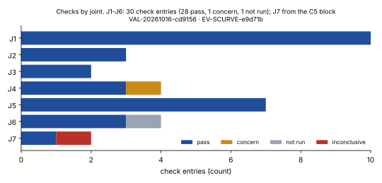
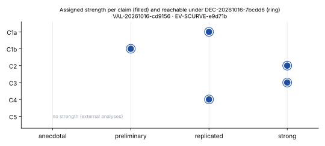
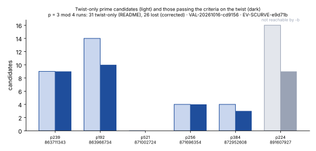
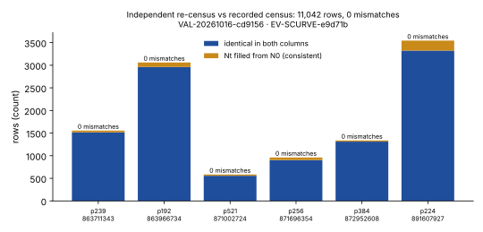

# Evidence review: NIST curve seed provenance (DEC-20261016-82753f)

**Verified provenance, not cryptanalysis.** This review changes no ECDLP cost, no attack claim, no curve-safety verdict and no SafeCurves cell.

| | |
|---|---|
| Decision | `support`, scoped (DEC-20261016-82753f) |
| Evidence | EV-SCURVE-e9d71b: record-level `replicated`, per claim below |
| Claim tier | `crypto` by parameter size (the standardized curves themselves). Scoped statements about those exact seeds only |
| Review round | opened by DEC-20261016-7bcdd6; plan frozen in TASK-20261016-9bf74b at `dbd1b8d15845579aaaa3af47b827955e2b625e77` |
| Validator report | VAL-20261016-cd9156 (`validation-20261016/validation_report.yaml`), snapshot TASK-20261016-670480 |
| Correction | CORR-20261016-10d498 (README "31 seeds lost / four runs"; DEC-20261016-264eed clarified) |
| Knowledge | KN-FIND-cee88d promoted |
| Ledger archive | TASK-20261016-a28b0d |
| Runs | none. These are verification computations, so there are no RUN-* ids |

## Scoped claim and strength

| claim | statement (short) | strength | basis |
|---|---|---|---|
| C1a | 10 prime seeds = one `(int)(drand48()*256)` block after `srand48(t)`, t in 1997-98; X9.62 c*b^2 = -27 for all 10; B-233/283/409/571 = five lrand48 words after srand48(s), 2s on 1998-04-17 | replicated | J1, J2, Q2, PTM-1..3 |
| C1b | README's description of the native Rust tests and the census.sh re-run | preliminary (cap, reading 4) | J6-4 not_run by plan design |
| C2 | state from seed alone, walk-back to exactly one block-aligned srand48 state = claimed t, all 10; 2^-112, 0.0147, 10^-11 | strong | C2-1, C2-2, PTM-4 |
| C3 | census 21,753 / 11,042 / 47 / 17 / 21 (10 published + 11 skipped), 21 of 21 vs posts, 31 twist-only in p = 3 mod 4 runs | strong (one sentence excluded and corrected) | J2-2, J3, J4, J5, PTM-5; row-by-row re-census |
| C4 | (p+1)/4 root on 9 of 9; P-224 b = -TS root with z = 11 | replicated | C4-1, C4-2 |
| C5 | external analyses | none (labelling holds; timing unverifiable) | J7 inconclusive |

## Observation
- J1 to J6 hold, J7 inconclusive. There are 30 check entries: 28 pass, 1 concern (J4-3), 1 not_run (J6-4). No numeric mismatches against the claim or the recorded data.
- Re-census of all 11,042 rows: 0 mismatches. 10,576 identical in both columns. In 466 rows the recorded Nt is composite where the independent twist count aborted, and each equals 2(p+1) - N0.
- Full counts on 289 rows (85 named plus a 204-row nonce sample): 0 mismatches. Every 0 entry is composite (smallest prime factor at most 137). 38 prime curve orders and 48 prime twist orders are certified by N*P = O and Hasse, without SEA.
- State recovery: for all 10 seeds, exactly 1 block-aligned srand48-form state among 2 or 3 in the window, equal to the README t. Random strings: none. Positive controls: 10 of 10.
- Twist bookkeeping: 31 twist-only rows in the five p = 3 (mod 4) runs, 26 of which pass the criteria on the twist. Failing bitlen: p192 rows 774, 1477, 3506 and 4492; p384 row 1432.

## Comparison
- Against the README: every count reproduces. The only discrepancy is the derived sentence "In the four p = 3 mod 4 runs, 31 seeds were lost": there are five runs (four of them with twist-only rows), and the loss is 26.
- Against the recorded prior (TASK-20261016-9bf74b): C1, C3 and C4 hold, as expected. The prior predicted "four" and did not predict 26 vs 31. C2 holds for all ten. J7 timing came back inconclusive, as predicted.
- Against the posts (read only after the Validator's outputs were logged): 21 accepted and 10 published indices agree.

## Inference
The generator, timestamp, census and root-choice claims survive an independent implementation that never read the producer's code. The seeds' origin is established for these curves. The skip rule, the B-163 seed, and the base points of P-224, P-256, P-384, P-521 and the binary curves are not.

## Limitation
- PARI/GP SEA is shared, so the composite (0) rows are empirical_only.
- Single reviewer, no red team. Step ordering is attested, not enforced.
- The harness-injected /home/user/crypto/CLAUDE.md (generic workflow rules) was ruled immaterial (DEC-20261016-82753f).
- prime192v2/v3 and prime239v1-v3 parameters come only from OpenSSL.
- The preregistration is self-dated and was first committed with the census data (ruling j7). A correction follows.

## Graphs to render (SVG + PNG beside this file, embedded in report.pdf; caption each with VAL-20261016-cd9156 and EV-SCURVE-e9d71b)

Fig 1 `fig1-checks-by-joint.svg`: stacked horizontal bars per joint (pass / concern / not_run / inconclusive), from validation_report.yaml.

| joint | pass | concern | not_run | inconclusive |
|---|---:|---:|---:|---:|
| J1 | 10 | 0 | 0 | 0 |
| J2 | 3 | 0 | 0 | 0 |
| J3 | 2 | 0 | 0 | 0 |
| J4 | 3 | 1 | 0 | 0 |
| J5 | 7 | 0 | 0 | 0 |
| J6 | 3 | 0 | 1 | 0 |
| J7 | 1 | 0 | 0 | 1 |
(J1: J1-1..4, Q2-1, C2-1, C2-2, PTM-1, PTM-2, PTM-4. J2: J2-1, J2-2, PTM-3. J3: J3-1, J3-2. J4: J4-1, J4-2, J4-4, concern J4-3. J5: J5-1..4, C4-1, C4-2, PTM-5. J6: J6-1..3, not_run J6-4. The J7 row is from the c5 block: labelling holds, timing inconclusive.)

Fig 2 `fig2-claim-strength.svg`: dot plot on an ordinal x axis (anecdotal < preliminary < replicated < strong). Filled dot = assigned, hollow = reachable under the DEC-20261016-7bcdd6 reading. C1a replicated/replicated; C1b preliminary/preliminary; C2 strong/strong; C3 strong/strong; C4 replicated/replicated; C5 shown as "no strength (external)".

Fig 3 `fig3-twist-bookkeeping.svg`: grouped bars per run, twist-only prime vs would pass criteria on the twist. P-224 marked "not reachable by -b". Annotate 31 (README) and 26 (corrected). Source out/j4_lost_criteria.json.

| run | field | p mod 4 | twist-only | pass on twist | fail bitlen |
|---|---|---:|---:|---:|---|
| 863711343 | p239 | 3 | 9 | 9 | - |
| 863966734 | p192 | 3 | 14 | 10 | 774, 1477, 3506, 4492 |
| 871002724 | p521 | 3 | 0 | 0 | - |
| 871696354 | p256 | 3 | 4 | 4 | - |
| 872952608 | p384 | 3 | 4 | 3 | 1432 |
| 891607927 | p224 | 1 | 16 | (9; not reachable) | 546, 2497, 3848, 4700, 5119, 6406, 6912 |
| p = 3 mod 4 total | | | 31 | 26 | 5 |

Fig 4 `fig4-recensus-agreement.svg`: stacked bars per run, identical vs Nt filled from N0 (consistent), with mismatches overlaid (0). Source out/recensus_compare.json.

| run | field | compared | identical | Nt from N0 | mismatches |
|---|---|---:|---:|---:|---:|
| 863711343 | p239 | 1,555 | 1,517 | 38 | 0 |
| 863966734 | p192 | 3,061 | 2,962 | 99 | 0 |
| 871002724 | p521 | 584 | 557 | 27 | 0 |
| 871696354 | p256 | 960 | 904 | 56 | 0 |
| 872952608 | p384 | 1,337 | 1,312 | 25 | 0 |
| 891607927 | p224 | 3,545 | 3,324 | 221 | 0 |
| total | | 11,042 | 10,576 | 466 | 0 |

## Canonical graphs checked
knowledge/frontiers/ has no seed or rigidity graph. streams.svg is drawn from summary.json, which this review reproduced exactly, so it is unchanged. No ECDLP cost row changes.

## Next actions
1. TASK-20261016-670480 snapshot alone, then TASK-20261016-a28b0d ledger archive alone. Verify, push and refresh the PR after each.
2. Next Coordinator pass: a correction for the preregistration-timing wording, and a dated addendum to KN-LIT-d2f917 pointing to KN-FIND-cee88d (fresh ids).
3. Goal next_actions are unchanged. The skip rule stays open in problems/nist-seed-selection-rule-unexplained.md.
