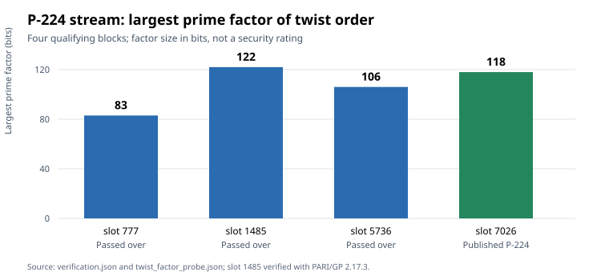

# P-224 seed-selection follow-up: the remaining twist case

**Date:** 2026-10-16  
**Scope:** Four qualifying 20-byte blocks in the recovered P-224 stream; comparison with the previously checked 21 prime-field candidates.  
**Status:** Derived structural result; historical selection cause still unknown.

## Question and result

Could the original program have passed over P-224 candidate blocks 777, 1485 and 5736 because it preferred the curve with the largest prime factor in the quadratic-twist order? The [previous selection study](../nist_seed_selection_deep_20261016/report.md) could not answer for block 1485: its 20-second factorization attempt timed out. A new bounded PARI/GP attempt completed that factorization. The four P-224 blocks now have largest twist-prime-factor sizes of **83, 122, 106 and 118 bits**, respectively; block 7026 is published P-224. Therefore the published curve was **not** the maximum under this proposed rule. A threshold at or below 118 bits would also admit passed-over block 1485. This is a counterexample to that specific selection rule, not evidence for any alternative historical rule.



## Exact new calculation

For block 1485 in the stream initialized at Unix timestamp `891607927`, the earlier exact curve assessment fixes the field, coefficient, prime ordinary-group order and quadratic-twist order. Its EC1 curve identifier is `EC1P224Cskip891607927i1485hb216c63c6aeb`; the two coefficient signs for this seed are isomorphic over the field. The twist order is `0x1000000000000000000000000000007e450566d2636dddf8924e106bb` and factors as

```text
3 × 31 × 103338691145424448535900484671
       × 2805260028296929757374709219448951881.
```

The two new factors have 97 and 122 bits. PARI/GP 2.17.3 returned `1` from `isprime` for each; [the verifier](verify_twist_1485.py) independently multiplies all four factors to the exact twist order and rechecks the published P-224 factorization from the earlier source. Its machine-readable output is [verification.json](verification.json), bound to the earlier `twist_factor_probe.json` by SHA-256. The vector chart is generated by [render_visuals.py](render_visuals.py). These primality checks use a separate PARI operation after factorization, not an independent software implementation.

The first retry with PARI's default 8 MB stack ended in a stack-overflow error after **58.444 seconds**. A retry with `gp -q -s 134217728`, running `factor` on the 218-bit residual with a **120-second process cap**, completed in **90.757 seconds** and returned the two factors above. The recorded times describe these local bounded attempts, not a performance comparison or an estimate of historical computation cost. The first failure remains an infrastructure/resource observation.

## What this changes about selection explanations

| Proposed explanation | Exact observation | Current status |
| --- | --- | --- |
| The first qualifying curve was published | P-256 follows one earlier qualifying block; P-224 follows three. | Refuted for the reconstructed uninterrupted 20-byte streams. |
| Prefer the largest twist prime factor in the P-224 stream | Passed-over block 1485 has 122 bits; P-224 has 118. | Refuted for this field and this monotone rule. |
| Require at least a 112-bit twist prime factor for P-224 | Both passed-over 1485 and published 7026 pass. | Cannot explain the omission. |
| Require positive trace or group order below the field prime | All three skipped P-224 classes already have both traits; published `prime239v2` contradicts a universal positive-trace rule. | Refuted as a complete rule. |
| Require easily provable ordinary-group order | All four P-224 ordinary group orders are certified prime now. A 1997 proof program could still have differed. | No measured discriminator; original software absent. |
| Another twist predicate, a historical program behavior, or an undocumented mathematical filter | The present test checks one twist metric only. | Open; a concrete predicate and independent historical prediction are needed. |

The factor sizes are **not** a general security ranking. Twist structure matters to protocols or arithmetic interfaces that can process unsuitable points. For an ordinary ECDSA verification path with correct point validation, this factor comparison does not by itself yield an attack. The previously checked ordinary groups remain prime and cofactor one. The result also does not identify how many timestamps, runs or other candidate streams were examined historically.

## Historical evidence boundary and next checks

[FIPS 186-2 Appendix 6.4](https://csrc.nist.gov/files/pubs/fips/186-2/final/docs/fips186-2.pdf) specifies seed-to-curve generation and a suitable-order retry; it does not log or prescribe the complete acceptance sequence. [The 1999 NIST curve note](https://csrc.nist.rip/groups/ST/toolkit/documents/dss/NISTReCur.pdf) states that the published prime-field curves have prime order and that any point of the required order can serve as a base point. [Solinas's 2015 correspondence, reproduced by Stephen Weis](https://saweis.net/posts/nist-curve-seed-origins.html), names Bob Reiter as the original coder and reports that they could not find the archives. That correspondence is retrospective testimony, not the program or its trace. [Anthropic's recovered seed source](https://www.anthropic.com/research/ecdsa-curve-origins) and [Valsorda's candidate list](https://words.filippo.io/seeds-solved/) establish the reproducible stream positions but not the historical acceptance test.

The most discriminating next artifact remains a provenanced copy of the original program or execution log. Short of that, a proposed process model should specify exactly which `lrand48` calls are consumed and predict the selected ordinals in all six streams; a mathematical filter should be fixed before testing historical decisions that were not used to choose it. The [open problem record](../../problems/nist-seed-selection-rule-unexplained.md) retains this obstruction. The earlier stream graph and `knowledge/frontiers/ecdlp/` canonical graphs were checked: this factorization changes one selection-hypothesis edge, but adds no verified isogeny, transfer or attack edge there.

## Provenance

- **Retrieved primary sources:** FIPS 186-2 and the 1999 NIST curve note, links above. Valsorda and Anthropic are the primary 2026 reconstruction accounts. Weis reproduces Solinas's correspondence; use it as attributed historical testimony.
- **Internal exact inputs:** [prior report](../nist_seed_selection_deep_20261016/report.md), [prior twist probe](../nist_seed_selection_deep_20261016/twist_factor_probe.json), and [curve assessment](../nist_seed_skipped_curves_20261016/assessed.json).
- **Derived and verified here:** [verification.json](verification.json), [replay script](verify_twist_1485.py), [chart source](render_visuals.py), [SVG](p224_twist.svg), and [PDF](report.pdf). No run, ledger evidence or hypothesis status is changed by this report.
