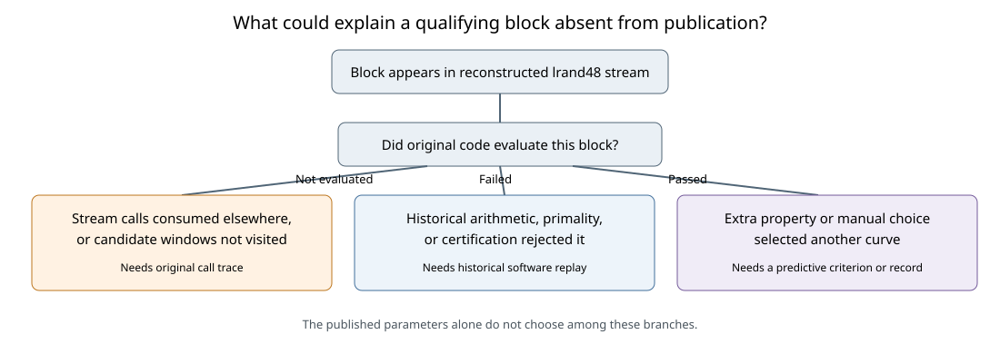
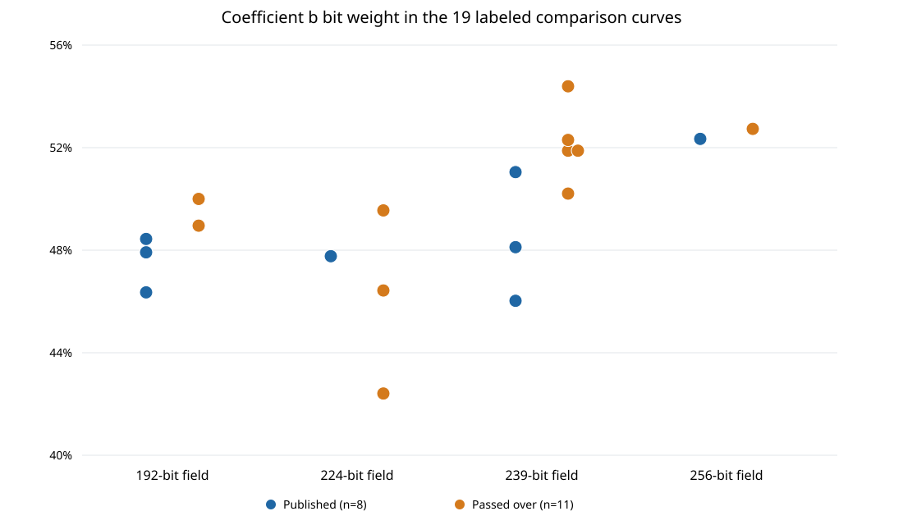

# What might have selected the published curves?

**Date:** 2026-10-22. **Status:** Exploratory, bounded comparison; historical selection remains unresolved. **Question:** What additional rule or process might explain the eleven mathematically qualifying seed blocks that occur in the recovered streams but were not published, and does the small generator space itself reveal a weak curve?

## Answer at the supported scope

**Derived from the recovered construction:** The clock-initialized `lrand48` generator makes the seed source enumerable. Under the strict 20-draw candidate model, there are `2^46` distinct candidate-start states over all possible timestamps and arbitrarily long runs. This makes a **specified** curve property searchable. It does not identify a property, establish how many candidates the 1997–98 designers examined, or demonstrate an ECDLP advantage on a published curve. The [first numeric shard](../nist_seed_exhaustive_20261016/orbit-runs/run-20261016T2344Z/manifest.json) prechecked 65,536 start states for the P-256 coefficient equation and did not point-count those curves; its root-admitting count is not a weak-curve count.

**Retrieved historical sources:** [FIPS 186-2 Appendix 6.4](https://csrc.nist.gov/files/pubs/fips/186-2/final/docs/fips186-2.pdf) tells a designer to choose an arbitrary 160-bit seed and retry if the curve lacks "suitable order"; its Appendix 6.5 verifies the seed-to-coefficient relation, not the complete search path. The July 1999 curve appendix says the published prime-field groups have prime order and that `a=-3` improves efficiency. A [2014 NIST historical presentation](https://csrc.nist.gov/CSRC/media/Projects/Crypto-Standards-Development-Process/documents/FIPS_186_and_Elliptic_Curves_052914.pdf) describes rejecting curves vulnerable to known attacks, without a complete acceptance rule. [Anthropic](https://www.anthropic.com/research/ecdsa-curve-origins) and [Valsorda](https://words.filippo.io/seeds-solved/) recovered the clock generator and the eleven qualifying omissions but no contemporaneous execution trace. Their finite list does not determine the number of timestamp restarts.

## A new exploratory pattern: coefficient bit weight

**Derived, exact for the archived 21 rows:** [analyze.py](analyze.py) reads the existing [curve trait archive](../nist_seed_skipped_curves_20261016/traits.json), SHA-256 `a1102bd487379d223581863fab731d6eb6957bf0e264b450f1c7b298279b0b67`, deduplicates the three equivalent P-224 sign pairs, and records each curve's EC1 identity in [analysis.json](analysis.json). The comparison uses only the four fields with both published and passed-over labels: **8 published and 11 passed-over seed blocks**. The P-384 and P-521 singleton published controls have no within-field alternative in this catalog and are excluded from the ranking. Exact field primes, coefficients, subgroup orders, cofactors and generators are in the [source-bound parameter records](../nist_seed_skipped_curves_20261016/assessed.json); the unpublished generators are study-defined, not historical.

For P-224, `b` and `-b` are isomorphic coefficient models. I use the **smaller of their two binary Hamming weights** so that this exploratory feature does not depend on an arbitrary sign convention. For the other three comparison fields, the archived eligible `b` is the sign that gives the checked prime-order group, and the [earlier sign audit](../nist_seed_generation_process_20261016/report.md) found that all 17 non-P-224 reported blocks, published and omitted, use the same exponentiation-root convention.

The published coefficient has lower bit weight in **22 of 25** published-versus-passed-over pairs within the same field; the pairs share rows and are not independent trials. In the 192-bit stream, the three published coefficients have weights **89, 92, 93**, while the two passed-over coefficients have weights **94, 96**. In P-256, published weight **134** is one below omitted block 876's **135**. The direction is mixed in P-224: the published sign-invariant weight is **107**, while passed-over blocks include **95** and **104**. In the 239-bit field, an omitted coefficient of weight **120** is lower than published prime239v2's **122**. A universal weight cutoff, a first-record-low rule, and a rule selecting exactly the lowest weights therefore **fail** on this catalog.

The [machine-readable comparison](analysis.json) gives an exact within-field label-allocation diagnostic: **37 of 4,480** assignments with the same published count per field have an equal or lower published rank sum for sign-invariant `b` weight. This number is **not** a valid historical probability or evidence of intent: bit weight was inspected after the labels were known; many plausible features and thresholds could have been tried; labels were not randomized; and it is unknown whether these were all historically evaluated candidates. As negative controls on the same 19 rows, the published candidate has lower `seed`, hash-derived `c`, and group-order `n` bit weight in **14/25**, **7/25**, and **12/25** pairs respectively. The coefficient observation is a lead for a predeclared reconstruction, not a recovered acceptance rule.

**Engineering interpretation:** Low bit weight in `b` offers no established ECDLP weakness. Standard short-Weierstrass addition and doubling formulas depend on `a` and point coordinates; `b` need not enter the main scalar-multiplication loop. See the [Explicit-Formulas Database](https://www.hyperelliptic.org/EFD/g1p/auto-shortw-jacobian.html) for concrete formulas. `b` appears in checking the curve equation and some alternative formulas, but the observed differences are small and no 1997 implementation or timing shows a benefit. The published `a=-3` choice is a documented efficiency choice; selecting `b` by bit weight remains speculation.

## What still could have happened

| Proposed mechanism | Why it could have been considered in 1997 | Test against current evidence and next discriminating check |
| --- | --- | --- |
| **Known security screens**: group size, cofactor, anomalous/MOV cases, twist or endomorphism properties | FIPS required suitable order; designers could apply additional known-attack checks. | All eleven omitted classes pass the recorded prime-order, cofactor-one, order-bit-length and bounded MOV/CM screens. Published controls refute simple universal `n<p`, positive trace, prime twist and no-small-twist-factor rules. A new criterion needs an exact predicate and classification of all 21 rows, followed by an independent historical holdout. See the [deep selection audit](../nist_seed_selection_deep_20261016/report.md). |
| **Different execution path**: other `lrand48` calls consumed nominal 20-byte windows | A program might use the same RNG for validation or buffered auxiliary values. | Each published prime-field seed starts at a 20-draw boundary. Extra calls must preserve that cumulative alignment. The six May 1997 published base points were reconstructed from a different FreeLIP generator, narrowing one base-point-consumption explanation. Original call logs or a replay of original code would decide this branch. |
| **Arithmetic, certificate or bookkeeping behavior** | Exact point counting and prime certification were costly in 1997; a time limit, failed proof, or implementation defect could suppress a valid candidate. | Modern checked orders do not replay the old implementation. Locate its source, dependencies, primality settings and logs; run every named candidate through that exact code with recorded stop/failure states. A modern timeout is not evidence of historical rejection. |
| **Convenience or appearance of `b`** | A designer might have preferred parameter constants with an aesthetic or implementation property. | The exploratory bit-weight bias above is real in the archived sample, but no deterministic rule or measured speed gain follows. Predeclare one rule, apply it to every candidate in an independently completed stream census, and seek original design notes or code. |
| **A deliberately chosen mathematical class** | The low-dimensional generator lets someone search for a defined curve property across timestamp starts. | Requires an actual predicate or retained witness that separates selected curves, a construction explaining its frequency in this generator, and a verified attack or transfer on an exact published subgroup. A same-field isogeny by itself preserves point count and does not turn a prime-order group into a smooth-order group. Include map construction/evaluation, destination solving, cold setup, amortization, memory and target count; a costly intermediate advantage may still matter. No such mechanism is identified in these records. |
| **Earlier field-prime or implementation choice** | The field primes and later base-point construction are separate degrees of freedom from the SHA-1 seed. | Analyze each fixed field and exact base point separately. A property of `p` cannot be inferred from the eleven within-field omitted curves. A point-validation or nonce-generation failure would be an implementation/protocol claim requiring its own executable evidence. |

The possibility space is therefore a **decision tree**. The reconstructed stream says a qualifying block *exists*. Only an original execution trace can first establish whether it was evaluated. If evaluated, the old program might have rejected it because of its own arithmetic or proof state. If it passed those checks, an extra criterion or manual choice remains. The published constants alone do not tell us which branch happened.

## What would turn this into a weak-curve finding?

**Proposed test boundary:** Choose a precise vulnerability property `W(E,p,n,G)` before examining additional candidates. For a rare-class search, report the number of eligible candidate starts, exact field and seed recipe, independent candidate validation, success probability under a stated distribution, and all computation and memory costs. Then demonstrate `W` on an **exact published curve**, including subgroup preservation and an independently checked solver or other cryptanalytic consequence. A hypothesized reduction from subgroup-size work `r^(1/2)` to `r^alpha` for `alpha<1/2` is worth evaluating even if it remains expensive; it is not inferred from seed provenance. Treat a method that applies to honestly generated curves as a separate hypothesis from deliberate instance selection.

**Current limit:** The strict candidate-start orbit is enumerable, but the 65,536-state shard only reached the cheap coefficient stage. It supplies no curve-order census of the `2^46` states. The observed 21 qualified blocks are a bounded local comparison, not a measured count of historical attempts or a guarantee that a rare weakness exists. The [selection obstruction](../../problems/nist-seed-selection-rule-unexplained.md) remains open. No canonical ECDLP graph edge is changed by this exploratory comparison; the prior [selection graph](../nist_seed_selection_deep_20261016/seed_slots.svg) and existing frontier records were checked for claims about the recovered stream and contain no identified attack map.

**Evidence labels:** `retrieved` historical standards and contemporary discovery accounts are linked above; `internal` exact curves, sign checks and numeric-shard receipt are linked above; `derived` features and counts are reproducible from [analyze.py](analyze.py) and [analysis.json](analysis.json). The visuals are generated by that same source. This report makes no research-state transition.
