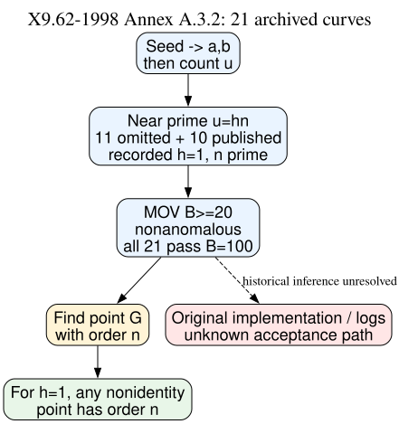

# The ANSI base-point step and the eleven omitted prime-field curves

**Date:** 2026-10-23 UTC. **Status:** Source-based and exact-record check; historical cause unresolved.

## Question and result

If the 1997–98 program reached all eleven qualifying candidates, could the standard base-point search itself have rejected them as weak? The [1998 ANSI X9.62 Annex A.3.2](https://safecurves.cr.yp.to/grouper.ieee.org/groups/1363/private/x9-62-09-20-98.pdf) specifies the sequence: choose the curve and count its points; test near-primality; test MOV and anomalous conditions; then find a point of the required prime order. Annex A.3.1 repeats random-point sampling if it gets the identity. This text is **retrieved primary-source evidence of the standard**, not evidence that the unrecovered 1997 code executed it verbatim.

**Derived:** In the archived eleven omitted and ten published prime-field curves, the certified group order is prime and the cofactor is one. For any such curve, every nonidentity rational point has the full order. Thus a correct implementation of the *specified* point-finding step has no curve-specific rejection condition left to apply after the order and MOV checks. Failure to find a point would require a defective or constrained random-point routine, an implementation error, a timeout, or a different private criterion. This argument does not explain which curves were historically reached.

**Exact-record check:** [check.py](check.py) regenerated [check.json](check.json) from the immutable [eleven-curve assessment](../nist_seed_skipped_curves_20261016/assessed.json) and [ten published controls](../nist_seed_skipped_curves_20261016/traits.json). It checks the recorded cofactor-one identities, order/field binding, order-size inequalities, nonanomalous condition, and `p^k != 1 (mod n)` for every `1 <= k <= 100`. Every one of the 21 records passes. The source archive supplies the prime-order certificates; this script does not redo point counts or primality proofs. The ANSI minimum MOV parameter is `B >= 20`; checking through 100 implies the stated minimum for these records. The `r_min` choice in the historical program is unknown; the standard requires it above `2^160` and `4 sqrt(p)`, and each recorded order exceeds those floors.

*Figure. Solid boxes summarize the standard's point-generation path and its implication for recorded prime-order, cofactor-one curves. The dashed branch marks the missing historical execution trace. Editable source: [workflow.dot](workflow.dot).*

## Why this matters to the hidden-weakness premise

The eleven omissions are five 239-bit, two 192-bit, one 256-bit, and three 224-bit seed classes. The two singleton 384/521-bit published fields provide no within-field omitted comparison. Under the user's working premise that all eleven were actually evaluated and rejected for a weakness, the standard point-finding step cannot be that weakness **if** implemented correctly. A hidden arithmetic filter remains possible, but it needs a named property, an attack-relevant mechanism, and a test against same-field published controls. A software failure or editorial choice remains possible too; neither can be distinguished from arithmetic alone.

The [Anthropic reconstruction](https://www.anthropic.com/research/ecdsa-curve-origins) independently identifies a separate FreeLIP generator for the six May 1997 *published* base points. Its code loops over x candidates until one lies on the curve; the six observed published cases take one to five tries. It does not reconstruct the original generator for the eleven omitted curves or the later P-224/P-256/P-384/P-521 base points. Therefore this reproduction supports a repeat-until-success workflow for the six published May curves, not a claim that the original program processed every omitted curve that way.

The exact 1998 standard was published after the May and August 1997 runs. It describes contemporaneous security checks but cannot by itself prove the 1997 implementation or its undocumented choice among acceptable curves. The [open problem](../../problems/nist-seed-selection-rule-unexplained.md) continues to require original code/logs or a frozen predictive selector; this round removes only the correct standard base-point step as a mathematical rejection mechanism. The canonical ECDLP graphs were checked; no verified attack, map, or cost edge changes here.

## Reproduction and provenance

Run `python3 research/nist_seed_selection_workflow_20261023/check.py`, then `dot -Tsvg research/nist_seed_selection_workflow_20261023/workflow.dot -o research/nist_seed_selection_workflow_20261023/workflow.svg`. The numeric inputs and SHA-256 hashes are in `check.json`. Primary sources: `retrieved` ANSI 1998 and Anthropic 2026; exact archived curve identities: `internal`; logical group-order implication and numeric gate results: `derived`. No historical rejection reason is observed.
